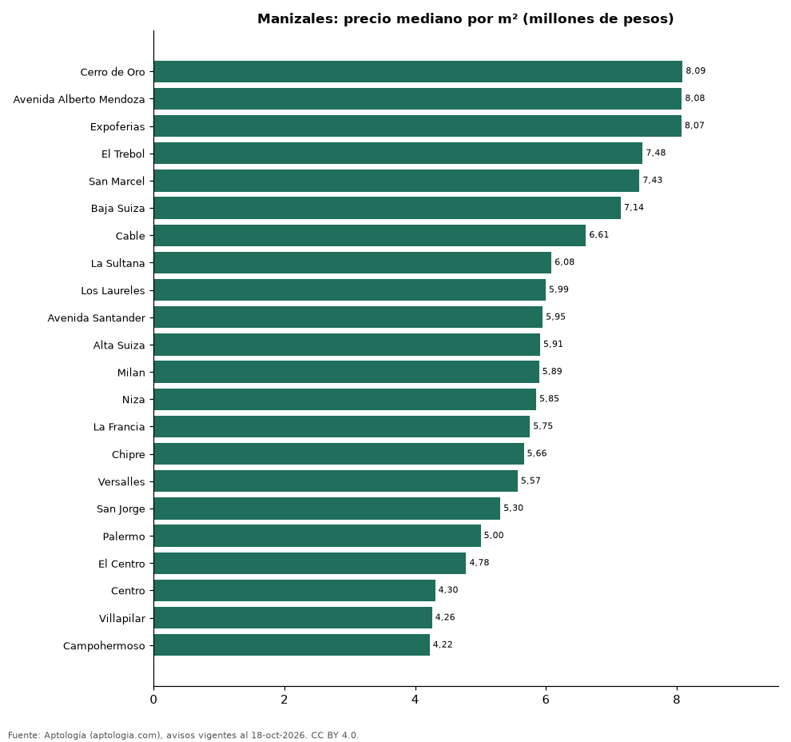

# Barrios más caros y más baratos de Manizales para comprar apartamento: ranking por m² (octubre 2026)

**En Manizales, el barrio con el m² más caro para comprar apartamento es Cerro de Oro (8,09 millones de pesos/m²) y el más barato Campohermoso (4,22 millones de pesos/m²), 1,9 veces menos.** Comparamos 22 barrios con al menos 30 avisos con área.

*Resumen: analizamos 1.754 apartamentos en venta con área declarada en 22 barrios de Manizales.*

**Actualizado:** 18 de octubre de 2026 (datos del 18 de octubre de 2026) · **Próxima actualización:** mensual.

## Resumen

| Indicador | Valor |
|---|---|
| Más caro por m² | Cerro de Oro: 8,09 millones de pesos |
| Más barato por m² | Campohermoso: 4,22 millones de pesos |
| Diferencia | 1,9 veces |
| Barrios | 22 |

## Ranking de barrios por precio del m²

| Barrio | Por m² (mediana) | Precio (mediana) | Área mediana (m²) | Avisos con área |
|---|---|---|---|---|
| Cerro de Oro | 8,09 millones de pesos | 720 millones de pesos | 80 | 111 |
| Avenida Alberto Mendoza | 8,08 millones de pesos | 650 millones de pesos | 87 | 57 |
| Expoferias | 8,07 millones de pesos | 780 millones de pesos | 97 | 45 |
| El Trebol | 7,48 millones de pesos | 650 millones de pesos | 92 | 103 |
| San Marcel | 7,43 millones de pesos | 590 millones de pesos | 85 | 30 |
| Baja Suiza | 7,14 millones de pesos | 460 millones de pesos | 63 | 94 |
| Cable | 6,61 millones de pesos | 695 millones de pesos | 100 | 32 |
| La Sultana | 6,08 millones de pesos | 300 millones de pesos | 50 | 39 |
| Los Laureles | 5,99 millones de pesos | 545 millones de pesos | 88 | 56 |
| Avenida Santander | 5,95 millones de pesos | 590 millones de pesos | 90 | 96 |
| Alta Suiza | 5,91 millones de pesos | 460 millones de pesos | 74 | 66 |
| Milan | 5,89 millones de pesos | 630 millones de pesos | 100 | 150 |
| Niza | 5,85 millones de pesos | 395 millones de pesos | 65 | 49 |
| La Francia | 5,75 millones de pesos | 355 millones de pesos | 60 | 136 |
| Chipre | 5,66 millones de pesos | 411 millones de pesos | 71 | 112 |
| Versalles | 5,57 millones de pesos | 450 millones de pesos | 74 | 31 |
| San Jorge | 5,30 millones de pesos | 340 millones de pesos | 64 | 47 |
| Palermo | 5,00 millones de pesos | 552 millones de pesos | 118 | 310 |
| El Centro | 4,78 millones de pesos | 370 millones de pesos | 80 | 68 |
| Centro | 4,30 millones de pesos | 370 millones de pesos | 85 | 49 |
| Villapilar | 4,26 millones de pesos | 295 millones de pesos | 66 | 34 |
| Campohermoso | 4,22 millones de pesos | 320 millones de pesos | 70 | 39 |

Medianas; solo barrios con 30 avisos o más con área declarada.

## Preguntas frecuentes

**¿Cuál es el barrio más caro de Manizales para comprar?**
Cerro de Oro, con 8,09 millones de pesos por m² en la mediana (octubre de 2026).

**¿Y el más barato?**
Campohermoso, con 4,22 millones de pesos por m².

## Metodología

- **Fuente:** exportes nocturnos de la base de datos de Aptología (aptologia.com) del 18 de octubre de 2026: avisos vigentes de vivienda en portales inmobiliarios de 13 países, recogidos por Aptología y vistos en línea entre el 11 y el 18 de octubre de 2026. Corte: 18 de octubre de 2026.
- **Depuración:** se eliminan duplicados exactos (misma ciudad, zona, tipo, precio, moneda, área, habitaciones y baños) y los precios fuera del percentil 1–99 de cada país, operación, moneda y tipo; el precio por m² usa solo avisos con área declarada entre 12 y 2.000 m² y también se recorta al P1–P99.
- **Qué se mide:** precios pedidos (publicados), no precios de cierre. En arriendo, el canon mensual sin administración, gastos comunes ni condominio.
- **Muestra mínima:** cada cifra publicada se apoya en al menos 30 avisos; las celdas con menos se omiten.
- **Colombia:** Precios en pesos colombianos, sin conversión de moneda.
- **Limitaciones:** la cobertura depende de los portales que recorre Aptología en cada país y es mayor en las ciudades grandes y en los segmentos medio-alto y alto; el área es la que declara el aviso, sin verificar; los nombres de zona vienen de los portales.
- **Privacidad:** solo se publican agregados; no se publica ningún dato personal, enlace a avisos ni nombre de anunciante.
- **Datos abiertos:** [datos.csv](datos.csv), licencia CC BY 4.0.

## Cómo citar

Pinzón Pineda, D. M. (2026). *Barrios más caros y más baratos de Manizales para comprar apartamento: ranking por m² (octubre 2026)*. Aptología (aptologia.com). https://github.com/elbroker/aptologia-datos/tree/main/estudios/barrios-mas-caros-y-baratos-manizales-venta-m2-2026. Datos: datos.csv, licencia CC BY 4.0.
