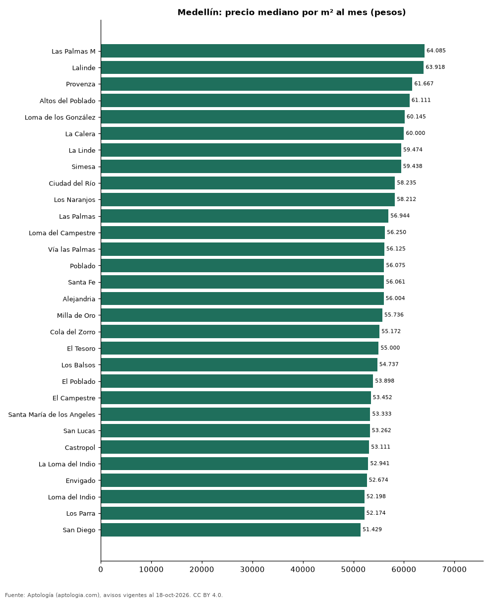

# Barrios más caros y más baratos de Medellín para arrendar apartamento: ranking por m² (octubre 2026)

**En Medellín, el barrio con el m² más caro para arrendar apartamento es Las Palmas M (64.085 pesos/m² al mes) y el más barato San Antonio de Prado (29.825 pesos/m² al mes), 2,1 veces menos.** Comparamos 77 barrios con al menos 30 avisos con área.

*Resumen: analizamos 17.599 apartamentos en arriendo con área declarada en 77 barrios de Medellín.*

**Actualizado:** 18 de octubre de 2026 (datos del 18 de octubre de 2026) · **Próxima actualización:** mensual.

## Resumen

| Indicador | Valor |
|---|---|
| Más caro por m² | Las Palmas M: 64.085 pesos |
| Más barato por m² | San Antonio de Prado: 29.825 pesos |
| Diferencia | 2,1 veces |
| Barrios | 77 |

## Ranking de barrios por precio del m²

| Barrio | Por m² (mediana) | Canon (mediana) | Área mediana (m²) | Avisos con área |
|---|---|---|---|---|
| Las Palmas M | 64.085 pesos | 5.250.000 pesos | 78 | 32 |
| Lalinde | 63.918 pesos | 6.500.000 pesos | 99 | 147 |
| Provenza | 61.667 pesos | 7.000.000 pesos | 123 | 83 |
| Altos del Poblado | 61.111 pesos | 6.000.000 pesos | 90 | 238 |
| Loma de los González | 60.145 pesos | 6.200.000 pesos | 106 | 115 |
| La Calera | 60.000 pesos | 10.150.000 pesos | 180 | 114 |
| La Linde | 59.474 pesos | 7.100.000 pesos | 114 | 54 |
| Simesa | 59.438 pesos | 4.500.000 pesos | 76 | 34 |
| Ciudad del Río | 58.235 pesos | 4.500.000 pesos | 79 | 394 |
| Los Naranjos | 58.212 pesos | 6.250.000 pesos | 104 | 56 |
| Las Palmas | 56.944 pesos | 4.400.000 pesos | 76 | 301 |
| Loma del Campestre | 56.250 pesos | 7.100.000 pesos | 135 | 33 |
| Vía las Palmas | 56.125 pesos | 4.700.000 pesos | 80 | 166 |
| Poblado | 56.075 pesos | 6.500.000 pesos | 120 | 781 |
| Santa Fe | 56.061 pesos | 3.900.000 pesos | 68 | 35 |
| Alejandria | 56.004 pesos | 6.400.000 pesos | 121 | 124 |
| Milla de Oro | 55.736 pesos | 6.650.000 pesos | 126 | 96 |
| Cola del Zorro | 55.172 pesos | 7.500.000 pesos | 145 | 43 |
| El Tesoro | 55.000 pesos | 8.200.000 pesos | 158 | 421 |
| Los Balsos | 54.737 pesos | 6.600.000 pesos | 120 | 521 |
| El Poblado | 53.898 pesos | 5.900.000 pesos | 110 | 6.186 |
| El Campestre | 53.452 pesos | 7.800.000 pesos | 144 | 122 |
| Santa María de los Angeles | 53.333 pesos | 5.800.000 pesos | 111 | 340 |
| San Lucas | 53.262 pesos | 7.300.000 pesos | 130 | 262 |
| Castropol | 53.111 pesos | 5.600.000 pesos | 105 | 538 |
| La Loma del Indio | 52.941 pesos | 3.700.000 pesos | 68 | 45 |
| Envigado | 52.674 pesos | 4.950.000 pesos | 97 | 30 |
| Loma del Indio | 52.198 pesos | 3.800.000 pesos | 74 | 206 |
| Los Parra | 52.174 pesos | 7.500.000 pesos | 143 | 73 |
| San Diego | 51.429 pesos | 3.700.000 pesos | 70 | 133 |
| Loma de los Parra | 51.257 pesos | 7.650.000 pesos | 140 | 68 |
| La Florida | 50.307 pesos | 7.500.000 pesos | 150 | 89 |
| Medellín | 50.000 pesos | 4.400.000 pesos | 80 | 71 |
| La Aguacatala | 49.667 pesos | 5.450.000 pesos | 85 | 54 |
| Loma Benedictinos | 49.405 pesos | 5.500.000 pesos | 112 | 33 |
| Guayabal | 49.254 pesos | 3.500.000 pesos | 69 | 93 |
| Loma de San Julian | 48.990 pesos | 3.800.000 pesos | 75 | 40 |
| Patio Bonito | 48.649 pesos | 4.600.000 pesos | 92 | 171 |
| Vizcaya | 48.333 pesos | 6.150.000 pesos | 127 | 54 |
| La Frontera | 47.723 pesos | 4.750.000 pesos | 108 | 64 |
| San German | 47.273 pesos | 3.300.000 pesos | 70 | 105 |
| Urbanización las Cumbres | 46.765 pesos | 6.000.000 pesos | 127 | 33 |
| Astorga | 46.667 pesos | 7.000.000 pesos | 132 | 37 |
| Belén Loma de los Bernal | 46.000 pesos | 3.550.000 pesos | 75 | 33 |
| Los Colores | 44.638 pesos | 3.500.000 pesos | 80 | 112 |
| Loma de los Bernal | 42.857 pesos | 3.300.000 pesos | 75 | 149 |
| Belén la Palma | 42.657 pesos | 3.200.000 pesos | 75 | 74 |
| Calasanz Parte Alta | 42.000 pesos | 2.500.000 pesos | 60 | 49 |
| La Candelaria | 41.742 pesos | 3.400.000 pesos | 80 | 90 |
| Laureles | 41.026 pesos | 4.100.000 pesos | 101 | 1.681 |
| Belén | 40.491 pesos | 3.200.000 pesos | 79 | 652 |
| Calasanz | 40.000 pesos | 2.700.000 pesos | 65 | 314 |
| Barrio Cristóbal | 40.000 pesos | 1.900.000 pesos | 48 | 35 |
| Conquistadores | 39.669 pesos | 4.000.000 pesos | 104 | 165 |
| La Pilarica | 39.080 pesos | 3.200.000 pesos | 84 | 41 |
| La America | 38.239 pesos | 2.800.000 pesos | 76 | 146 |
| Estadio | 38.182 pesos | 3.500.000 pesos | 97 | 71 |
| San Joaquin | 38.182 pesos | 3.100.000 pesos | 80 | 59 |
| Rodeo Alto | 37.143 pesos | 2.400.000 pesos | 65 | 63 |
| Belén Rosales | 36.538 pesos | 2.875.000 pesos | 79 | 40 |
| El Velodromo | 36.458 pesos | 4.000.000 pesos | 100 | 39 |
| La Castellana | 36.364 pesos | 3.500.000 pesos | 95 | 171 |
| Velodromo | 35.926 pesos | 3.450.000 pesos | 100 | 30 |
| La Floresta | 35.897 pesos | 2.800.000 pesos | 78 | 63 |
| Simón Bolívar | 35.870 pesos | 3.000.000 pesos | 80 | 111 |
| Boston | 35.000 pesos | 2.000.000 pesos | 58 | 101 |
| Floresta | 35.000 pesos | 2.900.000 pesos | 91 | 33 |
| Florida Nueva | 33.810 pesos | 3.050.000 pesos | 102 | 36 |
| Robledo | 33.750 pesos | 1.800.000 pesos | 55 | 237 |
| Santa Monica | 33.590 pesos | 2.500.000 pesos | 75 | 44 |
| Pajarito | 32.500 pesos | 1.750.000 pesos | 54 | 40 |
| Belén San Bernardo | 32.154 pesos | 2.500.000 pesos | 69 | 36 |
| Suramericana | 32.000 pesos | 3.500.000 pesos | 125 | 33 |
| La Milagrosa | 30.909 pesos | 1.650.000 pesos | 55 | 31 |
| Buenos Aires | 30.323 pesos | 1.800.000 pesos | 61 | 64 |
| Prado | 29.865 pesos | 2.000.000 pesos | 70 | 44 |
| San Antonio de Prado | 29.825 pesos | 1.500.000 pesos | 50 | 77 |

Medianas; solo barrios con 30 avisos o más con área declarada.

## Preguntas frecuentes

**¿Cuál es el barrio más caro de Medellín para arrendar?**
Las Palmas M, con 64.085 pesos por m² al mes en la mediana (octubre de 2026).

**¿Y el más barato?**
San Antonio de Prado, con 29.825 pesos por m² al mes.

## Metodología

- **Fuente:** exportes nocturnos de la base de datos de Aptología (aptologia.com) del 18 de octubre de 2026: avisos vigentes de vivienda en portales inmobiliarios de 13 países, recogidos por Aptología y vistos en línea entre el 11 y el 18 de octubre de 2026. Corte: 18 de octubre de 2026.
- **Depuración:** se eliminan duplicados exactos (misma ciudad, zona, tipo, precio, moneda, área, habitaciones y baños) y los precios fuera del percentil 1–99 de cada país, operación, moneda y tipo; el precio por m² usa solo avisos con área declarada entre 12 y 2.000 m² y también se recorta al P1–P99.
- **Qué se mide:** precios pedidos (publicados), no precios de cierre. En arriendo, el canon mensual sin administración, gastos comunes ni condominio.
- **Muestra mínima:** cada cifra publicada se apoya en al menos 30 avisos; las celdas con menos se omiten.
- **Colombia:** Precios en pesos colombianos, sin conversión de moneda.
- **Limitaciones:** la cobertura depende de los portales que recorre Aptología en cada país y es mayor en las ciudades grandes y en los segmentos medio-alto y alto; el área es la que declara el aviso, sin verificar; los nombres de zona vienen de los portales.
- **Privacidad:** solo se publican agregados; no se publica ningún dato personal, enlace a avisos ni nombre de anunciante.
- **Datos abiertos:** [datos.csv](datos.csv), licencia CC BY 4.0.

## Cómo citar

Pinzón Pineda, D. M. (2026). *Barrios más caros y más baratos de Medellín para arrendar apartamento: ranking por m² (octubre 2026)*. Aptología (aptologia.com). https://github.com/elbroker/aptologia-datos/tree/main/estudios/barrios-mas-caros-y-baratos-medellin-arriendo-m2-2026. Datos: datos.csv, licencia CC BY 4.0.
