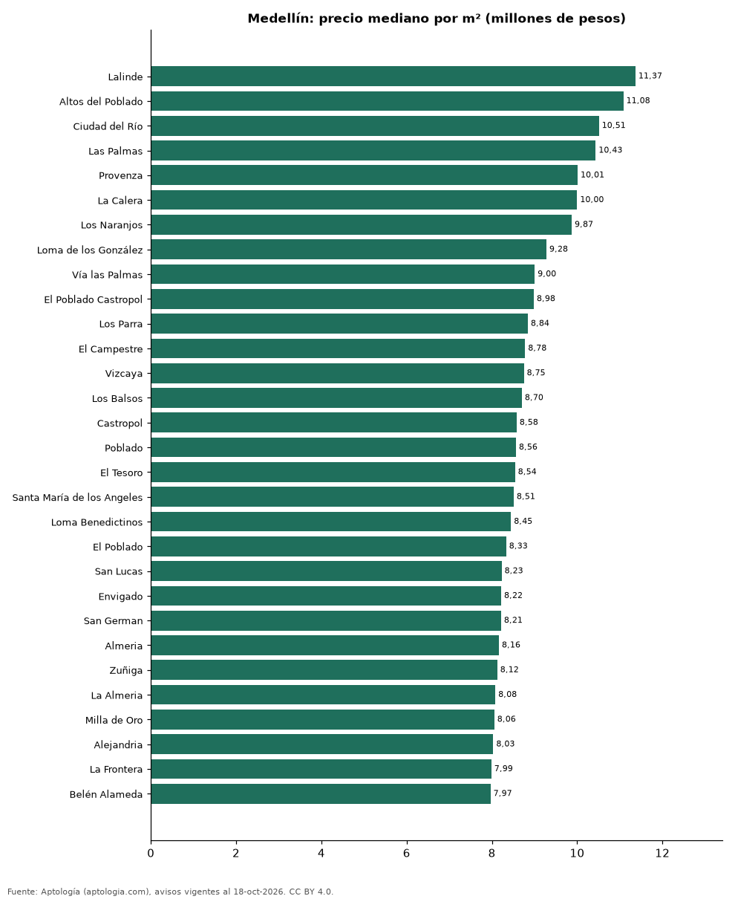

# Barrios más caros y más baratos de Medellín para comprar apartamento: ranking por m² (octubre 2026)

**En Medellín, el barrio con el m² más caro para comprar apartamento es Lalinde (11,37 millones de pesos/m²) y el más barato Centro (3,87 millones de pesos/m²), 2,9 veces menos.** Comparamos 78 barrios con al menos 30 avisos con área.

*Resumen: analizamos 16.988 apartamentos en venta con área declarada en 78 barrios de Medellín.*

**Actualizado:** 18 de octubre de 2026 (datos del 18 de octubre de 2026) · **Próxima actualización:** mensual.

## Resumen

| Indicador | Valor |
|---|---|
| Más caro por m² | Lalinde: 11,37 millones de pesos |
| Más barato por m² | Centro: 3,87 millones de pesos |
| Diferencia | 2,9 veces |
| Barrios | 78 |

## Ranking de barrios por precio del m²

| Barrio | Por m² (mediana) | Precio (mediana) | Área mediana (m²) | Avisos con área |
|---|---|---|---|---|
| Lalinde | 11,37 millones de pesos | 1.299 millones de pesos | 110 | 80 |
| Altos del Poblado | 11,08 millones de pesos | 1.200 millones de pesos | 108 | 191 |
| Ciudad del Río | 10,51 millones de pesos | 830 millones de pesos | 80 | 259 |
| Las Palmas | 10,43 millones de pesos | 970 millones de pesos | 94 | 355 |
| Provenza | 10,01 millones de pesos | 1.365 millones de pesos | 142 | 116 |
| La Calera | 10,00 millones de pesos | 2.350 millones de pesos | 239 | 83 |
| Los Naranjos | 9,87 millones de pesos | 1.095 millones de pesos | 116 | 30 |
| Loma de los González | 9,28 millones de pesos | 1.180 millones de pesos | 110 | 45 |
| Vía las Palmas | 9,00 millones de pesos | 752 millones de pesos | 82 | 94 |
| El Poblado Castropol | 8,98 millones de pesos | 1.190 millones de pesos | 117 | 30 |
| Los Parra | 8,84 millones de pesos | 1.200 millones de pesos | 145 | 33 |
| El Campestre | 8,78 millones de pesos | 1.350 millones de pesos | 158 | 139 |
| Vizcaya | 8,75 millones de pesos | 1.310 millones de pesos | 168 | 58 |
| Los Balsos | 8,70 millones de pesos | 1.400 millones de pesos | 170 | 345 |
| Castropol | 8,58 millones de pesos | 1.100 millones de pesos | 128 | 419 |
| Poblado | 8,56 millones de pesos | 1.200 millones de pesos | 136 | 760 |
| El Tesoro | 8,54 millones de pesos | 1.400 millones de pesos | 185 | 255 |
| Santa María de los Angeles | 8,51 millones de pesos | 1.100 millones de pesos | 137 | 187 |
| Loma Benedictinos | 8,45 millones de pesos | 1.155 millones de pesos | 137 | 31 |
| El Poblado | 8,33 millones de pesos | 1.190 millones de pesos | 142 | 4.919 |
| San Lucas | 8,23 millones de pesos | 1.415 millones de pesos | 171 | 198 |
| Envigado | 8,22 millones de pesos | 839 millones de pesos | 100 | 37 |
| San German | 8,21 millones de pesos | 580 millones de pesos | 70 | 64 |
| Almeria | 8,16 millones de pesos | 650 millones de pesos | 82 | 35 |
| Zuñiga | 8,12 millones de pesos | 1.100 millones de pesos | 135 | 37 |
| La Almeria | 8,08 millones de pesos | 625 millones de pesos | 82 | 46 |
| Milla de Oro | 8,06 millones de pesos | 1.350 millones de pesos | 170 | 89 |
| Alejandria | 8,03 millones de pesos | 1.350 millones de pesos | 180 | 82 |
| La Frontera | 7,99 millones de pesos | 950 millones de pesos | 123 | 87 |
| Belén Alameda | 7,97 millones de pesos | 820 millones de pesos | 106 | 33 |
| Loma de San Julian | 7,93 millones de pesos | 650 millones de pesos | 86 | 33 |
| Belén la Palma | 7,89 millones de pesos | 720 millones de pesos | 101 | 77 |
| Las Lomas No.1 | 7,88 millones de pesos | 1.300 millones de pesos | 165 | 39 |
| Loma del Indio | 7,84 millones de pesos | 580 millones de pesos | 70 | 214 |
| Belén Loma de los Bernal | 7,83 millones de pesos | 650 millones de pesos | 82 | 91 |
| Loma de los Bernal | 7,78 millones de pesos | 650 millones de pesos | 84 | 316 |
| Belén Malibu | 7,78 millones de pesos | 690 millones de pesos | 86 | 31 |
| San Diego | 7,76 millones de pesos | 620 millones de pesos | 76 | 98 |
| Los Bernal | 7,60 millones de pesos | 620 millones de pesos | 84 | 31 |
| Los Colores | 7,58 millones de pesos | 650 millones de pesos | 82 | 203 |
| Guayabal | 7,54 millones de pesos | 550 millones de pesos | 73 | 116 |
| La Tomatera | 7,42 millones de pesos | 1.650 millones de pesos | 190 | 39 |
| La Aguacatala | 7,35 millones de pesos | 875 millones de pesos | 144 | 40 |
| Sabaneta | 7,31 millones de pesos | 616 millones de pesos | 80 | 35 |
| La Castellana | 7,31 millones de pesos | 750 millones de pesos | 107 | 193 |
| Conquistadores | 7,19 millones de pesos | 830 millones de pesos | 122 | 291 |
| La Florida | 7,12 millones de pesos | 1.325 millones de pesos | 176 | 58 |
| Belén Fátima | 7,06 millones de pesos | 580 millones de pesos | 85 | 39 |
| Patio Bonito | 6,87 millones de pesos | 970 millones de pesos | 147 | 117 |
| Laureles | 6,75 millones de pesos | 830 millones de pesos | 125 | 2.253 |
| Calasanz Parte Alta | 6,73 millones de pesos | 390 millones de pesos | 55 | 62 |
| Rodeo Alto | 6,63 millones de pesos | 390 millones de pesos | 59 | 144 |
| Medellín | 6,59 millones de pesos | 760 millones de pesos | 118 | 75 |
| Belén | 6,58 millones de pesos | 565 millones de pesos | 85 | 743 |
| Calasanz | 6,56 millones de pesos | 450 millones de pesos | 69 | 485 |
| Santa Teresita | 6,42 millones de pesos | 850 millones de pesos | 135 | 48 |
| La Mota | 6,35 millones de pesos | 545 millones de pesos | 86 | 42 |
| La Floresta | 6,31 millones de pesos | 572 millones de pesos | 96 | 50 |
| Belén Rosales | 6,00 millones de pesos | 690 millones de pesos | 125 | 67 |
| El Velodromo | 5,79 millones de pesos | 700 millones de pesos | 115 | 31 |
| Estadio | 5,75 millones de pesos | 820 millones de pesos | 142 | 89 |
| La America | 5,66 millones de pesos | 460 millones de pesos | 85 | 181 |
| San Joaquin | 5,62 millones de pesos | 599 millones de pesos | 108 | 70 |
| Florida Nueva | 5,49 millones de pesos | 650 millones de pesos | 121 | 62 |
| Simón Bolívar | 5,47 millones de pesos | 650 millones de pesos | 108 | 104 |
| Suramericana | 5,30 millones de pesos | 685 millones de pesos | 133 | 34 |
| Boston | 5,20 millones de pesos | 350 millones de pesos | 66 | 155 |
| Buenos Aires | 5,00 millones de pesos | 320 millones de pesos | 62 | 104 |
| Robledo | 5,00 millones de pesos | 265 millones de pesos | 52 | 363 |
| San Antonio de Prado | 4,90 millones de pesos | 240 millones de pesos | 50 | 130 |
| San Javier | 4,85 millones de pesos | 330 millones de pesos | 67 | 41 |
| La Milagrosa | 4,64 millones de pesos | 325 millones de pesos | 65 | 30 |
| La Candelaria | 4,62 millones de pesos | 540 millones de pesos | 118 | 180 |
| Prado Centro | 4,51 millones de pesos | 366 millones de pesos | 75 | 32 |
| Prado | 4,29 millones de pesos | 370 millones de pesos | 92 | 49 |
| Villa Hermosa | 4,02 millones de pesos | 330 millones de pesos | 77 | 50 |
| Villa Nueva | 3,96 millones de pesos | 468 millones de pesos | 134 | 38 |
| Centro | 3,87 millones de pesos | 452 millones de pesos | 120 | 78 |

Medianas; solo barrios con 30 avisos o más con área declarada.

## Preguntas frecuentes

**¿Cuál es el barrio más caro de Medellín para comprar?**
Lalinde, con 11,37 millones de pesos por m² en la mediana (octubre de 2026).

**¿Y el más barato?**
Centro, con 3,87 millones de pesos por m².

## Metodología

- **Fuente:** exportes nocturnos de la base de datos de Aptología (aptologia.com) del 18 de octubre de 2026: avisos vigentes de vivienda en portales inmobiliarios de 13 países, recogidos por Aptología y vistos en línea entre el 11 y el 18 de octubre de 2026. Corte: 18 de octubre de 2026.
- **Depuración:** se eliminan duplicados exactos (misma ciudad, zona, tipo, precio, moneda, área, habitaciones y baños) y los precios fuera del percentil 1–99 de cada país, operación, moneda y tipo; el precio por m² usa solo avisos con área declarada entre 12 y 2.000 m² y también se recorta al P1–P99.
- **Qué se mide:** precios pedidos (publicados), no precios de cierre. En arriendo, el canon mensual sin administración, gastos comunes ni condominio.
- **Muestra mínima:** cada cifra publicada se apoya en al menos 30 avisos; las celdas con menos se omiten.
- **Colombia:** Precios en pesos colombianos, sin conversión de moneda.
- **Limitaciones:** la cobertura depende de los portales que recorre Aptología en cada país y es mayor en las ciudades grandes y en los segmentos medio-alto y alto; el área es la que declara el aviso, sin verificar; los nombres de zona vienen de los portales.
- **Privacidad:** solo se publican agregados; no se publica ningún dato personal, enlace a avisos ni nombre de anunciante.
- **Datos abiertos:** [datos.csv](datos.csv), licencia CC BY 4.0.

## Cómo citar

Pinzón Pineda, D. M. (2026). *Barrios más caros y más baratos de Medellín para comprar apartamento: ranking por m² (octubre 2026)*. Aptología (aptologia.com). https://github.com/elbroker/aptologia-datos/tree/main/estudios/barrios-mas-caros-y-baratos-medellin-venta-m2-2026. Datos: datos.csv, licencia CC BY 4.0.
