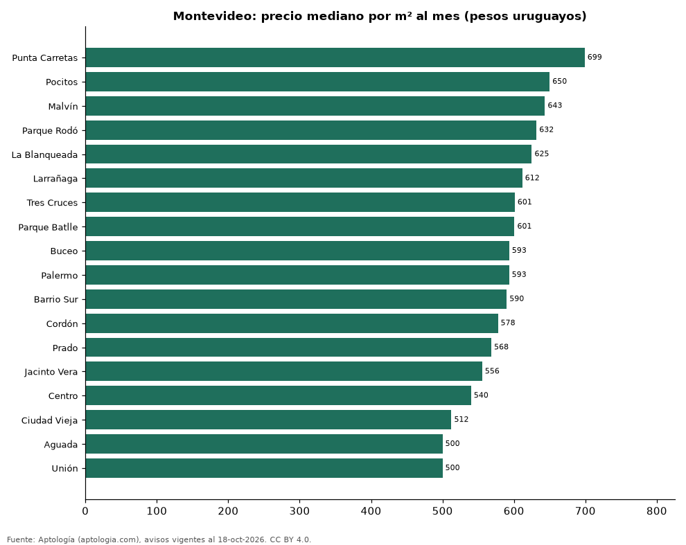

# Barrios más caros y más baratos de Montevideo para alquilar apartamento: ranking por m² (octubre 2026)

**En Montevideo, el barrio con el m² más caro para alquilar apartamento es Punta Carretas (699,1 pesos uruguayos (USD 17,4)/m² al mes) y el más barato Unión (500,0 pesos uruguayos (USD 12,4)/m² al mes), 1,4 veces menos.** Comparamos 18 barrios con al menos 30 avisos con área.

*Resumen: analizamos 2.512 apartamentos en alquiler con área declarada en 18 barrios de Montevideo.*

**Actualizado:** 18 de octubre de 2026 (datos del 18 de octubre de 2026) · **Próxima actualización:** mensual.

## Resumen

| Indicador | Valor |
|---|---|
| Más caro por m² | Punta Carretas: 699,1 pesos uruguayos (USD 17,4) |
| Más barato por m² | Unión: 500,0 pesos uruguayos (USD 12,4) |
| Diferencia | 1,4 veces |
| Barrios | 18 |

## Ranking de barrios por precio del m²

| Barrio | Por m² (mediana) | Canon (mediana) | Área mediana (m²) | Avisos con área |
|---|---|---|---|---|
| Punta Carretas | 699,1 pesos uruguayos (USD 17,4) | 38.000 pesos uruguayos (USD 945) | 55 | 118 |
| Pocitos | 650,0 pesos uruguayos (USD 16,2) | 36.000 pesos uruguayos (USD 895) | 55 | 340 |
| Malvín | 643,4 pesos uruguayos (USD 16,0) | 35.000 pesos uruguayos (USD 871) | 52 | 168 |
| Parque Rodó | 631,6 pesos uruguayos (USD 15,7) | 33.000 pesos uruguayos (USD 821) | 51 | 75 |
| La Blanqueada | 625,0 pesos uruguayos (USD 15,5) | 29.800 pesos uruguayos (USD 741) | 50 | 233 |
| Larrañaga | 611,7 pesos uruguayos (USD 15,2) | 28.500 pesos uruguayos (USD 709) | 48 | 34 |
| Tres Cruces | 601,1 pesos uruguayos (USD 15,0) | 30.750 pesos uruguayos (USD 765) | 50 | 210 |
| Parque Batlle | 600,8 pesos uruguayos (USD 14,9) | 29.950 pesos uruguayos (USD 745) | 52 | 98 |
| Buceo | 593,3 pesos uruguayos (USD 14,8) | 30.900 pesos uruguayos (USD 769) | 50 | 91 |
| Palermo | 593,2 pesos uruguayos (USD 14,8) | 29.500 pesos uruguayos (USD 734) | 51 | 75 |
| Barrio Sur | 589,9 pesos uruguayos (USD 14,7) | 30.000 pesos uruguayos (USD 746) | 49 | 70 |
| Cordón | 577,6 pesos uruguayos (USD 14,4) | 29.800 pesos uruguayos (USD 741) | 50 | 373 |
| Prado | 568,4 pesos uruguayos (USD 14,1) | 29.000 pesos uruguayos (USD 721) | 50 | 54 |
| Jacinto Vera | 555,5 pesos uruguayos (USD 13,8) | 30.800 pesos uruguayos (USD 766) | 60 | 36 |
| Centro | 540,0 pesos uruguayos (USD 13,4) | 29.000 pesos uruguayos (USD 721) | 54 | 281 |
| Ciudad Vieja | 512,5 pesos uruguayos (USD 12,7) | 28.000 pesos uruguayos (USD 696) | 51 | 95 |
| Aguada | 500,0 pesos uruguayos (USD 12,4) | 26.000 pesos uruguayos (USD 647) | 52 | 86 |
| Unión | 500,0 pesos uruguayos (USD 12,4) | 25.000 pesos uruguayos (USD 622) | 50 | 75 |

Medianas; solo barrios con 30 avisos o más con área declarada.

## Preguntas frecuentes

**¿Cuál es el barrio más caro de Montevideo para alquilar?**
Punta Carretas, con 699,1 pesos uruguayos (USD 17,4) por m² al mes en la mediana (octubre de 2026).

**¿Y el más barato?**
Unión, con 500,0 pesos uruguayos (USD 12,4) por m² al mes.

## Metodología

- **Fuente:** exportes nocturnos de la base de datos de Aptología (aptologia.com) del 18 de octubre de 2026: avisos vigentes de vivienda en portales inmobiliarios de 13 países, recogidos por Aptología y vistos en línea entre el 11 y el 18 de octubre de 2026. Corte: 18 de octubre de 2026.
- **Depuración:** se eliminan duplicados exactos (misma ciudad, zona, tipo, precio, moneda, área, habitaciones y baños) y los precios fuera del percentil 1–99 de cada país, operación, moneda y tipo; el precio por m² usa solo avisos con área declarada entre 12 y 2.000 m² y también se recorta al P1–P99.
- **Qué se mide:** precios pedidos (publicados), no precios de cierre. En arriendo, el canon mensual sin administración, gastos comunes ni condominio.
- **Muestra mínima:** cada cifra publicada se apoya en al menos 30 avisos; las celdas con menos se omiten.
- **Monedas:** nunca se mezclan avisos de monedas distintas sin convertirlos. Conversión a dólares con la tasa de mercado de ExchangeRate-API (open.er-api.com, actualización del 18 Oct 2026): 1 USD = 3.182,80 COP, 1 USD = 18,47 M.N, 1 USD = 5,09 BRL, 1 USD = 3,44 PEN, 1 USD = 982,44 CLP, 1 USD = 1.514,57 ARS, 1 USD = 40,20 UYU, 1 USD = 5.705,37 PYG, 1 USD = 61,27 DOP, 1 USD = 0,89 EUR, 1 USD = 11,72 BOB; la UF chilena a 41.178,64 CLP (mindicador,cl. 18-oct-2026). Los avisos publicados en dólares se usan tal cual.
- **Monedas:** en cada ciudad y operación se usa solo la moneda mayoritaria de los avisos (los avisos en otra moneda se excluyen) y la mediana se convierte a dólares con la tasa citada; nunca se promedian avisos de monedas distintas.
- **Limitaciones:** la cobertura depende de los portales que recorre Aptología en cada país y es mayor en las ciudades grandes y en los segmentos medio-alto y alto; el área es la que declara el aviso, sin verificar; los nombres de zona vienen de los portales.
- **Privacidad:** solo se publican agregados; no se publica ningún dato personal, enlace a avisos ni nombre de anunciante.
- **Datos abiertos:** [datos.csv](datos.csv), licencia CC BY 4.0.

## Cómo citar

Pinzón Pineda, D. M. (2026). *Barrios más caros y más baratos de Montevideo para alquilar apartamento: ranking por m² (octubre 2026)*. Aptología (aptologia.com). https://github.com/elbroker/aptologia-datos/tree/main/estudios/barrios-mas-caros-y-baratos-montevideo-alquiler-m2-2026. Datos: datos.csv, licencia CC BY 4.0.
