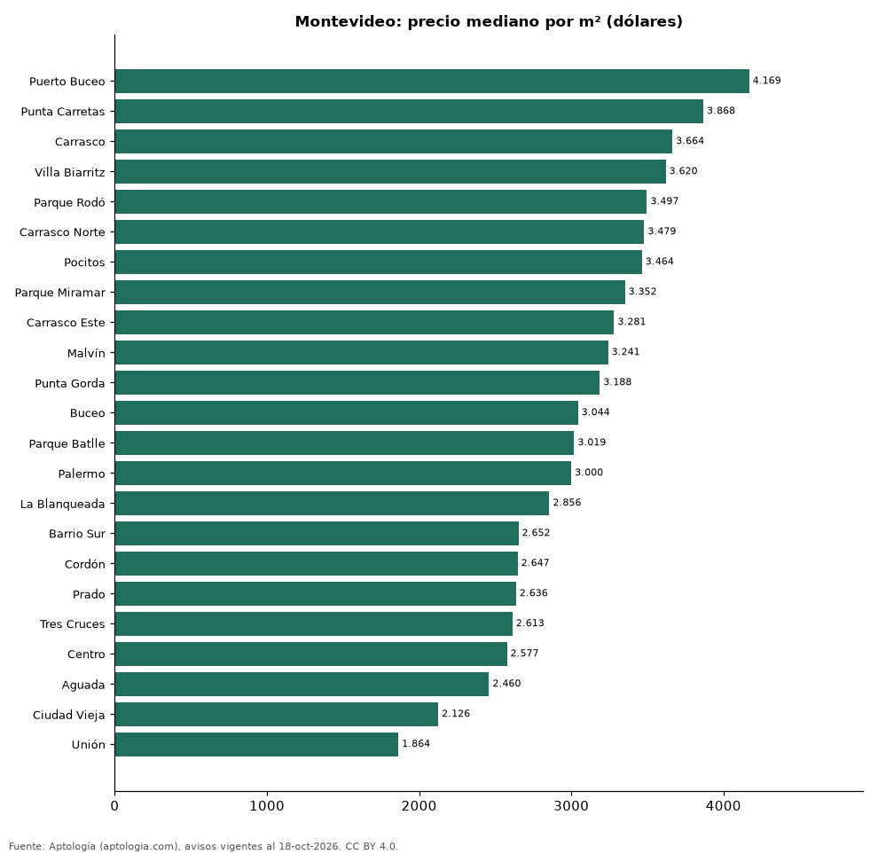

# Barrios más caros y más baratos de Montevideo para comprar apartamento: ranking por m² (octubre 2026)

**En Montevideo, el barrio con el m² más caro para comprar apartamento es Puerto Buceo (USD 4.169/m²) y el más barato Unión (USD 1.864/m²), 2,2 veces menos.** Comparamos 23 barrios con al menos 30 avisos con área.

*Resumen: analizamos 4.181 apartamentos en venta con área declarada en 23 barrios de Montevideo.*

**Actualizado:** 18 de octubre de 2026 (datos del 18 de octubre de 2026) · **Próxima actualización:** mensual.

## Resumen

| Indicador | Valor |
|---|---|
| Más caro por m² | Puerto Buceo: USD 4.169 |
| Más barato por m² | Unión: USD 1.864 |
| Diferencia | 2,2 veces |
| Barrios | 23 |

## Ranking de barrios por precio del m²

| Barrio | Por m² (mediana) | Precio (mediana) | Área mediana (m²) | Avisos con área |
|---|---|---|---|---|
| Puerto Buceo | USD 4.169 | USD 400.350 | 102 | 38 |
| Punta Carretas | USD 3.868 | USD 298.000 | 75 | 290 |
| Carrasco | USD 3.664 | USD 463.400 | 125 | 251 |
| Villa Biarritz | USD 3.620 | USD 452.500 | 122 | 36 |
| Parque Rodó | USD 3.497 | USD 200.700 | 58 | 98 |
| Carrasco Norte | USD 3.479 | USD 336.716 | 96 | 124 |
| Pocitos | USD 3.464 | USD 249.250 | 71 | 614 |
| Parque Miramar | USD 3.352 | USD 303.850 | 96 | 70 |
| Carrasco Este | USD 3.281 | USD 270.000 | 80 | 41 |
| Malvín | USD 3.241 | USD 225.000 | 71 | 370 |
| Punta Gorda | USD 3.188 | USD 235.000 | 77 | 40 |
| Buceo | USD 3.044 | USD 179.000 | 61 | 190 |
| Parque Batlle | USD 3.019 | USD 173.000 | 58 | 133 |
| Palermo | USD 3.000 | USD 158.400 | 55 | 93 |
| La Blanqueada | USD 2.856 | USD 155.381 | 56 | 353 |
| Barrio Sur | USD 2.652 | USD 158.700 | 60 | 105 |
| Cordón | USD 2.647 | USD 153.000 | 58 | 557 |
| Prado | USD 2.636 | USD 169.697 | 64 | 103 |
| Tres Cruces | USD 2.613 | USD 149.250 | 58 | 232 |
| Centro | USD 2.577 | USD 153.280 | 60 | 274 |
| Aguada | USD 2.460 | USD 157.300 | 58 | 88 |
| Ciudad Vieja | USD 2.126 | USD 130.000 | 67 | 48 |
| Unión | USD 1.864 | USD 125.000 | 60 | 33 |

Medianas; solo barrios con 30 avisos o más con área declarada.

## Preguntas frecuentes

**¿Cuál es el barrio más caro de Montevideo para comprar?**
Puerto Buceo, con USD 4.169 por m² en la mediana (octubre de 2026).

**¿Y el más barato?**
Unión, con USD 1.864 por m².

## Metodología

- **Fuente:** exportes nocturnos de la base de datos de Aptología (aptologia.com) del 18 de octubre de 2026: avisos vigentes de vivienda en portales inmobiliarios de 13 países, recogidos por Aptología y vistos en línea entre el 11 y el 18 de octubre de 2026. Corte: 18 de octubre de 2026.
- **Depuración:** se eliminan duplicados exactos (misma ciudad, zona, tipo, precio, moneda, área, habitaciones y baños) y los precios fuera del percentil 1–99 de cada país, operación, moneda y tipo; el precio por m² usa solo avisos con área declarada entre 12 y 2.000 m² y también se recorta al P1–P99.
- **Qué se mide:** precios pedidos (publicados), no precios de cierre. En arriendo, el canon mensual sin administración, gastos comunes ni condominio.
- **Muestra mínima:** cada cifra publicada se apoya en al menos 30 avisos; las celdas con menos se omiten.
- **Monedas:** nunca se mezclan avisos de monedas distintas sin convertirlos. Conversión a dólares con la tasa de mercado de ExchangeRate-API (open.er-api.com, actualización del 18 Oct 2026): 1 USD = 3.182,80 COP, 1 USD = 18,47 M.N, 1 USD = 5,09 BRL, 1 USD = 3,44 PEN, 1 USD = 982,44 CLP, 1 USD = 1.514,57 ARS, 1 USD = 40,20 UYU, 1 USD = 5.705,37 PYG, 1 USD = 61,27 DOP, 1 USD = 0,89 EUR, 1 USD = 11,72 BOB; la UF chilena a 41.178,64 CLP (mindicador,cl. 18-oct-2026). Los avisos publicados en dólares se usan tal cual.
- **Monedas:** en cada ciudad y operación se usa solo la moneda mayoritaria de los avisos (los avisos en otra moneda se excluyen) y la mediana se convierte a dólares con la tasa citada; nunca se promedian avisos de monedas distintas.
- **Limitaciones:** la cobertura depende de los portales que recorre Aptología en cada país y es mayor en las ciudades grandes y en los segmentos medio-alto y alto; el área es la que declara el aviso, sin verificar; los nombres de zona vienen de los portales.
- **Privacidad:** solo se publican agregados; no se publica ningún dato personal, enlace a avisos ni nombre de anunciante.
- **Datos abiertos:** [datos.csv](datos.csv), licencia CC BY 4.0.

## Cómo citar

Pinzón Pineda, D. M. (2026). *Barrios más caros y más baratos de Montevideo para comprar apartamento: ranking por m² (octubre 2026)*. Aptología (aptologia.com). https://github.com/elbroker/aptologia-datos/tree/main/estudios/barrios-mas-caros-y-baratos-montevideo-venta-m2-2026. Datos: datos.csv, licencia CC BY 4.0.
