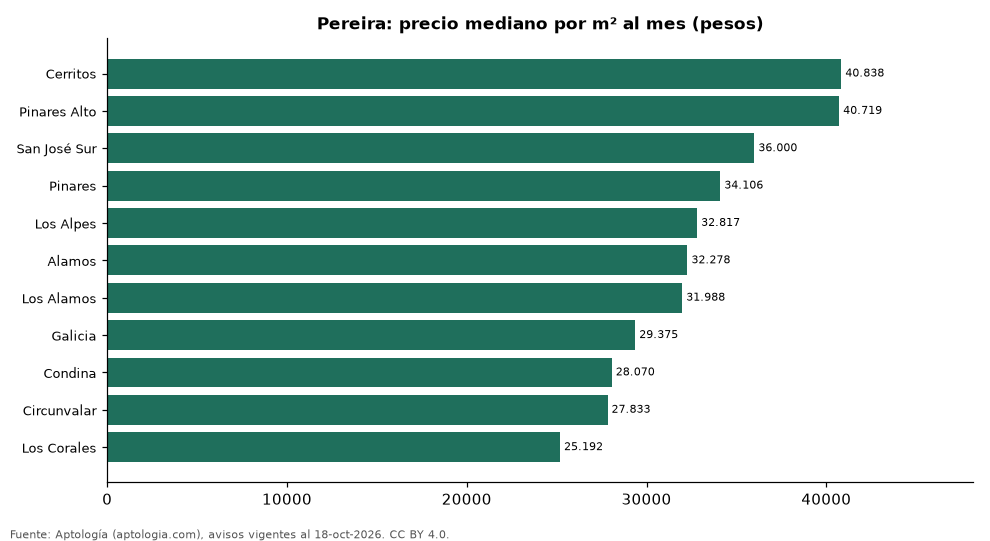

# Barrios más caros y más baratos de Pereira para arrendar apartamento: ranking por m² (octubre 2026)

**En Pereira, el barrio con el m² más caro para arrendar apartamento es Cerritos (40.838 pesos/m² al mes) y el más barato Los Corales (25.192 pesos/m² al mes), 1,6 veces menos.** Comparamos 11 barrios con al menos 30 avisos con área.

*Resumen: analizamos 1.137 apartamentos en arriendo con área declarada en 11 barrios de Pereira.*

**Actualizado:** 18 de octubre de 2026 (datos del 18 de octubre de 2026) · **Próxima actualización:** mensual.

## Resumen

| Indicador | Valor |
|---|---|
| Más caro por m² | Cerritos: 40.838 pesos |
| Más barato por m² | Los Corales: 25.192 pesos |
| Diferencia | 1,6 veces |
| Barrios | 11 |

## Ranking de barrios por precio del m²

| Barrio | Por m² (mediana) | Canon (mediana) | Área mediana (m²) | Avisos con área |
|---|---|---|---|---|
| Cerritos | 40.838 pesos | 3.900.000 pesos | 96 | 162 |
| Pinares Alto | 40.719 pesos | 4.800.000 pesos | 110 | 53 |
| San José Sur | 36.000 pesos | 3.300.000 pesos | 90 | 35 |
| Pinares | 34.106 pesos | 3.500.000 pesos | 96 | 336 |
| Los Alpes | 32.817 pesos | 3.100.000 pesos | 90 | 94 |
| Alamos | 32.278 pesos | 2.750.000 pesos | 86 | 179 |
| Los Alamos | 31.988 pesos | 3.230.000 pesos | 96 | 64 |
| Galicia | 29.375 pesos | 2.200.000 pesos | 72 | 89 |
| Condina | 28.070 pesos | 1.650.000 pesos | 58 | 63 |
| Circunvalar | 27.833 pesos | 2.675.000 pesos | 94 | 32 |
| Los Corales | 25.192 pesos | 1.700.000 pesos | 69 | 30 |

Medianas; solo barrios con 30 avisos o más con área declarada.

## Preguntas frecuentes

**¿Cuál es el barrio más caro de Pereira para arrendar?**
Cerritos, con 40.838 pesos por m² al mes en la mediana (octubre de 2026).

**¿Y el más barato?**
Los Corales, con 25.192 pesos por m² al mes.

## Metodología

- **Fuente:** exportes nocturnos de la base de datos de Aptología (aptologia.com) del 18 de octubre de 2026: avisos vigentes de vivienda en portales inmobiliarios de 13 países, recogidos por Aptología y vistos en línea entre el 11 y el 18 de octubre de 2026. Corte: 18 de octubre de 2026.
- **Depuración:** se eliminan duplicados exactos (misma ciudad, zona, tipo, precio, moneda, área, habitaciones y baños) y los precios fuera del percentil 1–99 de cada país, operación, moneda y tipo; el precio por m² usa solo avisos con área declarada entre 12 y 2.000 m² y también se recorta al P1–P99.
- **Qué se mide:** precios pedidos (publicados), no precios de cierre. En arriendo, el canon mensual sin administración, gastos comunes ni condominio.
- **Muestra mínima:** cada cifra publicada se apoya en al menos 30 avisos; las celdas con menos se omiten.
- **Colombia:** Precios en pesos colombianos, sin conversión de moneda.
- **Limitaciones:** la cobertura depende de los portales que recorre Aptología en cada país y es mayor en las ciudades grandes y en los segmentos medio-alto y alto; el área es la que declara el aviso, sin verificar; los nombres de zona vienen de los portales.
- **Privacidad:** solo se publican agregados; no se publica ningún dato personal, enlace a avisos ni nombre de anunciante.
- **Datos abiertos:** [datos.csv](datos.csv), licencia CC BY 4.0.

## Cómo citar

Pinzón Pineda, D. M. (2026). *Barrios más caros y más baratos de Pereira para arrendar apartamento: ranking por m² (octubre 2026)*. Aptología (aptologia.com). https://github.com/elbroker/aptologia-datos/tree/main/estudios/barrios-mas-caros-y-baratos-pereira-arriendo-m2-2026. Datos: datos.csv, licencia CC BY 4.0.
