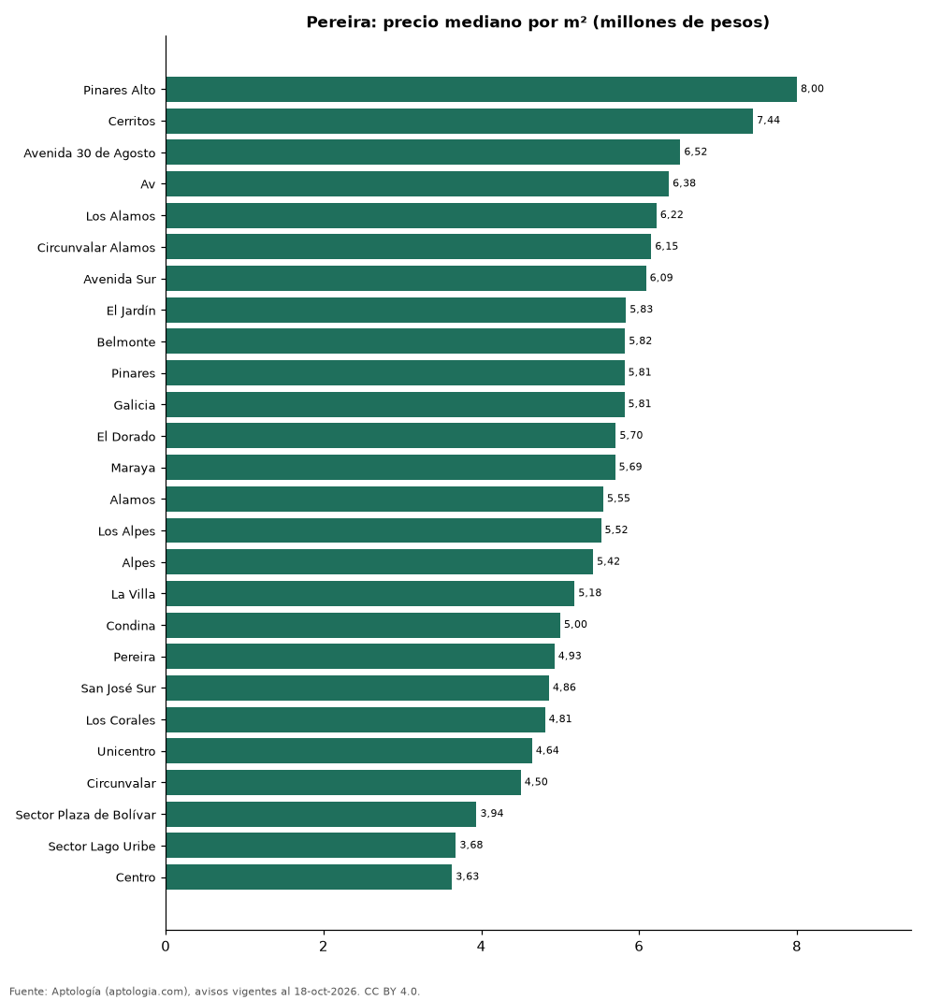

# Barrios más caros y más baratos de Pereira para comprar apartamento: ranking por m² (octubre 2026)

**En Pereira, el barrio con el m² más caro para comprar apartamento es Pinares Alto (8,00 millones de pesos/m²) y el más barato Centro (3,63 millones de pesos/m²), 2,2 veces menos.** Comparamos 26 barrios con al menos 30 avisos con área.

*Resumen: analizamos 3.106 apartamentos en venta con área declarada en 26 barrios de Pereira.*

**Actualizado:** 18 de octubre de 2026 (datos del 18 de octubre de 2026) · **Próxima actualización:** mensual.

## Resumen

| Indicador | Valor |
|---|---|
| Más caro por m² | Pinares Alto: 8,00 millones de pesos |
| Más barato por m² | Centro: 3,63 millones de pesos |
| Diferencia | 2,2 veces |
| Barrios | 26 |

## Ranking de barrios por precio del m²

| Barrio | Por m² (mediana) | Precio (mediana) | Área mediana (m²) | Avisos con área |
|---|---|---|---|---|
| Pinares Alto | 8,00 millones de pesos | 980 millones de pesos | 134 | 57 |
| Cerritos | 7,44 millones de pesos | 681 millones de pesos | 90 | 400 |
| Avenida 30 de Agosto | 6,52 millones de pesos | 470 millones de pesos | 74 | 57 |
| Av | 6,38 millones de pesos | 435 millones de pesos | 72 | 47 |
| Los Alamos | 6,22 millones de pesos | 600 millones de pesos | 100 | 141 |
| Circunvalar Alamos | 6,15 millones de pesos | 518 millones de pesos | 99 | 32 |
| Avenida Sur | 6,09 millones de pesos | 400 millones de pesos | 70 | 87 |
| El Jardín | 5,83 millones de pesos | 369 millones de pesos | 76 | 30 |
| Belmonte | 5,82 millones de pesos | 418 millones de pesos | 71 | 60 |
| Pinares | 5,81 millones de pesos | 650 millones de pesos | 118 | 672 |
| Galicia | 5,81 millones de pesos | 402 millones de pesos | 70 | 166 |
| El Dorado | 5,70 millones de pesos | 378 millones de pesos | 71 | 60 |
| Maraya | 5,69 millones de pesos | 400 millones de pesos | 72 | 70 |
| Alamos | 5,55 millones de pesos | 488 millones de pesos | 91 | 274 |
| Los Alpes | 5,52 millones de pesos | 522 millones de pesos | 100 | 136 |
| Alpes | 5,42 millones de pesos | 540 millones de pesos | 108 | 35 |
| La Villa | 5,18 millones de pesos | 340 millones de pesos | 70 | 40 |
| Condina | 5,00 millones de pesos | 280 millones de pesos | 56 | 177 |
| Pereira | 4,93 millones de pesos | 322 millones de pesos | 68 | 42 |
| San José Sur | 4,86 millones de pesos | 400 millones de pesos | 89 | 49 |
| Los Corales | 4,81 millones de pesos | 330 millones de pesos | 66 | 47 |
| Unicentro | 4,64 millones de pesos | 340 millones de pesos | 72 | 37 |
| Circunvalar | 4,50 millones de pesos | 450 millones de pesos | 97 | 99 |
| Sector Plaza de Bolívar | 3,94 millones de pesos | 420 millones de pesos | 110 | 59 |
| Sector Lago Uribe | 3,68 millones de pesos | 350 millones de pesos | 97 | 31 |
| Centro | 3,63 millones de pesos | 380 millones de pesos | 106 | 201 |

Medianas; solo barrios con 30 avisos o más con área declarada.

## Preguntas frecuentes

**¿Cuál es el barrio más caro de Pereira para comprar?**
Pinares Alto, con 8,00 millones de pesos por m² en la mediana (octubre de 2026).

**¿Y el más barato?**
Centro, con 3,63 millones de pesos por m².

## Metodología

- **Fuente:** exportes nocturnos de la base de datos de Aptología (aptologia.com) del 18 de octubre de 2026: avisos vigentes de vivienda en portales inmobiliarios de 13 países, recogidos por Aptología y vistos en línea entre el 11 y el 18 de octubre de 2026. Corte: 18 de octubre de 2026.
- **Depuración:** se eliminan duplicados exactos (misma ciudad, zona, tipo, precio, moneda, área, habitaciones y baños) y los precios fuera del percentil 1–99 de cada país, operación, moneda y tipo; el precio por m² usa solo avisos con área declarada entre 12 y 2.000 m² y también se recorta al P1–P99.
- **Qué se mide:** precios pedidos (publicados), no precios de cierre. En arriendo, el canon mensual sin administración, gastos comunes ni condominio.
- **Muestra mínima:** cada cifra publicada se apoya en al menos 30 avisos; las celdas con menos se omiten.
- **Colombia:** Precios en pesos colombianos, sin conversión de moneda.
- **Limitaciones:** la cobertura depende de los portales que recorre Aptología en cada país y es mayor en las ciudades grandes y en los segmentos medio-alto y alto; el área es la que declara el aviso, sin verificar; los nombres de zona vienen de los portales.
- **Privacidad:** solo se publican agregados; no se publica ningún dato personal, enlace a avisos ni nombre de anunciante.
- **Datos abiertos:** [datos.csv](datos.csv), licencia CC BY 4.0.

## Cómo citar

Pinzón Pineda, D. M. (2026). *Barrios más caros y más baratos de Pereira para comprar apartamento: ranking por m² (octubre 2026)*. Aptología (aptologia.com). https://github.com/elbroker/aptologia-datos/tree/main/estudios/barrios-mas-caros-y-baratos-pereira-venta-m2-2026. Datos: datos.csv, licencia CC BY 4.0.
