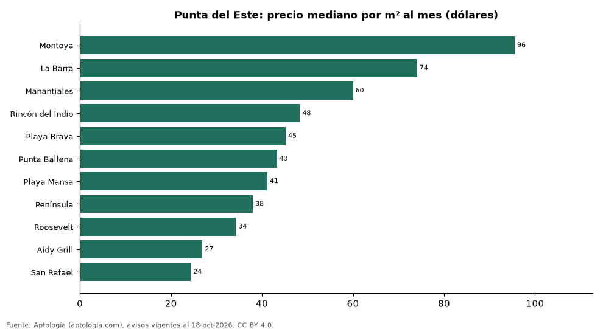

# Barrios más caros y más baratos de Punta del Este para alquilar apartamento: ranking por m² (octubre 2026)

**En Punta del Este, el barrio con el m² más caro para alquilar apartamento es Montoya (USD 95,5/m² al mes) y el más barato San Rafael (USD 24,4/m² al mes), 3,9 veces menos.** Comparamos 11 barrios con al menos 30 avisos con área.

*Resumen: analizamos 1.786 apartamentos en alquiler con área declarada en 11 barrios de Punta del Este.*

**Actualizado:** 18 de octubre de 2026 (datos del 18 de octubre de 2026) · **Próxima actualización:** mensual.

## Resumen

| Indicador | Valor |
|---|---|
| Más caro por m² | Montoya: USD 95,5 |
| Más barato por m² | San Rafael: USD 24,4 |
| Diferencia | 3,9 veces |
| Barrios | 11 |

## Ranking de barrios por precio del m²

| Barrio | Por m² (mediana) | Canon (mediana) | Área mediana (m²) | Avisos con área |
|---|---|---|---|---|
| Montoya | USD 95,5 | USD 12.750 | 150 | 32 |
| La Barra | USD 74,1 | USD 7.500 | 114 | 75 |
| Manantiales | USD 60,0 | USD 7.500 | 120 | 59 |
| Rincón del Indio | USD 48,3 | USD 8.300 | 143 | 33 |
| Playa Brava | USD 45,2 | USD 6.500 | 146 | 514 |
| Punta Ballena | USD 43,3 | USD 5.525 | 134 | 38 |
| Playa Mansa | USD 41,2 | USD 5.200 | 118 | 513 |
| Península | USD 38,0 | USD 3.200 | 82 | 197 |
| Roosevelt | USD 34,3 | USD 2.600 | 73 | 139 |
| Aidy Grill | USD 26,9 | USD 2.600 | 85 | 153 |
| San Rafael | USD 24,4 | USD 1.900 | 80 | 33 |

Medianas; solo barrios con 30 avisos o más con área declarada.

## Preguntas frecuentes

**¿Cuál es el barrio más caro de Punta del Este para alquilar?**
Montoya, con USD 95,5 por m² al mes en la mediana (octubre de 2026).

**¿Y el más barato?**
San Rafael, con USD 24,4 por m² al mes.

## Metodología

- **Fuente:** exportes nocturnos de la base de datos de Aptología (aptologia.com) del 18 de octubre de 2026: avisos vigentes de vivienda en portales inmobiliarios de 13 países, recogidos por Aptología y vistos en línea entre el 11 y el 18 de octubre de 2026. Corte: 18 de octubre de 2026.
- **Depuración:** se eliminan duplicados exactos (misma ciudad, zona, tipo, precio, moneda, área, habitaciones y baños) y los precios fuera del percentil 1–99 de cada país, operación, moneda y tipo; el precio por m² usa solo avisos con área declarada entre 12 y 2.000 m² y también se recorta al P1–P99.
- **Qué se mide:** precios pedidos (publicados), no precios de cierre. En arriendo, el canon mensual sin administración, gastos comunes ni condominio.
- **Muestra mínima:** cada cifra publicada se apoya en al menos 30 avisos; las celdas con menos se omiten.
- **Monedas:** nunca se mezclan avisos de monedas distintas sin convertirlos. Conversión a dólares con la tasa de mercado de ExchangeRate-API (open.er-api.com, actualización del 18 Oct 2026): 1 USD = 3.182,80 COP, 1 USD = 18,47 M.N, 1 USD = 5,09 BRL, 1 USD = 3,44 PEN, 1 USD = 982,44 CLP, 1 USD = 1.514,57 ARS, 1 USD = 40,20 UYU, 1 USD = 5.705,37 PYG, 1 USD = 61,27 DOP, 1 USD = 0,89 EUR, 1 USD = 11,72 BOB; la UF chilena a 41.178,64 CLP (mindicador,cl. 18-oct-2026). Los avisos publicados en dólares se usan tal cual.
- **Monedas:** en cada ciudad y operación se usa solo la moneda mayoritaria de los avisos (los avisos en otra moneda se excluyen) y la mediana se convierte a dólares con la tasa citada; nunca se promedian avisos de monedas distintas.
- **Limitaciones:** la cobertura depende de los portales que recorre Aptología en cada país y es mayor en las ciudades grandes y en los segmentos medio-alto y alto; el área es la que declara el aviso, sin verificar; los nombres de zona vienen de los portales.
- **Privacidad:** solo se publican agregados; no se publica ningún dato personal, enlace a avisos ni nombre de anunciante.
- **Datos abiertos:** [datos.csv](datos.csv), licencia CC BY 4.0.

## Cómo citar

Pinzón Pineda, D. M. (2026). *Barrios más caros y más baratos de Punta del Este para alquilar apartamento: ranking por m² (octubre 2026)*. Aptología (aptologia.com). https://github.com/elbroker/aptologia-datos/tree/main/estudios/barrios-mas-caros-y-baratos-punta-del-este-alquiler-m2-2026. Datos: datos.csv, licencia CC BY 4.0.
