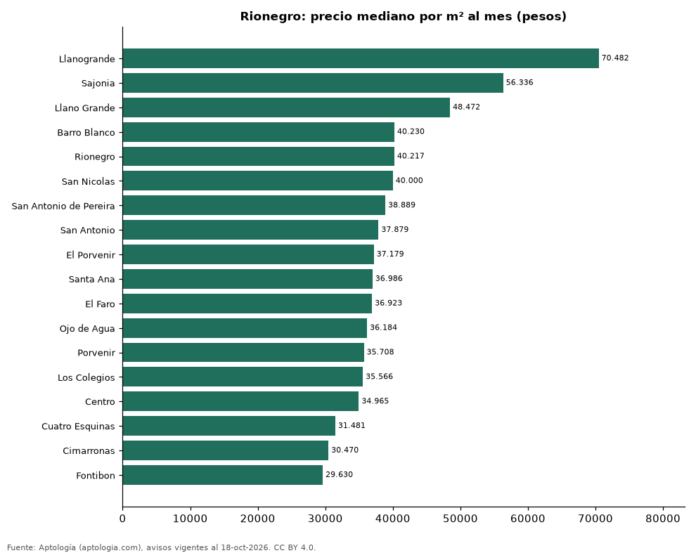

# Barrios más caros y más baratos de Rionegro para arrendar apartamento: ranking por m² (octubre 2026)

**En Rionegro, el barrio con el m² más caro para arrendar apartamento es Llanogrande (70.482 pesos/m² al mes) y el más barato Fontibon (29.630 pesos/m² al mes), 2,4 veces menos.** Comparamos 18 barrios con al menos 30 avisos con área.

*Resumen: analizamos 2.547 apartamentos en arriendo con área declarada en 18 barrios de Rionegro.*

**Actualizado:** 18 de octubre de 2026 (datos del 18 de octubre de 2026) · **Próxima actualización:** mensual.

## Resumen

| Indicador | Valor |
|---|---|
| Más caro por m² | Llanogrande: 70.482 pesos |
| Más barato por m² | Fontibon: 29.630 pesos |
| Diferencia | 2,4 veces |
| Barrios | 18 |

## Ranking de barrios por precio del m²

| Barrio | Por m² (mediana) | Canon (mediana) | Área mediana (m²) | Avisos con área |
|---|---|---|---|---|
| Llanogrande | 70.482 pesos | 5.750.000 pesos | 75 | 72 |
| Sajonia | 56.336 pesos | 6.000.000 pesos | 106 | 78 |
| Llano Grande | 48.472 pesos | 3.500.000 pesos | 76 | 218 |
| Barro Blanco | 40.230 pesos | 2.800.000 pesos | 70 | 203 |
| Rionegro | 40.217 pesos | 2.900.000 pesos | 72 | 285 |
| San Nicolas | 40.000 pesos | 2.900.000 pesos | 74 | 54 |
| San Antonio de Pereira | 38.889 pesos | 2.700.000 pesos | 70 | 147 |
| San Antonio | 37.879 pesos | 2.600.000 pesos | 70 | 129 |
| El Porvenir | 37.179 pesos | 2.600.000 pesos | 68 | 469 |
| Santa Ana | 36.986 pesos | 2.600.000 pesos | 69 | 141 |
| El Faro | 36.923 pesos | 2.500.000 pesos | 68 | 41 |
| Ojo de Agua | 36.184 pesos | 2.700.000 pesos | 75 | 67 |
| Porvenir | 35.708 pesos | 2.300.000 pesos | 62 | 34 |
| Los Colegios | 35.566 pesos | 2.600.000 pesos | 73 | 208 |
| Centro | 34.965 pesos | 2.300.000 pesos | 65 | 153 |
| Cuatro Esquinas | 31.481 pesos | 1.600.000 pesos | 52 | 43 |
| Cimarronas | 30.470 pesos | 1.600.000 pesos | 53 | 80 |
| Fontibon | 29.630 pesos | 1.700.000 pesos | 57 | 125 |

Medianas; solo barrios con 30 avisos o más con área declarada.

## Preguntas frecuentes

**¿Cuál es el barrio más caro de Rionegro para arrendar?**
Llanogrande, con 70.482 pesos por m² al mes en la mediana (octubre de 2026).

**¿Y el más barato?**
Fontibon, con 29.630 pesos por m² al mes.

## Metodología

- **Fuente:** exportes nocturnos de la base de datos de Aptología (aptologia.com) del 18 de octubre de 2026: avisos vigentes de vivienda en portales inmobiliarios de 13 países, recogidos por Aptología y vistos en línea entre el 11 y el 18 de octubre de 2026. Corte: 18 de octubre de 2026.
- **Depuración:** se eliminan duplicados exactos (misma ciudad, zona, tipo, precio, moneda, área, habitaciones y baños) y los precios fuera del percentil 1–99 de cada país, operación, moneda y tipo; el precio por m² usa solo avisos con área declarada entre 12 y 2.000 m² y también se recorta al P1–P99.
- **Qué se mide:** precios pedidos (publicados), no precios de cierre. En arriendo, el canon mensual sin administración, gastos comunes ni condominio.
- **Muestra mínima:** cada cifra publicada se apoya en al menos 30 avisos; las celdas con menos se omiten.
- **Colombia:** Precios en pesos colombianos, sin conversión de moneda.
- **Limitaciones:** la cobertura depende de los portales que recorre Aptología en cada país y es mayor en las ciudades grandes y en los segmentos medio-alto y alto; el área es la que declara el aviso, sin verificar; los nombres de zona vienen de los portales.
- **Privacidad:** solo se publican agregados; no se publica ningún dato personal, enlace a avisos ni nombre de anunciante.
- **Datos abiertos:** [datos.csv](datos.csv), licencia CC BY 4.0.

## Cómo citar

Pinzón Pineda, D. M. (2026). *Barrios más caros y más baratos de Rionegro para arrendar apartamento: ranking por m² (octubre 2026)*. Aptología (aptologia.com). https://github.com/elbroker/aptologia-datos/tree/main/estudios/barrios-mas-caros-y-baratos-rionegro-arriendo-m2-2026. Datos: datos.csv, licencia CC BY 4.0.
