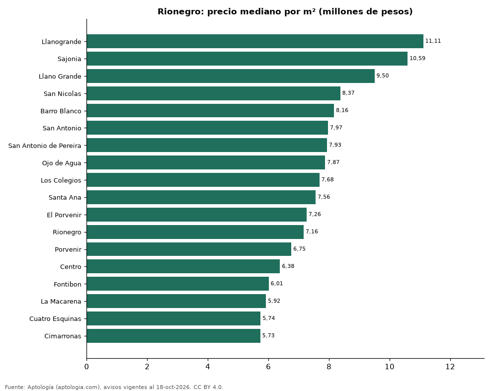

# Barrios más caros y más baratos de Rionegro para comprar apartamento: ranking por m² (octubre 2026)

**En Rionegro, el barrio con el m² más caro para comprar apartamento es Llanogrande (11,11 millones de pesos/m²) y el más barato Cimarronas (5,73 millones de pesos/m²), 1,9 veces menos.** Comparamos 18 barrios con al menos 30 avisos con área.

*Resumen: analizamos 2.314 apartamentos en venta con área declarada en 18 barrios de Rionegro.*

**Actualizado:** 18 de octubre de 2026 (datos del 18 de octubre de 2026) · **Próxima actualización:** mensual.

## Resumen

| Indicador | Valor |
|---|---|
| Más caro por m² | Llanogrande: 11,11 millones de pesos |
| Más barato por m² | Cimarronas: 5,73 millones de pesos |
| Diferencia | 1,9 veces |
| Barrios | 18 |

## Ranking de barrios por precio del m²

| Barrio | Por m² (mediana) | Precio (mediana) | Área mediana (m²) | Avisos con área |
|---|---|---|---|---|
| Llanogrande | 11,11 millones de pesos | 1.050 millones de pesos | 96 | 58 |
| Sajonia | 10,59 millones de pesos | 1.250 millones de pesos | 108 | 63 |
| Llano Grande | 9,50 millones de pesos | 700 millones de pesos | 79 | 177 |
| San Nicolas | 8,37 millones de pesos | 580 millones de pesos | 68 | 31 |
| Barro Blanco | 8,16 millones de pesos | 560 millones de pesos | 68 | 223 |
| San Antonio | 7,97 millones de pesos | 538 millones de pesos | 72 | 78 |
| San Antonio de Pereira | 7,93 millones de pesos | 570 millones de pesos | 73 | 201 |
| Ojo de Agua | 7,87 millones de pesos | 588 millones de pesos | 76 | 62 |
| Los Colegios | 7,68 millones de pesos | 600 millones de pesos | 76 | 100 |
| Santa Ana | 7,56 millones de pesos | 550 millones de pesos | 73 | 92 |
| El Porvenir | 7,26 millones de pesos | 470 millones de pesos | 62 | 415 |
| Rionegro | 7,16 millones de pesos | 505 millones de pesos | 67 | 282 |
| Porvenir | 6,75 millones de pesos | 360 millones de pesos | 53 | 30 |
| Centro | 6,38 millones de pesos | 380 millones de pesos | 60 | 104 |
| Fontibon | 6,01 millones de pesos | 350 millones de pesos | 57 | 260 |
| La Macarena | 5,92 millones de pesos | 310 millones de pesos | 53 | 32 |
| Cuatro Esquinas | 5,74 millones de pesos | 295 millones de pesos | 52 | 55 |
| Cimarronas | 5,73 millones de pesos | 300 millones de pesos | 53 | 51 |

Medianas; solo barrios con 30 avisos o más con área declarada.

## Preguntas frecuentes

**¿Cuál es el barrio más caro de Rionegro para comprar?**
Llanogrande, con 11,11 millones de pesos por m² en la mediana (octubre de 2026).

**¿Y el más barato?**
Cimarronas, con 5,73 millones de pesos por m².

## Metodología

- **Fuente:** exportes nocturnos de la base de datos de Aptología (aptologia.com) del 18 de octubre de 2026: avisos vigentes de vivienda en portales inmobiliarios de 13 países, recogidos por Aptología y vistos en línea entre el 11 y el 18 de octubre de 2026. Corte: 18 de octubre de 2026.
- **Depuración:** se eliminan duplicados exactos (misma ciudad, zona, tipo, precio, moneda, área, habitaciones y baños) y los precios fuera del percentil 1–99 de cada país, operación, moneda y tipo; el precio por m² usa solo avisos con área declarada entre 12 y 2.000 m² y también se recorta al P1–P99.
- **Qué se mide:** precios pedidos (publicados), no precios de cierre. En arriendo, el canon mensual sin administración, gastos comunes ni condominio.
- **Muestra mínima:** cada cifra publicada se apoya en al menos 30 avisos; las celdas con menos se omiten.
- **Colombia:** Precios en pesos colombianos, sin conversión de moneda.
- **Limitaciones:** la cobertura depende de los portales que recorre Aptología en cada país y es mayor en las ciudades grandes y en los segmentos medio-alto y alto; el área es la que declara el aviso, sin verificar; los nombres de zona vienen de los portales.
- **Privacidad:** solo se publican agregados; no se publica ningún dato personal, enlace a avisos ni nombre de anunciante.
- **Datos abiertos:** [datos.csv](datos.csv), licencia CC BY 4.0.

## Cómo citar

Pinzón Pineda, D. M. (2026). *Barrios más caros y más baratos de Rionegro para comprar apartamento: ranking por m² (octubre 2026)*. Aptología (aptologia.com). https://github.com/elbroker/aptologia-datos/tree/main/estudios/barrios-mas-caros-y-baratos-rionegro-venta-m2-2026. Datos: datos.csv, licencia CC BY 4.0.
