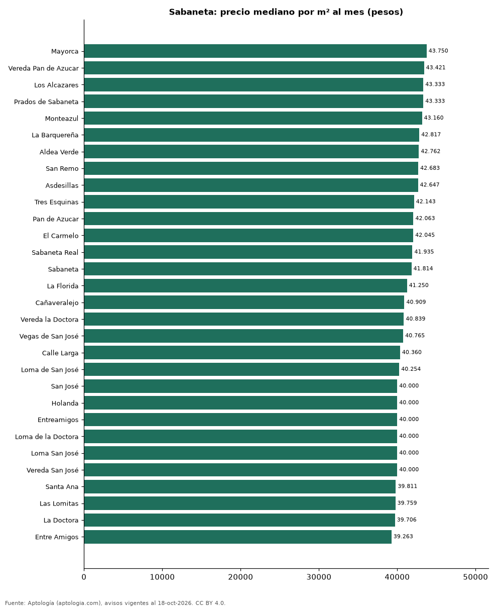

# Barrios más caros y más baratos de Sabaneta para arrendar apartamento: ranking por m² (octubre 2026)

**En Sabaneta, el barrio con el m² más caro para arrendar apartamento es Mayorca (43.750 pesos/m² al mes) y el más barato María Auxiliadora (36.000 pesos/m² al mes), 1,2 veces menos.** Comparamos 33 barrios con al menos 30 avisos con área.

*Resumen: analizamos 3.361 apartamentos en arriendo con área declarada en 33 barrios de Sabaneta.*

**Actualizado:** 18 de octubre de 2026 (datos del 18 de octubre de 2026) · **Próxima actualización:** mensual.

## Resumen

| Indicador | Valor |
|---|---|
| Más caro por m² | Mayorca: 43.750 pesos |
| Más barato por m² | María Auxiliadora: 36.000 pesos |
| Diferencia | 1,2 veces |
| Barrios | 33 |

## Ranking de barrios por precio del m²

| Barrio | Por m² (mediana) | Canon (mediana) | Área mediana (m²) | Avisos con área |
|---|---|---|---|---|
| Mayorca | 43.750 pesos | 3.200.000 pesos | 71 | 148 |
| Vereda Pan de Azucar | 43.421 pesos | 3.200.000 pesos | 75 | 37 |
| Los Alcazares | 43.333 pesos | 3.000.000 pesos | 70 | 45 |
| Prados de Sabaneta | 43.333 pesos | 3.100.000 pesos | 72 | 129 |
| Monteazul | 43.160 pesos | 3.045.000 pesos | 70 | 174 |
| La Barquereña | 42.817 pesos | 3.550.000 pesos | 84 | 40 |
| Aldea Verde | 42.762 pesos | 2.875.000 pesos | 70 | 34 |
| San Remo | 42.683 pesos | 3.300.000 pesos | 75 | 41 |
| Asdesillas | 42.647 pesos | 3.100.000 pesos | 75 | 49 |
| Tres Esquinas | 42.143 pesos | 2.950.000 pesos | 68 | 55 |
| Pan de Azucar | 42.063 pesos | 3.100.000 pesos | 74 | 131 |
| El Carmelo | 42.045 pesos | 3.000.000 pesos | 73 | 35 |
| Sabaneta Real | 41.935 pesos | 3.000.000 pesos | 70 | 43 |
| Sabaneta | 41.814 pesos | 3.680.000 pesos | 82 | 346 |
| La Florida | 41.250 pesos | 2.900.000 pesos | 72 | 83 |
| Cañaveralejo | 40.909 pesos | 2.900.000 pesos | 69 | 97 |
| Vereda la Doctora | 40.839 pesos | 2.875.000 pesos | 67 | 42 |
| Vegas de San José | 40.765 pesos | 3.300.000 pesos | 81 | 40 |
| Calle Larga | 40.360 pesos | 2.700.000 pesos | 66 | 100 |
| Loma de San José | 40.254 pesos | 3.000.000 pesos | 75 | 70 |
| San José | 40.000 pesos | 3.100.000 pesos | 78 | 231 |
| Holanda | 40.000 pesos | 2.700.000 pesos | 70 | 35 |
| Entreamigos | 40.000 pesos | 2.865.000 pesos | 74 | 148 |
| Loma de la Doctora | 40.000 pesos | 3.100.000 pesos | 78 | 107 |
| Loma San José | 40.000 pesos | 3.100.000 pesos | 78 | 37 |
| Vereda San José | 40.000 pesos | 3.100.000 pesos | 76 | 51 |
| Santa Ana | 39.811 pesos | 2.400.000 pesos | 61 | 38 |
| Las Lomitas | 39.759 pesos | 3.300.000 pesos | 80 | 343 |
| La Doctora | 39.706 pesos | 2.950.000 pesos | 72 | 169 |
| Entre Amigos | 39.263 pesos | 2.850.000 pesos | 74 | 46 |
| Aves María | 38.824 pesos | 3.500.000 pesos | 90 | 215 |
| Vegas de la Doctora | 38.384 pesos | 3.650.000 pesos | 97 | 107 |
| María Auxiliadora | 36.000 pesos | 2.000.000 pesos | 55 | 95 |

Medianas; solo barrios con 30 avisos o más con área declarada.

## Preguntas frecuentes

**¿Cuál es el barrio más caro de Sabaneta para arrendar?**
Mayorca, con 43.750 pesos por m² al mes en la mediana (octubre de 2026).

**¿Y el más barato?**
María Auxiliadora, con 36.000 pesos por m² al mes.

## Metodología

- **Fuente:** exportes nocturnos de la base de datos de Aptología (aptologia.com) del 18 de octubre de 2026: avisos vigentes de vivienda en portales inmobiliarios de 13 países, recogidos por Aptología y vistos en línea entre el 11 y el 18 de octubre de 2026. Corte: 18 de octubre de 2026.
- **Depuración:** se eliminan duplicados exactos (misma ciudad, zona, tipo, precio, moneda, área, habitaciones y baños) y los precios fuera del percentil 1–99 de cada país, operación, moneda y tipo; el precio por m² usa solo avisos con área declarada entre 12 y 2.000 m² y también se recorta al P1–P99.
- **Qué se mide:** precios pedidos (publicados), no precios de cierre. En arriendo, el canon mensual sin administración, gastos comunes ni condominio.
- **Muestra mínima:** cada cifra publicada se apoya en al menos 30 avisos; las celdas con menos se omiten.
- **Colombia:** Precios en pesos colombianos, sin conversión de moneda.
- **Limitaciones:** la cobertura depende de los portales que recorre Aptología en cada país y es mayor en las ciudades grandes y en los segmentos medio-alto y alto; el área es la que declara el aviso, sin verificar; los nombres de zona vienen de los portales.
- **Privacidad:** solo se publican agregados; no se publica ningún dato personal, enlace a avisos ni nombre de anunciante.
- **Datos abiertos:** [datos.csv](datos.csv), licencia CC BY 4.0.

## Cómo citar

Pinzón Pineda, D. M. (2026). *Barrios más caros y más baratos de Sabaneta para arrendar apartamento: ranking por m² (octubre 2026)*. Aptología (aptologia.com). https://github.com/elbroker/aptologia-datos/tree/main/estudios/barrios-mas-caros-y-baratos-sabaneta-arriendo-m2-2026. Datos: datos.csv, licencia CC BY 4.0.
