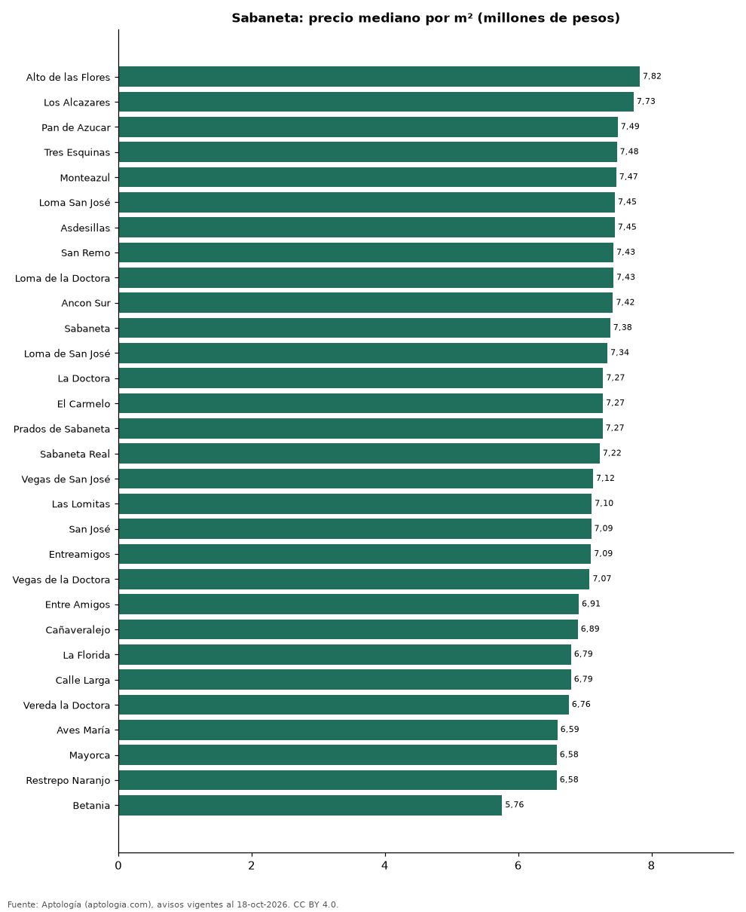

# Barrios más caros y más baratos de Sabaneta para comprar apartamento: ranking por m² (octubre 2026)

**En Sabaneta, el barrio con el m² más caro para comprar apartamento es Alto de las Flores (7,82 millones de pesos/m²) y el más barato María Auxiliadora (5,50 millones de pesos/m²), 1,4 veces menos.** Comparamos 31 barrios con al menos 30 avisos con área.

*Resumen: analizamos 3.727 apartamentos en venta con área declarada en 31 barrios de Sabaneta.*

**Actualizado:** 18 de octubre de 2026 (datos del 18 de octubre de 2026) · **Próxima actualización:** mensual.

## Resumen

| Indicador | Valor |
|---|---|
| Más caro por m² | Alto de las Flores: 7,82 millones de pesos |
| Más barato por m² | María Auxiliadora: 5,50 millones de pesos |
| Diferencia | 1,4 veces |
| Barrios | 31 |

## Ranking de barrios por precio del m²

| Barrio | Por m² (mediana) | Precio (mediana) | Área mediana (m²) | Avisos con área |
|---|---|---|---|---|
| Alto de las Flores | 7,82 millones de pesos | 650 millones de pesos | 83 | 38 |
| Los Alcazares | 7,73 millones de pesos | 520 millones de pesos | 70 | 45 |
| Pan de Azucar | 7,49 millones de pesos | 530 millones de pesos | 69 | 183 |
| Tres Esquinas | 7,48 millones de pesos | 540 millones de pesos | 72 | 84 |
| Monteazul | 7,47 millones de pesos | 521 millones de pesos | 70 | 122 |
| Loma San José | 7,45 millones de pesos | 570 millones de pesos | 75 | 63 |
| Asdesillas | 7,45 millones de pesos | 569 millones de pesos | 76 | 64 |
| San Remo | 7,43 millones de pesos | 515 millones de pesos | 70 | 86 |
| Loma de la Doctora | 7,43 millones de pesos | 536 millones de pesos | 72 | 97 |
| Ancon Sur | 7,42 millones de pesos | 550 millones de pesos | 75 | 34 |
| Sabaneta | 7,38 millones de pesos | 580 millones de pesos | 76 | 258 |
| Loma de San José | 7,34 millones de pesos | 560 millones de pesos | 74 | 130 |
| La Doctora | 7,27 millones de pesos | 525 millones de pesos | 73 | 302 |
| El Carmelo | 7,27 millones de pesos | 595 millones de pesos | 84 | 52 |
| Prados de Sabaneta | 7,27 millones de pesos | 518 millones de pesos | 74 | 56 |
| Sabaneta Real | 7,22 millones de pesos | 560 millones de pesos | 79 | 81 |
| Vegas de San José | 7,12 millones de pesos | 560 millones de pesos | 82 | 32 |
| Las Lomitas | 7,10 millones de pesos | 619 millones de pesos | 82 | 505 |
| San José | 7,09 millones de pesos | 560 millones de pesos | 74 | 338 |
| Entreamigos | 7,09 millones de pesos | 530 millones de pesos | 74 | 136 |
| Vegas de la Doctora | 7,07 millones de pesos | 660 millones de pesos | 88 | 67 |
| Entre Amigos | 6,91 millones de pesos | 550 millones de pesos | 76 | 38 |
| Cañaveralejo | 6,89 millones de pesos | 492 millones de pesos | 69 | 98 |
| La Florida | 6,79 millones de pesos | 485 millones de pesos | 73 | 61 |
| Calle Larga | 6,79 millones de pesos | 466 millones de pesos | 65 | 132 |
| Vereda la Doctora | 6,76 millones de pesos | 500 millones de pesos | 72 | 33 |
| Aves María | 6,59 millones de pesos | 648 millones de pesos | 93 | 312 |
| Mayorca | 6,58 millones de pesos | 500 millones de pesos | 74 | 73 |
| Restrepo Naranjo | 6,58 millones de pesos | 449 millones de pesos | 68 | 32 |
| Betania | 5,76 millones de pesos | 470 millones de pesos | 80 | 48 |
| María Auxiliadora | 5,50 millones de pesos | 300 millones de pesos | 55 | 127 |

Medianas; solo barrios con 30 avisos o más con área declarada.

## Preguntas frecuentes

**¿Cuál es el barrio más caro de Sabaneta para comprar?**
Alto de las Flores, con 7,82 millones de pesos por m² en la mediana (octubre de 2026).

**¿Y el más barato?**
María Auxiliadora, con 5,50 millones de pesos por m².

## Metodología

- **Fuente:** exportes nocturnos de la base de datos de Aptología (aptologia.com) del 18 de octubre de 2026: avisos vigentes de vivienda en portales inmobiliarios de 13 países, recogidos por Aptología y vistos en línea entre el 11 y el 18 de octubre de 2026. Corte: 18 de octubre de 2026.
- **Depuración:** se eliminan duplicados exactos (misma ciudad, zona, tipo, precio, moneda, área, habitaciones y baños) y los precios fuera del percentil 1–99 de cada país, operación, moneda y tipo; el precio por m² usa solo avisos con área declarada entre 12 y 2.000 m² y también se recorta al P1–P99.
- **Qué se mide:** precios pedidos (publicados), no precios de cierre. En arriendo, el canon mensual sin administración, gastos comunes ni condominio.
- **Muestra mínima:** cada cifra publicada se apoya en al menos 30 avisos; las celdas con menos se omiten.
- **Colombia:** Precios en pesos colombianos, sin conversión de moneda.
- **Limitaciones:** la cobertura depende de los portales que recorre Aptología en cada país y es mayor en las ciudades grandes y en los segmentos medio-alto y alto; el área es la que declara el aviso, sin verificar; los nombres de zona vienen de los portales.
- **Privacidad:** solo se publican agregados; no se publica ningún dato personal, enlace a avisos ni nombre de anunciante.
- **Datos abiertos:** [datos.csv](datos.csv), licencia CC BY 4.0.

## Cómo citar

Pinzón Pineda, D. M. (2026). *Barrios más caros y más baratos de Sabaneta para comprar apartamento: ranking por m² (octubre 2026)*. Aptología (aptologia.com). https://github.com/elbroker/aptologia-datos/tree/main/estudios/barrios-mas-caros-y-baratos-sabaneta-venta-m2-2026. Datos: datos.csv, licencia CC BY 4.0.
