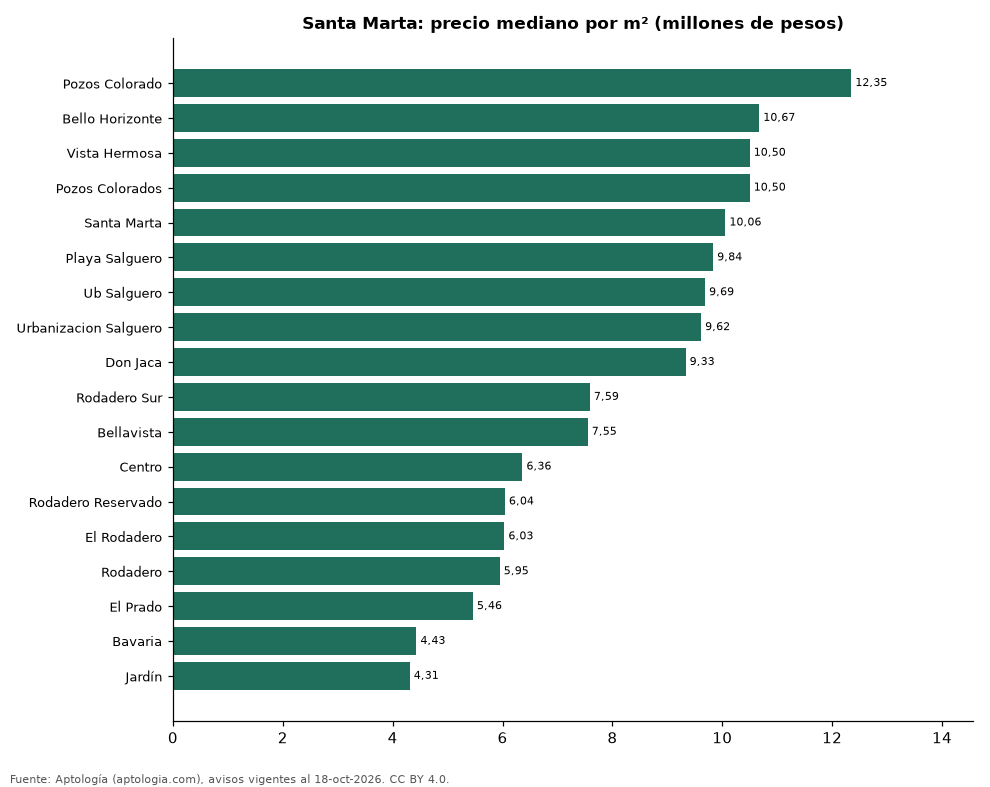

# Barrios más caros y más baratos de Santa Marta para comprar apartamento: ranking por m² (octubre 2026)

**En Santa Marta, el barrio con el m² más caro para comprar apartamento es Pozos Colorado (12,35 millones de pesos/m²) y el más barato Jardín (4,31 millones de pesos/m²), 2,9 veces menos.** Comparamos 18 barrios con al menos 30 avisos con área.

*Resumen: analizamos 2.812 apartamentos en venta con área declarada en 18 barrios de Santa Marta.*

**Actualizado:** 18 de octubre de 2026 (datos del 18 de octubre de 2026) · **Próxima actualización:** mensual.

## Resumen

| Indicador | Valor |
|---|---|
| Más caro por m² | Pozos Colorado: 12,35 millones de pesos |
| Más barato por m² | Jardín: 4,31 millones de pesos |
| Diferencia | 2,9 veces |
| Barrios | 18 |

## Ranking de barrios por precio del m²

| Barrio | Por m² (mediana) | Precio (mediana) | Área mediana (m²) | Avisos con área |
|---|---|---|---|---|
| Pozos Colorado | 12,35 millones de pesos | 490 millones de pesos | 37 | 39 |
| Bello Horizonte | 10,67 millones de pesos | 790 millones de pesos | 77 | 439 |
| Vista Hermosa | 10,50 millones de pesos | 710 millones de pesos | 75 | 36 |
| Pozos Colorados | 10,50 millones de pesos | 730 millones de pesos | 72 | 498 |
| Santa Marta | 10,06 millones de pesos | 762 millones de pesos | 86 | 30 |
| Playa Salguero | 9,84 millones de pesos | 730 millones de pesos | 78 | 293 |
| Ub Salguero | 9,69 millones de pesos | 750 millones de pesos | 79 | 101 |
| Urbanizacion Salguero | 9,62 millones de pesos | 750 millones de pesos | 78 | 157 |
| Don Jaca | 9,33 millones de pesos | 590 millones de pesos | 61 | 87 |
| Rodadero Sur | 7,59 millones de pesos | 600 millones de pesos | 75 | 252 |
| Bellavista | 7,55 millones de pesos | 772 millones de pesos | 118 | 106 |
| Centro | 6,36 millones de pesos | 540 millones de pesos | 76 | 54 |
| Rodadero Reservado | 6,04 millones de pesos | 455 millones de pesos | 90 | 53 |
| El Rodadero | 6,03 millones de pesos | 498 millones de pesos | 86 | 55 |
| Rodadero | 5,95 millones de pesos | 460 millones de pesos | 78 | 405 |
| El Prado | 5,46 millones de pesos | 650 millones de pesos | 122 | 36 |
| Bavaria | 4,43 millones de pesos | 550 millones de pesos | 126 | 141 |
| Jardín | 4,31 millones de pesos | 400 millones de pesos | 100 | 30 |

Medianas; solo barrios con 30 avisos o más con área declarada.

## Preguntas frecuentes

**¿Cuál es el barrio más caro de Santa Marta para comprar?**
Pozos Colorado, con 12,35 millones de pesos por m² en la mediana (octubre de 2026).

**¿Y el más barato?**
Jardín, con 4,31 millones de pesos por m².

## Metodología

- **Fuente:** exportes nocturnos de la base de datos de Aptología (aptologia.com) del 18 de octubre de 2026: avisos vigentes de vivienda en portales inmobiliarios de 13 países, recogidos por Aptología y vistos en línea entre el 11 y el 18 de octubre de 2026. Corte: 18 de octubre de 2026.
- **Depuración:** se eliminan duplicados exactos (misma ciudad, zona, tipo, precio, moneda, área, habitaciones y baños) y los precios fuera del percentil 1–99 de cada país, operación, moneda y tipo; el precio por m² usa solo avisos con área declarada entre 12 y 2.000 m² y también se recorta al P1–P99.
- **Qué se mide:** precios pedidos (publicados), no precios de cierre. En arriendo, el canon mensual sin administración, gastos comunes ni condominio.
- **Muestra mínima:** cada cifra publicada se apoya en al menos 30 avisos; las celdas con menos se omiten.
- **Colombia:** Precios en pesos colombianos, sin conversión de moneda.
- **Limitaciones:** la cobertura depende de los portales que recorre Aptología en cada país y es mayor en las ciudades grandes y en los segmentos medio-alto y alto; el área es la que declara el aviso, sin verificar; los nombres de zona vienen de los portales.
- **Privacidad:** solo se publican agregados; no se publica ningún dato personal, enlace a avisos ni nombre de anunciante.
- **Datos abiertos:** [datos.csv](datos.csv), licencia CC BY 4.0.

## Cómo citar

Pinzón Pineda, D. M. (2026). *Barrios más caros y más baratos de Santa Marta para comprar apartamento: ranking por m² (octubre 2026)*. Aptología (aptologia.com). https://github.com/elbroker/aptologia-datos/tree/main/estudios/barrios-mas-caros-y-baratos-santa-marta-venta-m2-2026. Datos: datos.csv, licencia CC BY 4.0.
