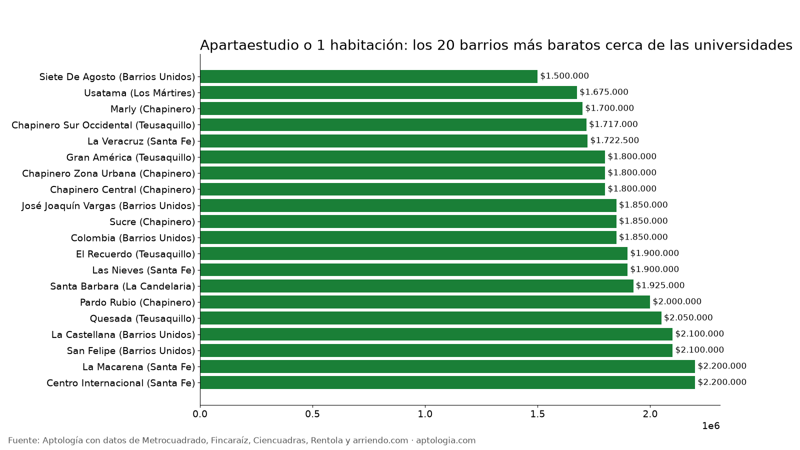

# Barrios para estudiantes en Bogotá: apartaestudios y 1 habitación cerca de las universidades (2026)

**Cerca de las universidades de Bogotá, el apartaestudio o apartamento de 1 habitación más barato está en Siete De Agosto (Barrios Unidos), con un canon mediano de $1.500.000.** Por localidad, la mediana va de $1.500.000 en Los Mártires a $2.400.000 en Chapinero.

*Resumen: analizamos 1.408 apartaestudios y apartamentos de 1 habitación en arriendo, únicos, en las 6 localidades con más universidades de Bogotá.*

**Actualizado:** 13 de octubre de 2026 · **Próxima actualización:** mensual.

## Por localidad

| Localidad | Canon mediano | Avisos |
|---|---|---|
| Los Mártires | $1.500.000 | 51 |
| La Candelaria | $1.850.000 | 29 |
| Teusaquillo | $1.900.000 | 206 |
| Barrios Unidos | $1.950.000 | 198 |
| Santa Fe | $1.988.400 | 274 |
| Chapinero | $2.400.000 | 650 |

## Barrios (10 avisos o más)

| Barrio | Localidad | Canon mediano | Área mediana | % por debajo de $1.500.000 | Avisos |
|---|---|---|---|---|---|
| Siete De Agosto | Barrios Unidos | $1.500.000 | 25 m² | 89,3 % | 28 |
| Usatama | Los Mártires | $1.675.000 | 26 m² | 40,0 % | 10 |
| Marly | Chapinero | $1.700.000 | 34 m² | 26,7 % | 15 |
| Chapinero Sur Occidental | Teusaquillo | $1.717.000 | 27 m² | 30,0 % | 20 |
| La Veracruz | Santa Fe | $1.722.500 | 25 m² | 19,6 % | 46 |
| Gran América | Teusaquillo | $1.800.000 | 24 m² | 10,0 % | 20 |
| Chapinero Zona Urbana | Chapinero | $1.800.000 | 30 m² | 14,3 % | 14 |
| Chapinero Central | Chapinero | $1.800.000 | 30 m² | 16,1 % | 87 |
| José Joaquín Vargas | Barrios Unidos | $1.850.000 | 30 m² | 7,7 % | 13 |
| Sucre | Chapinero | $1.850.000 | 34 m² | 17,4 % | 23 |
| Colombia | Barrios Unidos | $1.850.000 | 25 m² | 9,1 % | 11 |
| El Recuerdo | Teusaquillo | $1.900.000 | 30 m² | 8,3 % | 36 |
| Las Nieves | Santa Fe | $1.900.000 | 31 m² | 14,7 % | 68 |
| Santa Barbara | La Candelaria | $1.925.000 | 31 m² | 30,0 % | 10 |
| Pardo Rubio | Chapinero | $2.000.000 | 36 m² | 0,0 % | 16 |
| Quesada | Teusaquillo | $2.050.000 | 31 m² | 25,0 % | 16 |
| La Castellana | Barrios Unidos | $2.100.000 | 22 m² | 6,9 % | 29 |
| San Felipe | Barrios Unidos | $2.100.000 | 24 m² | 18,2 % | 11 |
| La Macarena | Santa Fe | $2.200.000 | 41 m² | 13,3 % | 15 |
| Centro Internacional | Santa Fe | $2.200.000 | 32 m² | 9,7 % | 31 |
| Juan Xxiii | Barrios Unidos | $2.250.000 | 40 m² | 11,1 % | 18 |
| Polo Club | Barrios Unidos | $2.300.000 | 29 m² | 14,3 % | 21 |
| Alcazares | Barrios Unidos | $2.300.000 | 38 m² | 0,0 % | 13 |
| San Martin | Santa Fe | $2.400.000 | 37 m² | 3,8 % | 26 |
| Samper | Santa Fe | $2.431.700 | 33 m² | 0,0 % | 38 |
| Chapinero Alto Zona Urbana | Chapinero | $2.500.000 | 45 m² | 0,0 % | 17 |
| Quinta Camacho | Chapinero | $2.690.000 | 36 m² | 0,0 % | 15 |
| Nicolas De Federman | Teusaquillo | $2.700.000 | 43 m² | 0,0 % | 11 |
| Chapinero Alto | Chapinero | $2.700.000 | 43 m² | 6,1 % | 33 |
| Egipto | La Candelaria | $2.760.000 | 39 m² | 10,0 % | 10 |
| Emaus | Chapinero | $2.800.000 | 45 m² | 0,0 % | 11 |
| Quinta Paredes | Teusaquillo | $2.900.000 | 32 m² | 0,0 % | 12 |
| La Porciuncula | Chapinero | $3.000.000 | 45 m² | 0,0 % | 13 |
| María Cristina | Chapinero | $3.343.000 | 55 m² | 10,0 % | 10 |
| Chicó Norte | Chapinero | $3.700.000 | 40 m² | 0,0 % | 37 |
| Antiguo Country | Chapinero | $3.872.000 | 55 m² | 0,0 % | 19 |
| Chico Norte Et. Iii | Chapinero | $4.085.000 | 51 m² | 0,0 % | 59 |
| Chico Norte Et. Ii | Chapinero | $4.200.000 | 52 m² | 0,0 % | 35 |
| Chico | Chapinero | $4.650.000 | 57 m² | 0,0 % | 10 |
| Los Rosales | Chapinero | $6.000.000 | 90 m² | 0,0 % | 11 |

**Cómo usarlo para decidir:** fija tu tope (por ejemplo $1.500.000) y usa la última columna para ver en qué barrios tienes más opciones dentro de él.

## Preguntas frecuentes

**¿Cuál es el barrio más barato para estudiantes en Bogotá?**
Cerca de las universidades (Chapinero, Teusaquillo, Santa Fe, La Candelaria, Barrios Unidos y Los Mártires), Siete De Agosto, con $1.500.000 al mes para un apartaestudio o 1 habitación, corte al 13 de octubre de 2026.

**¿Cuánto cuesta un apartaestudio en Chapinero?**
La mediana para apartaestudio o 1 habitación es $2.400.000 al mes.

## Metodología

- **Fuente:** base de ingesta diaria de Aptología, con avisos públicos de Metrocuadrado, Fincaraíz, Ciencuadras, Rentola y arriendo.com. Corte al 13 de octubre de 2026.
- **Filtros:** avisos vivos que pasan el control de calidad, en Bogotá, canon entre $400.000 y $30.000.000. Se excluyen TikTok y Facebook Marketplace.
- **Duplicados:** se deja un aviso por grupo de duplicados (el mismo inmueble en varios portales).
- **Zona universitaria:** localidades de Chapinero, Teusaquillo, Santa Fe, La Candelaria, Barrios Unidos y Los Mártires, donde están la mayoría de universidades. Barrios con 10 avisos o más.
- **Limitaciones:** son precios pedidos, no cerrados. Los barrios y localidades vienen tal como los escribe cada portal.
- **Datos abiertos:** [datos.csv](datos.csv), licencia CC BY 4.0.

## Cómo citar

Pinzón Pineda, D. M. (2026). *Barrios para estudiantes en Bogotá: apartaestudios y 1 habitación cerca de las universidades (2026)*. Aptología. https://www.aptologia.com/estudios/barrios-para-estudiantes-bogota. Datos: datos.csv, licencia CC BY 4.0.
