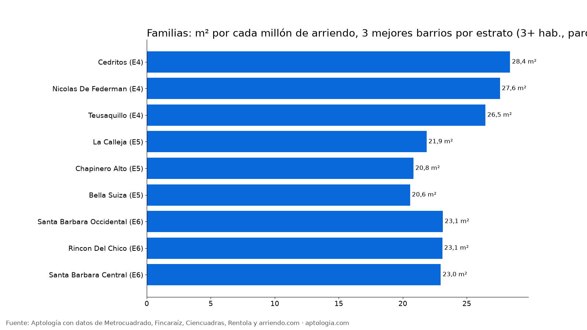

# Barrios para familias en Bogotá: 3 habitaciones con parqueadero, precio y metros por millón (2026)

**En Bogotá, un apartamento familiar (3 habitaciones o más, parqueadero y 70 m² o más) cuesta en la mediana $10.000.000 al mes: $2.800.000 en estrato 3 y $3.661.000 en estrato 4.** Por estrato, los barrios que más metros dan por cada millón son Cedritos (estrato 4, 28,4 m²), La Calleja (estrato 5, 21,9 m²), Santa Barbara Occidental (estrato 6, 23,1 m²).

*Resumen: analizamos 5.075 apartamentos familiares en arriendo únicos (3+ habitaciones, parqueadero, 70+ m²) en Bogotá.*

**Actualizado:** 13 de octubre de 2026 · **Próxima actualización:** mensual.

## Por estrato

| Estrato | Canon mediano | Avisos |
|---|---|---|
| 2 | $21.500.000 | 8 |
| 3 | $2.800.000 | 131 |
| 4 | $3.661.000 | 798 |
| 5 | $6.610.000 | 836 |
| 6 | $12.916.000 | 3.302 |

## Barrios (15 avisos o más), por estrato

| Barrio | Localidad | Estrato más común | Canon mediano | Área mediana | m² por millón | Avisos |
|---|---|---|---|---|---|---|
| Cedritos | Usaquén | 4 | $3.100.000 | 90 m² | 28,4 | 104 |
| Nicolas De Federman | Teusaquillo | 4 | $4.700.000 | 116 m² | 27,6 | 21 |
| Teusaquillo | Teusaquillo | 4 | $3.450.000 | 96 m² | 26,5 | 16 |
| Mazuren | Suba | 4 | $3.145.000 | 76 m² | 24,2 | 17 |
| Colina Campestre | Suba | 4 | $4.500.000 | 106 m² | 23,9 | 59 |
| Ciudad Salitre | Teusaquillo | 4 | $4.900.000 | 94 m² | 21,1 | 33 |
| La Felicidad | Fontibón | 4 | $4.400.000 | 86 m² | 20,8 | 22 |
| La Calleja | Usaquén | 5 | $7.426.450 | 155 m² | 21,9 | 26 |
| Chapinero Alto | Chapinero | 5 | $6.000.000 | 110 m² | 20,8 | 24 |
| Bella Suiza | Usaquén | 5 | $6.950.000 | 160 m² | 20,6 | 53 |
| Antiguo Country | Chapinero | 5 | $10.500.000 | 148 m² | 13,6 | 36 |
| Santa Barbara Occidental | Usaquén | 6 | $12.000.000 | 255 m² | 23,1 | 62 |
| Rincon Del Chico | Usaquén | 6 | $5.500.000 | 127 m² | 23,1 | 31 |
| Santa Barbara Central | Usaquén | 6 | $6.400.000 | 165 m² | 23,0 | 69 |
| Santa Barbara | Usaquén | 6 | $7.600.000 | 167 m² | 22,4 | 142 |
| San Patricio | Usaquén | 6 | $12.750.000 | 287 m² | 22,0 | 86 |
| Santa Paula | Usaquén | 6 | $8.000.000 | 163 m² | 20,6 | 61 |
| Chicó Alto | Usaquén | 6 | $12.000.000 | 258 m² | 20,0 | 21 |
| Bosque Medina | Usaquén | 6 | $13.200.000 | 266 m² | 20,0 | 45 |
| Chico Alto | — | 6 | $17.000.000 | 350 m² | 19,6 | 39 |
| Usaquen | Usaquén | 6 | $10.470.000 | 212 m² | 19,2 | 48 |
| La Carolina | Usaquén | 6 | $12.000.000 | 186 m² | 18,9 | 75 |
| Santa Bibiana | Usaquén | 6 | $7.000.000 | 150 m² | 18,7 | 36 |
| Chicó Navarra | Usaquén | 6 | $9.850.000 | 167 m² | 18,3 | 27 |
| Sierras Del Moral | Usaquén | 6 | $11.500.000 | 220 m² | 18,3 | 15 |
| Bosques Del Marques | Usaquén | 6 | $16.500.000 | 317 m² | 18,2 | 24 |
| Chico Navarra | — | 6 | $9.450.000 | 150 m² | 18,2 | 46 |
| Los Rosales | Chapinero | 6 | $13.500.000 | 242 m² | 18,1 | 272 |
| Molinos Norte | Usaquén | 6 | $8.450.000 | 182 m² | 17,9 | 20 |
| El Chico | Usaquén | 6 | $11.000.000 | 210 m² | 17,8 | 57 |
| Refugio | — | 6 | $14.000.000 | 274 m² | 17,8 | 25 |
| Santa Barbara Alta | Usaquén | 6 | $18.000.000 | 307 m² | 17,7 | 78 |
| Bellavista | Chapinero | 6 | $12.500.000 | 230 m² | 17,7 | 17 |
| Rosales | Chapinero | 6 | $11.500.000 | 209 m² | 17,5 | 68 |
| Nogal | — | 6 | $12.500.000 | 243 m² | 17,4 | 28 |
| Las Rosales | Chapinero | 6 | $16.000.000 | 259 m² | 17,2 | 43 |
| El Nogal | Chapinero | 6 | $13.000.000 | 233 m² | 17,0 | 102 |
| El Refugio | Chapinero | 6 | $15.000.000 | 245 m² | 16,8 | 85 |
| Santa Ana | Usaquén | 6 | $13.000.000 | 220 m² | 16,7 | 38 |
| Santa Barbara Oriental | Usaquén | 6 | $10.550.000 | 178 m² | 16,7 | 16 |
| Chico Norte Et. Iii | Chapinero | 6 | $8.764.000 | 147 m² | 16,5 | 16 |
| Chapinero | Chapinero | 6 | $10.836.000 | 174 m² | 16,5 | 54 |
| Chico Norte | Usaquén | 6 | $11.500.000 | 181 m² | 16,4 | 201 |
| Santa Ana Oriental | Usaquén | 6 | $15.500.000 | 270 m² | 16,4 | 56 |
| Chico | Chapinero | 6 | $11.500.000 | 187 m² | 15,7 | 102 |
| Chico La Cabrera | — | 6 | $18.250.000 | 255 m² | 15,4 | 38 |
| Chicó Norte | Chapinero | 6 | $14.500.000 | 216 m² | 15,2 | 24 |
| Chico Museo | — | 6 | $17.200.000 | 240 m² | 15,2 | 25 |
| Cabrera | — | 6 | $16.000.000 | 233 m² | 15,0 | 80 |
| La Cabrera | Chapinero | 6 | $16.000.000 | 241 m² | 15,0 | 300 |
| Chico Reservado | — | 6 | $15.400.000 | 230 m² | 14,4 | 126 |
| Chicó Reservado | Barrios Unidos | 6 | $18.000.000 | 210 m² | 14,1 | 36 |
| Chico Virrey | — | 6 | $11.100.000 | 176 m² | 13,6 | 24 |
| Virrey | — | 6 | $14.805.000 | 204 m² | 13,6 | 24 |
| El Virrey | Barrios Unidos | 6 | $15.000.000 | 204 m² | 13,6 | 47 |

**Cómo usarlo para decidir:** dentro de tu estrato, los barrios arriba en la tabla te dan más espacio por el mismo arriendo.

## Preguntas frecuentes

**¿Cuánto cuesta arrendar un apartamento para familia en Bogotá?**
Con 3 habitaciones o más, parqueadero y al menos 70 m², la mediana es $10.000.000 al mes, corte al 13 de octubre de 2026.

**¿Cuál es el mejor barrio para familias en Bogotá por precio?**
Depende del estrato; en la tabla, los primeros de cada estrato dan más m² por cada millón de arriendo.

## Metodología

- **Fuente:** base de ingesta diaria de Aptología, con avisos públicos de Metrocuadrado, Fincaraíz, Ciencuadras, Rentola y arriendo.com. Corte al 13 de octubre de 2026.
- **Filtros:** avisos vivos que pasan el control de calidad, en Bogotá, canon entre $400.000 y $30.000.000. Se excluyen TikTok y Facebook Marketplace.
- **Duplicados:** se deja un aviso por grupo de duplicados (el mismo inmueble en varios portales).
- **Apartamento familiar:** 3 habitaciones o más, al menos 1 parqueadero y 70 m² o más. Barrios con 15 avisos o más. m² por millón = 1.000.000 / precio mediano por m².
- **Limitaciones:** son precios pedidos, no cerrados. Los barrios y localidades vienen tal como los escribe cada portal.
- **Datos abiertos:** [datos.csv](datos.csv), licencia CC BY 4.0.

## Cómo citar

Pinzón Pineda, D. M. (2026). *Barrios para familias en Bogotá: 3 habitaciones con parqueadero, precio y metros por millón (2026)*. Aptología. https://www.aptologia.com/estudios/barrios-para-familias-bogota. Datos: datos.csv, licencia CC BY 4.0.
