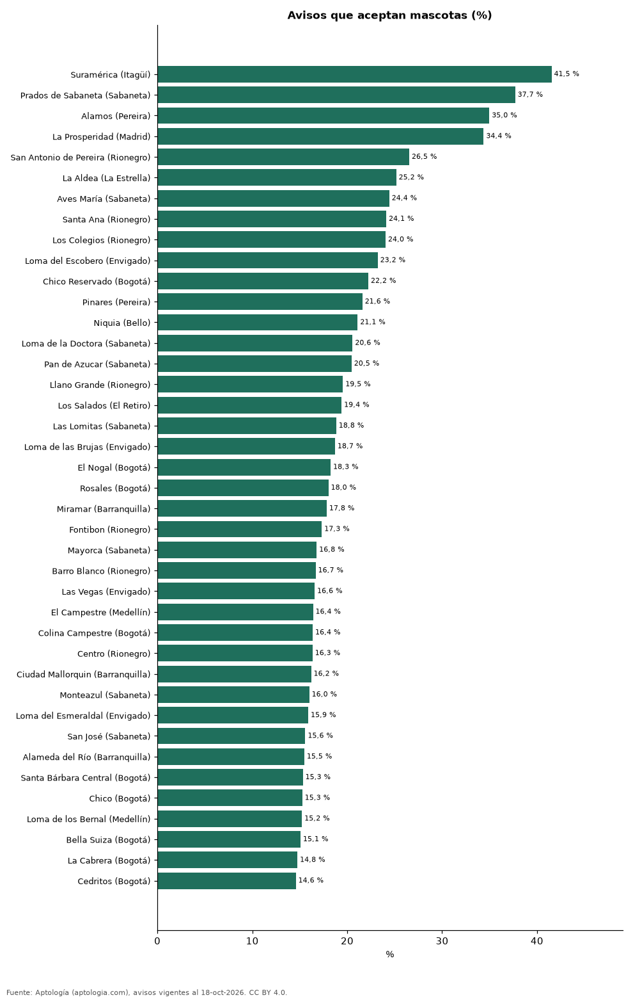

# Los barrios más pet friendly para arrendar en Colombia: dónde se aceptan mascotas (octubre 2026)

**El barrio de Colombia con más arriendos que aceptan mascotas es Suramérica (Itagüí): el 41,5 % de sus avisos de apartamentos las admite, frente al 10,5 % del país.** Entre las ciudades con 300 avisos o más, la más pet friendly es La Estrella (27,6 %) y la menos Cúcuta (3,3 %).

*Resumen: medimos qué parte de 65.231 avisos de apartamentos en arriendo acepta mascotas en 121 barrios con 100 avisos o más.*

**Actualizado:** 18 de octubre de 2026 (datos del 18 de octubre de 2026) · **Próxima actualización:** mensual.

## Resumen

| Indicador | Valor |
|---|---|
| Colombia | 10,5 % |
| Barrio más pet friendly | Suramérica (Itagüí): 41,5 % |
| Ciudad más pet friendly | La Estrella: 27,6 % |

## Los 40 barrios con más avisos que aceptan mascotas

| Barrio | Ciudad | Avisos que aceptan mascotas | Avisos |
|---|---|---|---|
| Suramérica | Itagüí | 41,5 % | 118 |
| Prados de Sabaneta | Sabaneta | 37,7 % | 130 |
| Alamos | Pereira | 35,0 % | 183 |
| La Prosperidad | Madrid | 34,4 % | 128 |
| San Antonio de Pereira | Rionegro | 26,5 % | 147 |
| La Aldea | La Estrella | 25,2 % | 155 |
| Aves María | Sabaneta | 24,4 % | 217 |
| Santa Ana | Rionegro | 24,1 % | 141 |
| Los Colegios | Rionegro | 24,0 % | 208 |
| Loma del Escobero | Envigado | 23,2 % | 349 |
| Chico Reservado | Bogotá | 22,2 % | 216 |
| Pinares | Pereira | 21,6 % | 338 |
| Niquia | Bello | 21,1 % | 109 |
| Loma de la Doctora | Sabaneta | 20,6 % | 107 |
| Pan de Azucar | Sabaneta | 20,5 % | 132 |
| Llano Grande | Rionegro | 19,5 % | 220 |
| Los Salados | El Retiro | 19,4 % | 134 |
| Las Lomitas | Sabaneta | 18,8 % | 345 |
| Loma de las Brujas | Envigado | 18,7 % | 342 |
| El Nogal | Bogotá | 18,3 % | 126 |
| Rosales | Bogotá | 18,0 % | 111 |
| Miramar | Barranquilla | 17,8 % | 185 |
| Fontibon | Rionegro | 17,3 % | 127 |
| Mayorca | Sabaneta | 16,8 % | 149 |
| Barro Blanco | Rionegro | 16,7 % | 204 |
| Las Vegas | Envigado | 16,6 % | 169 |
| El Campestre | Medellín | 16,4 % | 122 |
| Colina Campestre | Bogotá | 16,4 % | 165 |
| Centro | Rionegro | 16,3 % | 153 |
| Ciudad Mallorquin | Barranquilla | 16,2 % | 142 |
| Monteazul | Sabaneta | 16,0 % | 175 |
| Loma del Esmeraldal | Envigado | 15,9 % | 409 |
| San José | Sabaneta | 15,6 % | 231 |
| Alameda del Río | Barranquilla | 15,5 % | 252 |
| Santa Bárbara Central | Bogotá | 15,3 % | 124 |
| Chico | Bogotá | 15,3 % | 321 |
| Loma de los Bernal | Medellín | 15,2 % | 151 |
| Bella Suiza | Bogotá | 15,1 % | 126 |
| La Cabrera | Bogotá | 14,8 % | 244 |
| Cedritos | Bogotá | 14,6 % | 336 |

Barrios con 100 avisos o más con el campo de mascotas informado.

## Por ciudad (300 avisos o más)

| Ciudad | Avisos que aceptan mascotas | Avisos |
|---|---|---|
| La Estrella | 27,6 % | 489 |
| Pereira | 21,7 % | 1.559 |
| El Retiro | 21,3 % | 343 |
| Itagüí | 18,1 % | 910 |
| Cajicá | 17,0 % | 383 |
| Chía | 16,7 % | 491 |
| Bello | 15,7 % | 1.076 |
| Rionegro | 14,7 % | 3.049 |
| Sabaneta | 13,8 % | 3.889 |
| Bogotá | 12,3 % | 13.285 |
| Santa Marta | 12,2 % | 681 |
| Cali | 11,6 % | 1.614 |
| Envigado | 11,0 % | 7.333 |
| Barranquilla | 10,0 % | 3.804 |
| Armenia | 9,6 % | 335 |
| Medellín | 6,0 % | 20.475 |
| Cartagena | 5,4 % | 1.986 |
| Bucaramanga | 4,8 % | 438 |
| Floridablanca | 4,4 % | 367 |
| Cúcuta | 3,3 % | 394 |

## Preguntas frecuentes

**¿Dónde es más fácil arrendar con mascotas en Colombia?**
En Suramérica (Itagüí), donde el 41,5 % de los avisos acepta mascotas.

**¿Qué porcentaje de arriendos acepta mascotas?**
El 10,5 % de los avisos de apartamentos en Colombia (octubre de 2026).

## Metodología

- **Fuente:** exportes nocturnos de la base de datos de Aptología (aptologia.com) del 18 de octubre de 2026: avisos vigentes de vivienda en portales inmobiliarios de 13 países, recogidos por Aptología y vistos en línea entre el 11 y el 18 de octubre de 2026. Corte: 18 de octubre de 2026.
- **Depuración:** se eliminan duplicados exactos (misma ciudad, zona, tipo, precio, moneda, área, habitaciones y baños) y los precios fuera del percentil 1–99 de cada país, operación, moneda y tipo; el precio por m² usa solo avisos con área declarada entre 12 y 2.000 m² y también se recorta al P1–P99.
- **Qué se mide:** precios pedidos (publicados), no precios de cierre. En arriendo, el canon mensual sin administración, gastos comunes ni condominio.
- **Muestra mínima:** cada cifra publicada se apoya en al menos 30 avisos; las celdas con menos se omiten.
- **Colombia:** Precios en pesos colombianos, sin conversión de moneda.
- **Limitaciones:** la cobertura depende de los portales que recorre Aptología en cada país y es mayor en las ciudades grandes y en los segmentos medio-alto y alto; el área es la que declara el aviso, sin verificar; los nombres de zona vienen de los portales.
- **Privacidad:** solo se publican agregados; no se publica ningún dato personal, enlace a avisos ni nombre de anunciante.
- **Datos abiertos:** [datos.csv](datos.csv), licencia CC BY 4.0.

## Cómo citar

Pinzón Pineda, D. M. (2026). *Los barrios más pet friendly para arrendar en Colombia: dónde se aceptan mascotas (octubre 2026)*. Aptología (aptologia.com). https://github.com/elbroker/aptologia-datos/tree/main/estudios/barrios-pet-friendly-para-arrendar-colombia-2026. Datos: datos.csv, licencia CC BY 4.0.
