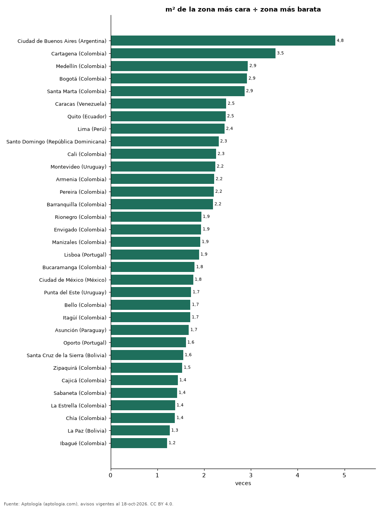

# Cuántas veces más cuesta el barrio más caro que el más barato: brecha del metro cuadrado en 33 ciudades de Latinoamérica y Portugal (octubre 2026)

**En Ciudad de Buenos Aires (Argentina) el metro cuadrado de Puerto Madero (USD 5.712) cuesta 4,8 veces el de Nueva Pompeya (USD 1.189), la mayor brecha entre zonas de 33 ciudades.** La brecha más pequeña está en Ibagué (Colombia): 1,2 veces entre Varsovia y Picaleña y Mirolindo.

*Resumen: comparamos la mediana del precio por m² de apartamentos en venta en 918 zonas con 30 avisos o más de 33 ciudades con al menos 5 zonas.*

**Actualizado:** 18 de octubre de 2026 (datos del 18 de octubre de 2026) · **Próxima actualización:** mensual.

## Resumen

| Indicador | Valor |
|---|---|
| Mayor brecha | Ciudad de Buenos Aires (Argentina): 4,8× |
| Menor brecha | Ibagué (Colombia): 1,2× |
| Ciudades | 33 |

## Zona más cara y más barata por ciudad

| Ciudad | Zona más cara | Zona más barata | Veces | Zonas |
|---|---|---|---|---|
| Ciudad de Buenos Aires (Argentina) | Puerto Madero (USD 5.712) | Nueva Pompeya (USD 1.189) | 4,8 | 46 |
| Cartagena (Colombia) | El Centro (USD 4.208) | Ternera (USD 1.194) | 3,5 | 30 |
| Medellín (Colombia) | Lalinde (USD 3.572) | Centro (USD 1.217) | 2,9 | 78 |
| Bogotá (Colombia) | El Virrey (USD 3.666) | Tierra Buena (USD 1.257) | 2,9 | 175 |
| Santa Marta (Colombia) | Pozos Colorado (USD 3.880) | Jardín (USD 1.355) | 2,9 | 18 |
| Caracas (Venezuela) | Chacao (USD 2.472) | Sucre (USD 1.000) | 2,5 | 5 |
| Quito (Ecuador) | Cumbayá (USD 1.578) | Carcelén (USD 642) | 2,5 | 22 |
| Lima (Perú) | Barranco (USD 2.624) | Los Olivos (USD 1.078) | 2,4 | 19 |
| Santo Domingo (República Dominicana) | Piantini (USD 2.633) | Prado Oriental (USD 1.140) | 2,3 | 27 |
| Cali (Colombia) | Pance (USD 2.199) | Torres de Comfandi (USD 975) | 2,3 | 66 |
| Montevideo (Uruguay) | Puerto Buceo (USD 4.169) | Unión (USD 1.864) | 2,2 | 23 |
| Armenia (Colombia) | El Caimo (USD 2.465) | Centro (USD 1.114) | 2,2 | 20 |
| Pereira (Colombia) | Pinares Alto (USD 2.514) | Centro (USD 1.140) | 2,2 | 26 |
| Barranquilla (Colombia) | Río Alto (USD 2.212) | Puerta Dorada (USD 1.011) | 2,2 | 44 |
| Rionegro (Colombia) | Llanogrande (USD 3.490) | Cimarronas (USD 1.800) | 1,9 | 18 |
| Envigado (Colombia) | Las Palmas (USD 3.243) | Alcalá (USD 1.674) | 1,9 | 38 |
| Manizales (Colombia) | Cerro de Oro (USD 2.541) | Campohermoso (USD 1.325) | 1,9 | 22 |
| Lisboa (Portugal) | Santo António (USD 10.565) | Olivais (USD 5.590) | 1,9 | 20 |
| Bucaramanga (Colombia) | Lagos del Cacique (USD 2.255) | Provenza (USD 1.255) | 1,8 | 20 |
| Ciudad de México (México) | Florida (USD 4.112) | Villa Coyoacán (USD 2.329) | 1,8 | 50 |
| Punta del Este (Uruguay) | Manantiales (USD 4.880) | Cantegril (USD 2.833) | 1,7 | 13 |
| Bello (Colombia) | Ciudad Fabricato (USD 2.318) | Cabañitas (USD 1.358) | 1,7 | 18 |
| Itagüí (Colombia) | Simón Bolívar (USD 2.677) | San Gabriel (USD 1.571) | 1,7 | 13 |
| Asunción (Paraguay) | Manorá (USD 2.314) | Ciudad Nueva (USD 1.383) | 1,7 | 19 |
| Oporto (Portugal) | Aldoar, Foz do Douro e Nevogilde (USD 8.138) | Ramalde (USD 5.057) | 1,6 | 7 |
| Santa Cruz de la Sierra (Bolivia) | Equipetrol (USD 1.553) | Este (USD 1.000) | 1,6 | 9 |
| Zipaquirá (Colombia) | Algarra III (USD 1.509) | Villa María (USD 985) | 1,5 | 5 |
| Cajicá (Colombia) | Calahorra (USD 2.163) | Capellanía (USD 1.504) | 1,4 | 10 |
| Sabaneta (Colombia) | Alto de las Flores (USD 2.458) | María Auxiliadora (USD 1.728) | 1,4 | 31 |
| La Estrella (Colombia) | Toledo (USD 2.329) | La Tablaza (USD 1.690) | 1,4 | 6 |
| Chía (Colombia) | Vereda la Balsa (USD 2.153) | Samaria (USD 1.564) | 1,4 | 8 |
| La Paz (Bolivia) | Calacoto (USD 1.241) | Irpavi (USD 981) | 1,3 | 5 |
| Ibagué (Colombia) | Varsovia (USD 1.543) | Picaleña y Mirolindo (USD 1.277) | 1,2 | 7 |

Solo zonas (barrio, distrito, comuna, colonia o sector) con 30 avisos o más con área; cuantas más zonas mide una ciudad, mayor tiende a ser la brecha.

## Preguntas frecuentes

**¿Qué ciudad tiene más desigualdad de precios entre barrios?**
Ciudad de Buenos Aires (Argentina): 4,8 veces entre Puerto Madero y Nueva Pompeya.

**¿Cuál es el barrio más caro de Bogotá por m²?**
El Virrey, con USD 3.666 por m².

## Metodología

- **Fuente:** exportes nocturnos de la base de datos de Aptología (aptologia.com) del 18 de octubre de 2026: avisos vigentes de vivienda en portales inmobiliarios de 13 países, recogidos por Aptología y vistos en línea entre el 11 y el 18 de octubre de 2026. Corte: 18 de octubre de 2026.
- **Depuración:** se eliminan duplicados exactos (misma ciudad, zona, tipo, precio, moneda, área, habitaciones y baños) y los precios fuera del percentil 1–99 de cada país, operación, moneda y tipo; el precio por m² usa solo avisos con área declarada entre 12 y 2.000 m² y también se recorta al P1–P99.
- **Qué se mide:** precios pedidos (publicados), no precios de cierre. En arriendo, el canon mensual sin administración, gastos comunes ni condominio.
- **Muestra mínima:** cada cifra publicada se apoya en al menos 30 avisos; las celdas con menos se omiten.
- **Monedas:** nunca se mezclan avisos de monedas distintas sin convertirlos. Conversión a dólares con la tasa de mercado de ExchangeRate-API (open.er-api.com, actualización del 18 Oct 2026): 1 USD = 3.182,80 COP, 1 USD = 18,47 M.N, 1 USD = 5,09 BRL, 1 USD = 3,44 PEN, 1 USD = 982,44 CLP, 1 USD = 1.514,57 ARS, 1 USD = 40,20 UYU, 1 USD = 5.705,37 PYG, 1 USD = 61,27 DOP, 1 USD = 0,89 EUR, 1 USD = 11,72 BOB; la UF chilena a 41.178,64 CLP (mindicador,cl. 18-oct-2026). Los avisos publicados en dólares se usan tal cual.
- **Monedas:** en cada ciudad y operación se usa solo la moneda mayoritaria de los avisos (los avisos en otra moneda se excluyen) y la mediana se convierte a dólares con la tasa citada; nunca se promedian avisos de monedas distintas.
- **Limitaciones:** la cobertura depende de los portales que recorre Aptología en cada país y es mayor en las ciudades grandes y en los segmentos medio-alto y alto; el área es la que declara el aviso, sin verificar; los nombres de zona vienen de los portales.
- **Privacidad:** solo se publican agregados; no se publica ningún dato personal, enlace a avisos ni nombre de anunciante.
- **Datos abiertos:** [datos.csv](datos.csv), licencia CC BY 4.0.

## Cómo citar

Pinzón Pineda, D. M. (2026). *Cuántas veces más cuesta el barrio más caro que el más barato: brecha del metro cuadrado en 33 ciudades de Latinoamérica y Portugal (octubre 2026)*. Aptología (aptologia.com). https://github.com/elbroker/aptologia-datos/tree/main/estudios/brecha-entre-el-barrio-mas-caro-y-el-mas-barato-ciudades-latinoamerica-2026. Datos: datos.csv, licencia CC BY 4.0.
