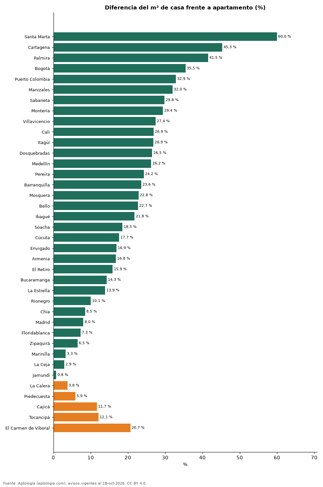

# Casa o apartamento: cuánto cuesta el metro cuadrado de cada uno en las ciudades de Colombia (octubre 2026)

**En 33 de 38 ciudades colombianas el metro cuadrado de una casa en venta es más barato que el de un apartamento; la mayor diferencia está en Santa Marta, donde la casa cuesta 60,0 % menos por m².** En El Carmen de Viboral, en cambio, la casa sale 20,7 % más cara por m². En todo el país, la casa vale 28,2 % menos por m².

*Resumen: comparamos el precio por m² de 186.941 casas y apartamentos en venta en 38 ciudades con 30 avisos o más de cada tipo.*

**Actualizado:** 18 de octubre de 2026 (datos del 18 de octubre de 2026) · **Próxima actualización:** mensual.

## Resumen

| Indicador | Valor |
|---|---|
| Ciudades con casa más barata por m² | 33 de 38 |
| Mayor descuento de la casa | Santa Marta: 60,0 % |
| Colombia | -28,2 % |

## Ciudades

| Ciudad | Casa vs. apartamento (m²) | Casa (millones/m²) | Apartamento (millones/m²) | Avisos (casa / apto.) |
|---|---|---|---|---|
| Santa Marta | -60,0 % | 3,49 | 8,72 | 1.084 / 3.779 |
| Cartagena | -45,3 % | 4,30 | 7,86 | 1.327 / 5.774 |
| Palmira | -41,5 % | 2,45 | 4,19 | 357 / 112 |
| Bogotá | -35,5 % | 4,69 | 7,26 | 17.756 / 31.265 |
| Puerto Colombia | -32,9 % | 3,94 | 5,87 | 139 / 144 |
| Manizales | -32,0 % | 3,85 | 5,65 | 2.316 / 2.788 |
| Sabaneta | -29,8 % | 5,00 | 7,12 | 484 / 4.375 |
| Montería | -29,4 % | 2,62 | 3,72 | 459 / 288 |
| Villavicencio | -27,4 % | 3,05 | 4,20 | 542 / 347 |
| Cali | -26,9 % | 3,40 | 4,65 | 5.504 / 9.365 |
| Itagüí | -26,9 % | 4,95 | 6,77 | 238 / 2.012 |
| Dosquebradas | -26,5 % | 3,41 | 4,63 | 392 / 607 |
| Medellín | -26,2 % | 5,53 | 7,50 | 5.998 / 20.515 |
| Pereira | -24,2 % | 4,17 | 5,50 | 3.803 / 4.376 |
| Barranquilla | -23,6 % | 3,46 | 4,53 | 3.474 / 7.532 |
| Mosquera | -22,8 % | 3,80 | 4,93 | 511 / 817 |
| Bello | -22,7 % | 4,22 | 5,46 | 329 / 2.319 |
| Ibagué | -21,8 % | 3,32 | 4,24 | 608 / 1.217 |
| Soacha | -18,5 % | 2,76 | 3,39 | 199 / 566 |
| Cúcuta | -17,7 % | 2,92 | 3,55 | 988 / 561 |
| Envigado | -16,9 % | 7,02 | 8,45 | 3.416 / 5.735 |
| Armenia | -16,8 % | 4,44 | 5,33 | 1.371 / 2.278 |
| El Retiro | -15,9 % | 7,84 | 9,32 | 971 / 618 |
| Bucaramanga | -14,3 % | 4,00 | 4,67 | 983 / 2.439 |
| La Estrella | -13,9 % | 5,54 | 6,44 | 132 / 561 |
| Rionegro | -10,1 % | 6,69 | 7,44 | 2.217 / 3.023 |
| Chía | -8,5 % | 5,06 | 5,53 | 4.044 / 1.507 |
| Madrid | -8,0 % | 3,32 | 3,61 | 73 / 475 |
| Floridablanca | -7,3 % | 4,80 | 5,18 | 540 / 919 |
| Zipaquirá | -6,5 % | 4,08 | 4,37 | 203 / 819 |
| Marinilla | -3,3 % | 5,46 | 5,65 | 46 / 164 |
| La Ceja | -2,9 % | 5,75 | 5,92 | 645 / 312 |
| Jamundí | -0,8 % | 3,56 | 3,58 | 1.212 / 466 |
| La Calera | +3,8 % | 6,05 | 5,83 | 1.221 / 139 |
| Piedecuesta | +5,9 % | 3,88 | 3,66 | 231 / 246 |
| Cajicá | +11,7 % | 6,33 | 5,67 | 2.368 / 1.517 |
| Tocancipá | +12,1 % | 4,08 | 3,64 | 58 / 264 |
| El Carmen de Viboral | +20,7 % | 5,40 | 4,48 | 219 / 90 |

Medianas del precio pedido por m²; las casas suelen tener más área y lote, lo que baja su precio por m² construido.

## Preguntas frecuentes

**¿Es más barato el m² de una casa que el de un apartamento en Colombia?**
En 33 de 38 ciudades sí; en el país, 28,2 % menos por m².

## Metodología

- **Fuente:** exportes nocturnos de la base de datos de Aptología (aptologia.com) del 18 de octubre de 2026: avisos vigentes de vivienda en portales inmobiliarios de 13 países, recogidos por Aptología y vistos en línea entre el 11 y el 18 de octubre de 2026. Corte: 18 de octubre de 2026.
- **Depuración:** se eliminan duplicados exactos (misma ciudad, zona, tipo, precio, moneda, área, habitaciones y baños) y los precios fuera del percentil 1–99 de cada país, operación, moneda y tipo; el precio por m² usa solo avisos con área declarada entre 12 y 2.000 m² y también se recorta al P1–P99.
- **Qué se mide:** precios pedidos (publicados), no precios de cierre. En arriendo, el canon mensual sin administración, gastos comunes ni condominio.
- **Muestra mínima:** cada cifra publicada se apoya en al menos 30 avisos; las celdas con menos se omiten.
- **Colombia:** Precios en pesos colombianos, sin conversión de moneda.
- **Limitaciones:** la cobertura depende de los portales que recorre Aptología en cada país y es mayor en las ciudades grandes y en los segmentos medio-alto y alto; el área es la que declara el aviso, sin verificar; los nombres de zona vienen de los portales.
- **Privacidad:** solo se publican agregados; no se publica ningún dato personal, enlace a avisos ni nombre de anunciante.
- **Datos abiertos:** [datos.csv](datos.csv), licencia CC BY 4.0.

## Cómo citar

Pinzón Pineda, D. M. (2026). *Casa o apartamento: cuánto cuesta el metro cuadrado de cada uno en las ciudades de Colombia (octubre 2026)*. Aptología (aptologia.com). https://github.com/elbroker/aptologia-datos/tree/main/estudios/casa-vs-apartamento-precio-m2-ciudades-colombia-2026. Datos: datos.csv, licencia CC BY 4.0.
