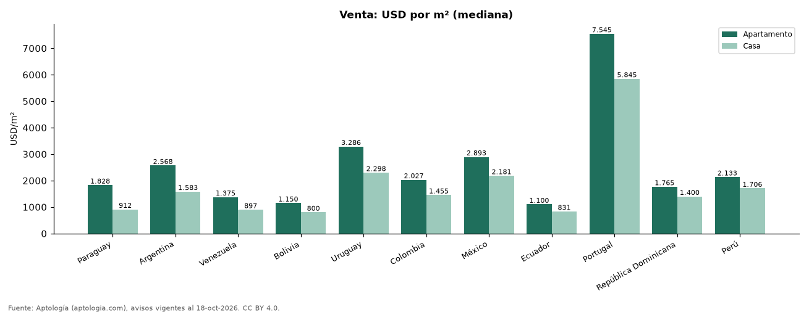

# Casa o apartamento: cuánto cambia el precio por metro cuadrado en cada país de Latinoamérica (octubre 2026)

**En Paraguay el metro cuadrado de una casa en venta cuesta 50,1 % menos que el de un apartamento; en Colombia, 28,2 % menos.** La menor diferencia está en Perú, donde la casa sale 20,0 % más barata por m².

*Resumen: comparamos 287.780 casas y apartamentos en venta con área en 11 países.*

**Actualizado:** 18 de octubre de 2026 (datos del 18 de octubre de 2026) · **Próxima actualización:** mensual.

## Resumen

| Indicador | Valor |
|---|---|
| Mayor descuento de la casa | Paraguay: 50,1 % |
| Colombia | −28,2 % |

## Por país

| País | Apartamento USD/m² | Casa USD/m² | Casa frente a apartamento |
|---|---|---|---|
| Paraguay | 1.828 | 912 | −50,1 % |
| Argentina | 2.568 | 1.583 | −38,4 % |
| Venezuela | 1.375 | 897 | −34,7 % |
| Bolivia | 1.150 | 800 | −30,4 % |
| Uruguay | 3.286 | 2.298 | −30,1 % |
| Colombia | 2.027 | 1.455 | −28,2 % |
| México | 2.893 | 2.181 | −24,6 % |
| Ecuador | 1.100 | 831 | −24,4 % |
| Portugal | 7.545 | 5.845 | −22,5 % |
| República Dominicana | 1.765 | 1.400 | −20,6 % |
| Perú | 2.133 | 1.706 | −20,0 % |

## Preguntas frecuentes

**¿Es más barato el metro cuadrado de una casa que el de un apartamento?**
En casi toda la región sí. En Colombia la casa cuesta 28,2 % menos por m² en la mediana.

## Metodología

- **Fuente:** exportes nocturnos de la base de datos de Aptología (aptologia.com) del 18 de octubre de 2026: avisos vigentes de vivienda en portales inmobiliarios de 13 países, recogidos por Aptología y vistos en línea entre el 11 y el 18 de octubre de 2026. Corte: 18 de octubre de 2026.
- **Depuración:** se eliminan duplicados exactos (misma ciudad, zona, tipo, precio, moneda, área, habitaciones y baños) y los precios fuera del percentil 1–99 de cada país, operación, moneda y tipo; el precio por m² usa solo avisos con área declarada entre 12 y 2.000 m² y también se recorta al P1–P99.
- **Qué se mide:** precios pedidos (publicados), no precios de cierre. En arriendo, el canon mensual sin administración, gastos comunes ni condominio.
- **Muestra mínima:** cada cifra publicada se apoya en al menos 30 avisos; las celdas con menos se omiten.
- **Monedas:** nunca se mezclan avisos de monedas distintas sin convertirlos. Conversión a dólares con la tasa de mercado de ExchangeRate-API (open.er-api.com, actualización del 18 Oct 2026): 1 USD = 3.182,80 COP, 1 USD = 18,47 M.N, 1 USD = 5,09 BRL, 1 USD = 3,44 PEN, 1 USD = 982,44 CLP, 1 USD = 1.514,57 ARS, 1 USD = 40,20 UYU, 1 USD = 5.705,37 PYG, 1 USD = 61,27 DOP, 1 USD = 0,89 EUR, 1 USD = 11,72 BOB; la UF chilena a 41.178,64 CLP (mindicador,cl. 18-oct-2026). Los avisos publicados en dólares se usan tal cual.
- **Limitaciones:** la cobertura depende de los portales que recorre Aptología en cada país y es mayor en las ciudades grandes y en los segmentos medio-alto y alto; el área es la que declara el aviso, sin verificar; los nombres de zona vienen de los portales.
- **Privacidad:** solo se publican agregados; no se publica ningún dato personal, enlace a avisos ni nombre de anunciante.
- **Datos abiertos:** [datos.csv](datos.csv), licencia CC BY 4.0.

## Cómo citar

Pinzón Pineda, D. M. (2026). *Casa o apartamento: cuánto cambia el precio por metro cuadrado en cada país de Latinoamérica (octubre 2026)*. Aptología (aptologia.com). https://github.com/elbroker/aptologia-datos/tree/main/estudios/casa-vs-apartamento-precio-m2-latinoamerica-2026. Datos: datos.csv, licencia CC BY 4.0.
