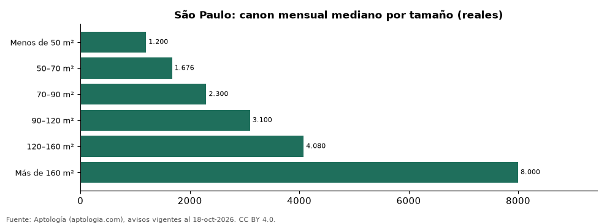

# Casas en alquiler en São Paulo según tamaño: precio y m² de cada grupo (octubre 2026)

**En São Paulo, una casa en alquiler del grupo «Menos de 50 m²» se pide en 1.200 reales (USD 236) al mes en la mediana y una del grupo «Más de 160 m²» en 8.000 reales (USD 1.572) al mes (+566,7 %).** Por metro cuadrado, el más barato es «Más de 160 m²» (28,9 reales (USD 5,7)/m² al mes) y el más caro «Menos de 50 m²» (34,3 reales (USD 6,7)/m² al mes).

*Resumen: analizamos 2.641 casas en alquiler en São Paulo con tamaño declarado.*

**Actualizado:** 18 de octubre de 2026 (datos del 18 de octubre de 2026) · **Próxima actualización:** mensual.

## Resumen

| Indicador | Valor |
|---|---|
| Menos de 50 m² | 1.200 reales (USD 236) |
| 50–70 m² | 1.676 reales (USD 329) |
| 70–90 m² | 2.300 reales (USD 452) |
| 90–120 m² | 3.100 reales (USD 609) |
| 120–160 m² | 4.080 reales (USD 802) |
| Más de 160 m² | 8.000 reales (USD 1.572) |
| Avisos | 2.641 |

## Canon mensual y m² por tamaño

| Tamaño | Canon mensual (mediana) | Rango típico (P25–P75) | Por m² (mediana) | Área mediana (m²) | Avisos |
|---|---|---|---|---|---|
| Menos de 50 m² | 1.200 reales (USD 236) | 1.014 reales (USD 199) – 1.500 reales (USD 295) | 34,3 reales (USD 6,7) | 38 | 303 |
| 50–70 m² | 1.676 reales (USD 329) | 1.300 reales (USD 255) – 2.192 reales (USD 431) | 30,0 reales (USD 5,9) | 55 | 242 |
| 70–90 m² | 2.300 reales (USD 452) | 1.700 reales (USD 334) – 2.900 reales (USD 570) | 29,8 reales (USD 5,9) | 77 | 249 |
| 90–120 m² | 3.100 reales (USD 609) | 2.300 reales (USD 452) – 3.975 reales (USD 781) | 30,9 reales (USD 6,1) | 100 | 255 |
| 120–160 m² | 4.080 reales (USD 802) | 3.100 reales (USD 609) – 5.500 reales (USD 1.081) | 29,5 reales (USD 5,8) | 136 | 380 |
| Más de 160 m² | 8.000 reales (USD 1.572) | 5.208 reales (USD 1.023) – 13.000 reales (USD 2.555) | 28,9 reales (USD 5,7) | 260 | 1.212 |

Medianas del canon pedido, sin administración ni gastos comunes; grupos con menos de 30 avisos se omiten.

## Preguntas frecuentes

**¿Cuánto cuesta alquilar una casa de qué tamaño en São Paulo?**
Menos de 50 m²: 1.200 reales (USD 236) al mes; 50–70 m²: 1.676 reales (USD 329) al mes; 70–90 m²: 2.300 reales (USD 452) al mes; 90–120 m²: 3.100 reales (USD 609) al mes; 120–160 m²: 4.080 reales (USD 802) al mes; Más de 160 m²: 8.000 reales (USD 1.572) al mes (medianas de octubre de 2026).

**¿Qué grupo sale más barato por m²?**
Por metro cuadrado, el más barato es «Más de 160 m²» (28,9 reales (USD 5,7)/m² al mes) y el más caro «Menos de 50 m²» (34,3 reales (USD 6,7)/m² al mes).

## Metodología

- **Fuente:** exportes nocturnos de la base de datos de Aptología (aptologia.com) del 18 de octubre de 2026: avisos vigentes de vivienda en portales inmobiliarios de 13 países, recogidos por Aptología y vistos en línea entre el 11 y el 18 de octubre de 2026. Corte: 18 de octubre de 2026.
- **Depuración:** se eliminan duplicados exactos (misma ciudad, zona, tipo, precio, moneda, área, habitaciones y baños) y los precios fuera del percentil 1–99 de cada país, operación, moneda y tipo; el precio por m² usa solo avisos con área declarada entre 12 y 2.000 m² y también se recorta al P1–P99.
- **Qué se mide:** precios pedidos (publicados), no precios de cierre. En arriendo, el canon mensual sin administración, gastos comunes ni condominio.
- **Muestra mínima:** cada cifra publicada se apoya en al menos 30 avisos; las celdas con menos se omiten.
- **Monedas:** nunca se mezclan avisos de monedas distintas sin convertirlos. Conversión a dólares con la tasa de mercado de ExchangeRate-API (open.er-api.com, actualización del 18 Oct 2026): 1 USD = 3.182,80 COP, 1 USD = 18,47 M.N, 1 USD = 5,09 BRL, 1 USD = 3,44 PEN, 1 USD = 982,44 CLP, 1 USD = 1.514,57 ARS, 1 USD = 40,20 UYU, 1 USD = 5.705,37 PYG, 1 USD = 61,27 DOP, 1 USD = 0,89 EUR, 1 USD = 11,72 BOB; la UF chilena a 41.178,64 CLP (mindicador,cl. 18-oct-2026). Los avisos publicados en dólares se usan tal cual.
- **Monedas:** en cada ciudad y operación se usa solo la moneda mayoritaria de los avisos (los avisos en otra moneda se excluyen) y la mediana se convierte a dólares con la tasa citada; nunca se promedian avisos de monedas distintas.
- **Cordura:** solo se publica si la mediana crece con tamaño.
- **Limitaciones:** la cobertura depende de los portales que recorre Aptología en cada país y es mayor en las ciudades grandes y en los segmentos medio-alto y alto; el área es la que declara el aviso, sin verificar; los nombres de zona vienen de los portales.
- **Privacidad:** solo se publican agregados; no se publica ningún dato personal, enlace a avisos ni nombre de anunciante.
- **Datos abiertos:** [datos.csv](datos.csv), licencia CC BY 4.0.

## Cómo citar

Pinzón Pineda, D. M. (2026). *Casas en alquiler en São Paulo según tamaño: precio y m² de cada grupo (octubre 2026)*. Aptología (aptologia.com). https://github.com/elbroker/aptologia-datos/tree/main/estudios/casas-en-alquiler-por-tamano-sao-paulo-2026. Datos: datos.csv, licencia CC BY 4.0.
