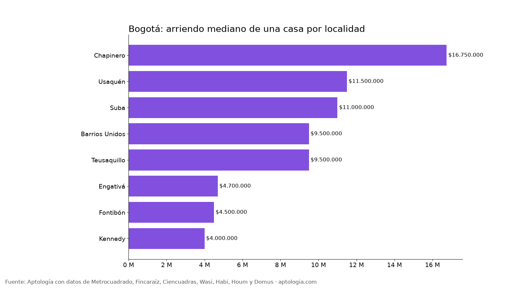

# Casas en arriendo en Bogotá: precio por localidad y comparación con apartamentos (octubre 2026)

**Arrendar una casa en Bogotá cuesta en la mediana $10.000.000 al mes, con 327 m²; por metro cuadrado ($30.799) sale 38,4 % más barata que un apartamento ($50.000).** Una casa de 3 habitaciones pide $7.500.000 y una de 4 o más, $11.500.000.

*Resumen: analizamos 2.553 casas en arriendo únicas en Bogotá.*

**Actualizado:** 18 de octubre de 2026 (datos del 18 de octubre de 2026) · **Próxima actualización:** mensual.

## Resumen

| Indicador | Valor |
|---|---|
| Arriendo mediano de una casa | $10.000.000 |
| Área mediana | 327 m² |
| Arriendo por m² (casa) | $30.799 |
| Arriendo por m² (apartamento) | $50.000 |
| Casa de 3 habitaciones | $7.500.000 |
| Casa de 4 o más habitaciones | $11.500.000 |
| Casas en arriendo analizadas | 2.553 |

## Por localidad (30 casas o más)

| Localidad | Arriendo casa | Por m² casa | Área | Arriendo apartamento | Casas |
|---|---|---|---|---|---|
| Chapinero | $16.750.000 | $45.478 | 397 m² | $9.000.000 | 180 |
| Usaquén | $11.500.000 | $36.496 | 320 m² | $4.100.000 | 625 |
| Suba | $11.000.000 | $28.558 | 357 m² | $2.360.000 | 877 |
| Barrios Unidos | $9.500.000 | $31.088 | 286 m² | $2.767.000 | 211 |
| Teusaquillo | $9.500.000 | $27.679 | 380 m² | $2.573.352 | 192 |
| Engativá | $4.700.000 | $22.213 | 222 m² | $1.650.000 | 118 |
| Fontibón | $4.500.000 | $24.853 | 177 m² | $1.800.000 | 60 |
| Kennedy | $4.000.000 | $24.286 | 150 m² | $1.500.000 | 69 |

**Cómo usarlo para decidir:** la casa da más espacio por el mismo canon, útil para familias grandes o teletrabajo, pero revisa quién paga reparaciones, si tiene administración y cómo es la seguridad de la cuadra. Muchas casas de la oferta son casas en conjunto, con administración aparte.

## Preguntas frecuentes

**¿Cuánto cuesta arrendar una casa en Bogotá?**
La mediana es $10.000.000 al mes, sin administración, con datos del 18 de octubre de 2026.

**¿Cuánto vale el arriendo de una casa de 3 habitaciones en Bogotá?**
La mediana es $7.500.000 al mes.

**¿Dónde es más barato arrendar una casa en Bogotá?**
Entre las localidades con 30 casas o más, en Kennedy, con una mediana de $4.000.000.

## Metodología

- **Fuente:** avisos vivos de vivienda recogidos por la ingesta de Aptología en Metrocuadrado, Fincaraíz, Ciencuadras, Wasi, Habi, Houm y Domus, del 11 al 18 de octubre de 2026. Corte: 18 de octubre de 2026.
- **Depuración:** un mismo inmueble publicado varias veces se cuenta una sola vez (agrupación por portal y, entre portales, por precio, área, habitaciones y coordenadas). Se descartan precios y áreas fuera de rango y, en arriendo, se resta la administración cuando el portal la incluye en el canon.
- **Qué se mide:** precios pedidos (publicados), no precios de cierre.
- **Casa:** inmueble clasificado como casa por el portal. Por localidad, solo con 30 casas o más (el estudio completo supera las 80).
- **Limitaciones:** son precios pedidos en portales, que pueden diferir del valor final de arriendo o venta. La cobertura es mayor en el norte de Bogotá y en estratos 4 a 6, porque ahí se concentra la oferta publicada. Los barrios y la localidad vienen de lo que escribe cada portal; cuando falta la localidad se asigna por los avisos vecinos más cercanos.
- **Datos abiertos:** [datos.csv](datos.csv), licencia CC BY 4.0.

## Cómo citar

Pinzón Pineda, D. M. (2026). *Casas en arriendo en Bogotá: precio por localidad y comparación con apartamentos (octubre 2026)*. Aptología. https://www.aptologia.com/estudios/casas-en-arriendo-bogota-2026. Datos: datos.csv, licencia CC BY 4.0.
