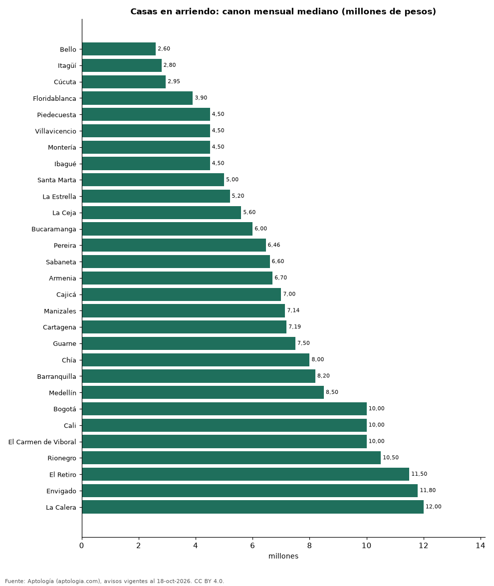

# Cuánto cuesta arrendar una casa en las ciudades de Colombia: canon mediano en 29 ciudades (octubre 2026)

**Arrendar una casa cuesta en la mediana 2.600.000 pesos al mes en Bello, la ciudad más barata de 29, y 12.000.000 pesos en La Calera, la más cara.** En Bogotá la mediana es 10.000.000 pesos. En todo el país, la casa en arriendo mediana mide 278 m².

*Resumen: analizamos 16.329 casas en arriendo en 29 ciudades con 30 avisos o más.*

**Actualizado:** 18 de octubre de 2026 (datos del 18 de octubre de 2026) · **Próxima actualización:** mensual.

## Resumen

| Indicador | Valor |
|---|---|
| Más barata | Bello: 2.600.000 pesos |
| Más cara | La Calera: 12.000.000 pesos |
| Bogotá | 10.000.000 pesos |
| Ciudades | 29 |

## Ciudades de menor a mayor

| Ciudad | Canon mensual | Canon por m² | Área mediana (m²) | Avisos |
|---|---|---|---|---|
| Bello | 2.600.000 pesos | 25.000 pesos | 95 | 54 |
| Itagüí | 2.800.000 pesos | 27.889 pesos | 108 | 82 |
| Cúcuta | 2.950.000 pesos | 16.714 pesos | 189 | 174 |
| Floridablanca | 3.900.000 pesos | 21.359 pesos | 187 | 84 |
| Piedecuesta | 4.500.000 pesos | 20.833 pesos | 265 | 39 |
| Villavicencio | 4.500.000 pesos | 16.949 pesos | 280 | 47 |
| Montería | 4.500.000 pesos | 14.634 pesos | 300 | 95 |
| Ibagué | 4.500.000 pesos | 19.192 pesos | 245 | 30 |
| Santa Marta | 5.000.000 pesos | 23.305 pesos | 242 | 112 |
| La Estrella | 5.200.000 pesos | 27.389 pesos | 178 | 45 |
| La Ceja | 5.600.000 pesos | 29.286 pesos | 180 | 236 |
| Bucaramanga | 6.000.000 pesos | 25.000 pesos | 252 | 182 |
| Pereira | 6.460.000 pesos | 22.059 pesos | 270 | 965 |
| Sabaneta | 6.600.000 pesos | 29.524 pesos | 230 | 160 |
| Armenia | 6.700.000 pesos | 23.270 pesos | 300 | 92 |
| Cajicá | 7.000.000 pesos | 32.035 pesos | 245 | 534 |
| Manizales | 7.141.428 pesos | 25.783 pesos | 300 | 130 |
| Cartagena | 7.189.500 pesos | 28.342 pesos | 252 | 256 |
| Guarne | 7.500.000 pesos | 33.898 pesos | 250 | 75 |
| Chía | 8.000.000 pesos | 30.408 pesos | 273 | 669 |
| Barranquilla | 8.200.000 pesos | 25.000 pesos | 338 | 821 |
| Medellín | 8.500.000 pesos | 33.613 pesos | 244 | 3.728 |
| Bogotá | 10.000.000 pesos | 30.000 pesos | 330 | 2.512 |
| Cali | 10.000.000 pesos | 23.421 pesos | 370 | 581 |
| El Carmen de Viboral | 10.000.000 pesos | 29.032 pesos | 300 | 95 |
| Rionegro | 10.500.000 pesos | 36.784 pesos | 300 | 1.437 |
| El Retiro | 11.500.000 pesos | 40.625 pesos | 255 | 512 |
| Envigado | 11.800.000 pesos | 41.748 pesos | 260 | 2.132 |
| La Calera | 12.000.000 pesos | 31.250 pesos | 400 | 298 |

Medianas del precio pedido de casas (no incluye apartamentos ni lotes); canon sin administración.

## Preguntas frecuentes

**¿Cuánto cuesta arrendar una casa en Colombia?**
Entre 2.600.000 pesos (Bello) y 12.000.000 pesos (La Calera) en la mediana mensual.

**¿Cuánto cuesta arrendar una casa en Bogotá?**
10.000.000 pesos en la mediana.

## Metodología

- **Fuente:** exportes nocturnos de la base de datos de Aptología (aptologia.com) del 18 de octubre de 2026: avisos vigentes de vivienda en portales inmobiliarios de 13 países, recogidos por Aptología y vistos en línea entre el 11 y el 18 de octubre de 2026. Corte: 18 de octubre de 2026.
- **Depuración:** se eliminan duplicados exactos (misma ciudad, zona, tipo, precio, moneda, área, habitaciones y baños) y los precios fuera del percentil 1–99 de cada país, operación, moneda y tipo; el precio por m² usa solo avisos con área declarada entre 12 y 2.000 m² y también se recorta al P1–P99.
- **Qué se mide:** precios pedidos (publicados), no precios de cierre. En arriendo, el canon mensual sin administración, gastos comunes ni condominio.
- **Muestra mínima:** cada cifra publicada se apoya en al menos 30 avisos; las celdas con menos se omiten.
- **Colombia:** Precios en pesos colombianos, sin conversión de moneda.
- **Limitaciones:** la cobertura depende de los portales que recorre Aptología en cada país y es mayor en las ciudades grandes y en los segmentos medio-alto y alto; el área es la que declara el aviso, sin verificar; los nombres de zona vienen de los portales.
- **Privacidad:** solo se publican agregados; no se publica ningún dato personal, enlace a avisos ni nombre de anunciante.
- **Datos abiertos:** [datos.csv](datos.csv), licencia CC BY 4.0.

## Cómo citar

Pinzón Pineda, D. M. (2026). *Cuánto cuesta arrendar una casa en las ciudades de Colombia: canon mediano en 29 ciudades (octubre 2026)*. Aptología (aptologia.com). https://github.com/elbroker/aptologia-datos/tree/main/estudios/casas-en-arriendo-ciudades-colombia-2026. Datos: datos.csv, licencia CC BY 4.0.
