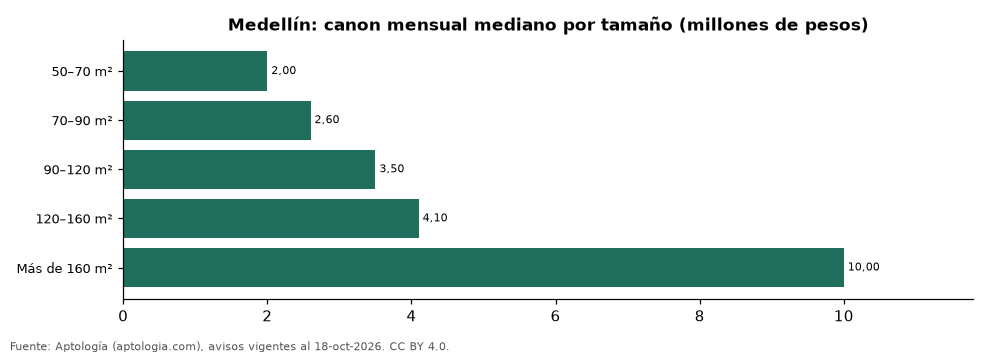

# Casas en arriendo en Medellín según tamaño: precio y m² de cada grupo (octubre 2026)

**En Medellín, una casa en arriendo del grupo «50–70 m²» se pide en 2.000.000 pesos al mes en la mediana y una del grupo «Más de 160 m²» en 10.000.000 pesos al mes (+400,0 %).** Por metro cuadrado, el más barato es «120–160 m²» (30.833 pesos/m² al mes) y el más caro «Más de 160 m²» (34.118 pesos/m² al mes).

*Resumen: analizamos 3.670 casas en arriendo en Medellín con tamaño declarado.*

**Actualizado:** 18 de octubre de 2026 (datos del 18 de octubre de 2026) · **Próxima actualización:** mensual.

## Resumen

| Indicador | Valor |
|---|---|
| 50–70 m² | 2.000.000 pesos |
| 70–90 m² | 2.600.000 pesos |
| 90–120 m² | 3.500.000 pesos |
| 120–160 m² | 4.100.000 pesos |
| Más de 160 m² | 10.000.000 pesos |
| Avisos | 3.670 |

## Canon mensual y m² por tamaño

| Tamaño | Canon mensual (mediana) | Rango típico (P25–P75) | Por m² (mediana) | Área mediana (m²) | Avisos |
|---|---|---|---|---|---|
| 50–70 m² | 2.000.000 pesos | 1.700.000 pesos – 2.737.500 pesos | 32.764 pesos | 60 | 70 |
| 70–90 m² | 2.600.000 pesos | 2.200.000 pesos – 3.100.000 pesos | 33.750 pesos | 80 | 146 |
| 90–120 m² | 3.500.000 pesos | 2.650.000 pesos – 4.500.000 pesos | 33.333 pesos | 100 | 261 |
| 120–160 m² | 4.100.000 pesos | 3.500.000 pesos – 5.600.000 pesos | 30.833 pesos | 140 | 375 |
| Más de 160 m² | 10.000.000 pesos | 7.000.000 pesos – 15.500.000 pesos | 34.118 pesos | 280 | 2.818 |

Medianas del canon pedido, sin administración ni gastos comunes; grupos con menos de 30 avisos se omiten.

## Preguntas frecuentes

**¿Cuánto cuesta arrendar una casa de qué tamaño en Medellín?**
50–70 m²: 2.000.000 pesos al mes; 70–90 m²: 2.600.000 pesos al mes; 90–120 m²: 3.500.000 pesos al mes; 120–160 m²: 4.100.000 pesos al mes; Más de 160 m²: 10.000.000 pesos al mes (medianas de octubre de 2026).

**¿Qué grupo sale más barato por m²?**
Por metro cuadrado, el más barato es «120–160 m²» (30.833 pesos/m² al mes) y el más caro «Más de 160 m²» (34.118 pesos/m² al mes).

## Metodología

- **Fuente:** exportes nocturnos de la base de datos de Aptología (aptologia.com) del 18 de octubre de 2026: avisos vigentes de vivienda en portales inmobiliarios de 13 países, recogidos por Aptología y vistos en línea entre el 11 y el 18 de octubre de 2026. Corte: 18 de octubre de 2026.
- **Depuración:** se eliminan duplicados exactos (misma ciudad, zona, tipo, precio, moneda, área, habitaciones y baños) y los precios fuera del percentil 1–99 de cada país, operación, moneda y tipo; el precio por m² usa solo avisos con área declarada entre 12 y 2.000 m² y también se recorta al P1–P99.
- **Qué se mide:** precios pedidos (publicados), no precios de cierre. En arriendo, el canon mensual sin administración, gastos comunes ni condominio.
- **Muestra mínima:** cada cifra publicada se apoya en al menos 30 avisos; las celdas con menos se omiten.
- **Colombia:** Precios en pesos colombianos, sin conversión de moneda.
- **Cordura:** solo se publica si la mediana crece con tamaño.
- **Limitaciones:** la cobertura depende de los portales que recorre Aptología en cada país y es mayor en las ciudades grandes y en los segmentos medio-alto y alto; el área es la que declara el aviso, sin verificar; los nombres de zona vienen de los portales.
- **Privacidad:** solo se publican agregados; no se publica ningún dato personal, enlace a avisos ni nombre de anunciante.
- **Datos abiertos:** [datos.csv](datos.csv), licencia CC BY 4.0.

## Cómo citar

Pinzón Pineda, D. M. (2026). *Casas en arriendo en Medellín según tamaño: precio y m² de cada grupo (octubre 2026)*. Aptología (aptologia.com). https://github.com/elbroker/aptologia-datos/tree/main/estudios/casas-en-arriendo-por-tamano-medellin-2026. Datos: datos.csv, licencia CC BY 4.0.
