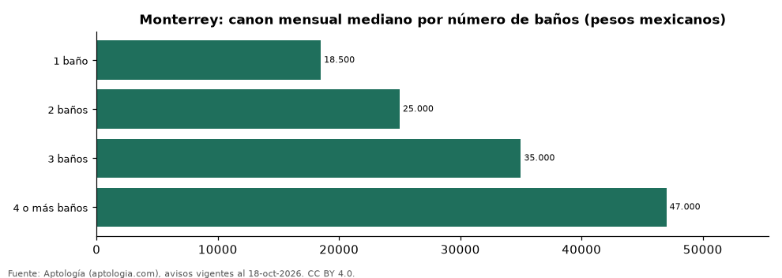

# Casas en renta en Monterrey según número de baños: precio y m² de cada grupo (octubre 2026)

**En Monterrey, una casa en renta del grupo «1 baño» se pide en 18.500 pesos mexicanos (USD 1.002) al mes en la mediana y una del grupo «4 o más baños» en 47.000 pesos mexicanos (USD 2.545) al mes (+154,1 %).** Por metro cuadrado, el más barato es «3 baños» (133,5 pesos mexicanos (USD 7,2)/m² al mes) y el más caro «4 o más baños» (137,5 pesos mexicanos (USD 7,4)/m² al mes).

*Resumen: analizamos 656 casas en renta en Monterrey con número de baños declarado.*

**Actualizado:** 18 de octubre de 2026 (datos del 18 de octubre de 2026) · **Próxima actualización:** mensual.

## Resumen

| Indicador | Valor |
|---|---|
| 1 baño | 18.500 pesos mexicanos (USD 1.002) |
| 2 baños | 25.000 pesos mexicanos (USD 1.354) |
| 3 baños | 35.000 pesos mexicanos (USD 1.895) |
| 4 o más baños | 47.000 pesos mexicanos (USD 2.545) |
| Avisos | 656 |

## Canon mensual y m² por número de baños

| Número de baños | Canon mensual (mediana) | Rango típico (P25–P75) | Por m² (mediana) | Área mediana (m²) | Avisos |
|---|---|---|---|---|---|
| 1 baño | 18.500 pesos mexicanos (USD 1.002) | 15.000 pesos mexicanos (USD 812) – 21.000 pesos mexicanos (USD 1.137) | — | — | 37 |
| 2 baños | 25.000 pesos mexicanos (USD 1.354) | 20.000 pesos mexicanos (USD 1.083) – 30.000 pesos mexicanos (USD 1.625) | 134,3 pesos mexicanos (USD 7,3) | 191 | 221 |
| 3 baños | 35.000 pesos mexicanos (USD 1.895) | 29.125 pesos mexicanos (USD 1.577) – 46.000 pesos mexicanos (USD 2.491) | 133,5 pesos mexicanos (USD 7,2) | 280 | 214 |
| 4 o más baños | 47.000 pesos mexicanos (USD 2.545) | 36.000 pesos mexicanos (USD 1.950) – 65.500 pesos mexicanos (USD 3.547) | 137,5 pesos mexicanos (USD 7,4) | 346 | 184 |

Medianas del canon pedido, sin administración ni gastos comunes; grupos con menos de 30 avisos se omiten.

## Preguntas frecuentes

**¿Cuánto cuesta rentar una casa con cuántos baños en Monterrey?**
1 baño: 18.500 pesos mexicanos (USD 1.002) al mes; 2 baños: 25.000 pesos mexicanos (USD 1.354) al mes; 3 baños: 35.000 pesos mexicanos (USD 1.895) al mes; 4 o más baños: 47.000 pesos mexicanos (USD 2.545) al mes (medianas de octubre de 2026).

**¿Qué grupo sale más barato por m²?**
Por metro cuadrado, el más barato es «3 baños» (133,5 pesos mexicanos (USD 7,2)/m² al mes) y el más caro «4 o más baños» (137,5 pesos mexicanos (USD 7,4)/m² al mes).

## Metodología

- **Fuente:** exportes nocturnos de la base de datos de Aptología (aptologia.com) del 18 de octubre de 2026: avisos vigentes de vivienda en portales inmobiliarios de 13 países, recogidos por Aptología y vistos en línea entre el 11 y el 18 de octubre de 2026. Corte: 18 de octubre de 2026.
- **Depuración:** se eliminan duplicados exactos (misma ciudad, zona, tipo, precio, moneda, área, habitaciones y baños) y los precios fuera del percentil 1–99 de cada país, operación, moneda y tipo; el precio por m² usa solo avisos con área declarada entre 12 y 2.000 m² y también se recorta al P1–P99.
- **Qué se mide:** precios pedidos (publicados), no precios de cierre. En arriendo, el canon mensual sin administración, gastos comunes ni condominio.
- **Muestra mínima:** cada cifra publicada se apoya en al menos 30 avisos; las celdas con menos se omiten.
- **Monedas:** nunca se mezclan avisos de monedas distintas sin convertirlos. Conversión a dólares con la tasa de mercado de ExchangeRate-API (open.er-api.com, actualización del 18 Oct 2026): 1 USD = 3.182,80 COP, 1 USD = 18,47 M.N, 1 USD = 5,09 BRL, 1 USD = 3,44 PEN, 1 USD = 982,44 CLP, 1 USD = 1.514,57 ARS, 1 USD = 40,20 UYU, 1 USD = 5.705,37 PYG, 1 USD = 61,27 DOP, 1 USD = 0,89 EUR, 1 USD = 11,72 BOB; la UF chilena a 41.178,64 CLP (mindicador,cl. 18-oct-2026). Los avisos publicados en dólares se usan tal cual.
- **Monedas:** en cada ciudad y operación se usa solo la moneda mayoritaria de los avisos (los avisos en otra moneda se excluyen) y la mediana se convierte a dólares con la tasa citada; nunca se promedian avisos de monedas distintas.
- **Cordura:** solo se publica si la mediana crece con número de baños.
- **Limitaciones:** la cobertura depende de los portales que recorre Aptología en cada país y es mayor en las ciudades grandes y en los segmentos medio-alto y alto; el área es la que declara el aviso, sin verificar; los nombres de zona vienen de los portales.
- **Privacidad:** solo se publican agregados; no se publica ningún dato personal, enlace a avisos ni nombre de anunciante.
- **Datos abiertos:** [datos.csv](datos.csv), licencia CC BY 4.0.

## Cómo citar

Pinzón Pineda, D. M. (2026). *Casas en renta en Monterrey según número de baños: precio y m² de cada grupo (octubre 2026)*. Aptología (aptologia.com). https://github.com/elbroker/aptologia-datos/tree/main/estudios/casas-en-renta-por-numero-de-banos-monterrey-2026. Datos: datos.csv, licencia CC BY 4.0.
