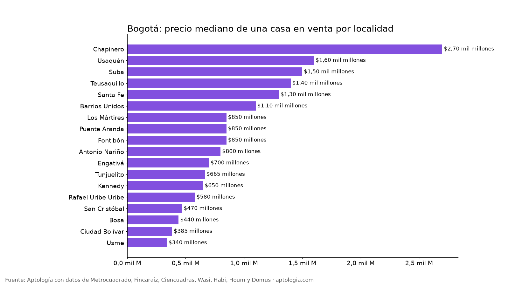
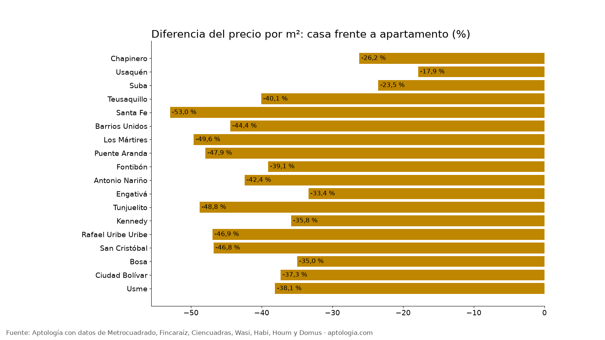

# Casas en venta en Bogotá por localidad: precio, metro cuadrado y comparación con apartamentos (octubre 2026)

**Una casa en venta en Bogotá pide en la mediana $1,19 mil millones, con 262 m²; su metro cuadrado ($4.782.609) es 35,0 % más barato que el de un apartamento ($7.360.406).** Por localidad, la casa mediana va de $340 millones en Usme a $2,70 mil millones en Chapinero.

*Resumen: analizamos 18.333 casas en venta únicas en Bogotá (17.795 con localidad) y las comparamos con 36.813 apartamentos.*

**Actualizado:** 18 de octubre de 2026 (datos del 18 de octubre de 2026) · **Próxima actualización:** mensual.

## Casas en venta por localidad

| Localidad | Precio mediano casa | Por m² casa | Área mediana | Por m² apartamento | Casa vs. apto (m²) | Casas |
|---|---|---|---|---|---|---|
| Chapinero | $2,70 mil millones | $7.000.000 | 405 m² | $9.482.759 | -26,2 % | 530 |
| Usaquén | $1,60 mil millones | $6.086.957 | 268 m² | $7.410.714 | -17,9 % | 3.129 |
| Suba | $1,50 mil millones | $5.113.636 | 300 m² | $6.686.047 | -23,5 % | 6.176 |
| Teusaquillo | $1,40 mil millones | $4.731.861 | 300 m² | $7.894.737 | -40,1 % | 971 |
| Santa Fe | $1,30 mil millones | $4.255.319 | 306 m² | $9.047.619 | -53,0 % | 200 |
| Barrios Unidos | $1,10 mil millones | $4.565.352 | 251 m² | $8.216.732 | -44,4 % | 932 |
| Los Mártires | $850 millones | $3.500.000 | 256 m² | $6.944.444 | -49,6 % | 160 |
| Puente Aranda | $850 millones | $3.662.791 | 244 m² | $7.036.033 | -47,9 % | 499 |
| Fontibón | $850 millones | $4.205.263 | 200 m² | $6.904.762 | -39,1 % | 631 |
| Antonio Nariño | $800 millones | $3.475.936 | 240 m² | $6.036.725 | -42,4 % | 280 |
| Engativá | $700 millones | $3.696.296 | 210 m² | $5.548.780 | -33,4 % | 1.428 |
| Tunjuelito | $665 millones | $2.656.250 | 250 m² | $5.185.185 | -48,8 % | 162 |
| Kennedy | $650 millones | $3.666.667 | 190 m² | $5.714.286 | -35,8 % | 1.224 |
| Rafael Uribe Uribe | $580 millones | $2.642.678 | 224 m² | $4.981.387 | -46,9 % | 399 |
| San Cristóbal | $470 millones | $2.500.000 | 219 m² | $4.700.000 | -46,8 % | 273 |
| Bosa | $440 millones | $2.615.385 | 160 m² | $4.021.739 | -35,0 % | 379 |
| Ciudad Bolívar | $385 millones | $3.058.390 | 147 m² | $4.878.049 | -37,3 % | 221 |
| Usme | $340 millones | $2.262.500 | 142 m² | $3.655.495 | -38,1 % | 143 |

**Cómo usarlo para decidir:** la casa suele dar más metros por el mismo dinero, pero sin las zonas comunes ni la seguridad de un conjunto y con más mantenimiento a cargo del dueño. Compara siempre por m² y revisa el estado de la estructura y si la casa está en propiedad horizontal.

## Preguntas frecuentes

**¿Cuánto cuesta una casa en Bogotá?**
La mediana del precio pedido es $1,19 mil millones, con un área mediana de 262 m², datos del 18 de octubre de 2026.

**¿Es más barato el metro cuadrado de una casa o de un apartamento en Bogotá?**
De una casa: $4.782.609 por m² frente a $7.360.406 en apartamentos (medianas de toda la ciudad).

**¿Dónde son más baratas las casas en venta en Bogotá?**
Entre las localidades con 80 casas o más, en Usme, con una mediana de $340 millones.

## Metodología

- **Fuente:** avisos vivos de vivienda recogidos por la ingesta de Aptología en Metrocuadrado, Fincaraíz, Ciencuadras, Wasi, Habi, Houm y Domus, del 11 al 18 de octubre de 2026. Corte: 18 de octubre de 2026.
- **Depuración:** un mismo inmueble publicado varias veces se cuenta una sola vez (agrupación por portal y, entre portales, por precio, área, habitaciones y coordenadas). Se descartan precios y áreas fuera de rango y, en arriendo, se resta la administración cuando el portal la incluye en el canon.
- **Qué se mide:** precios pedidos (publicados), no precios de cierre.
- **Casa:** inmueble clasificado como casa por el portal (incluye casas en conjunto). Solo localidades con 80 casas o más.
- **Limitaciones:** son precios pedidos en portales, que pueden diferir del valor final de arriendo o venta. La cobertura es mayor en el norte de Bogotá y en estratos 4 a 6, porque ahí se concentra la oferta publicada. Los barrios y la localidad vienen de lo que escribe cada portal; cuando falta la localidad se asigna por los avisos vecinos más cercanos.
- **Datos abiertos:** [datos.csv](datos.csv), licencia CC BY 4.0.

## Cómo citar

Pinzón Pineda, D. M. (2026). *Casas en venta en Bogotá por localidad: precio, metro cuadrado y comparación con apartamentos (octubre 2026)*. Aptología. https://www.aptologia.com/estudios/casas-en-venta-bogota-por-localidad-2026. Datos: datos.csv, licencia CC BY 4.0.
