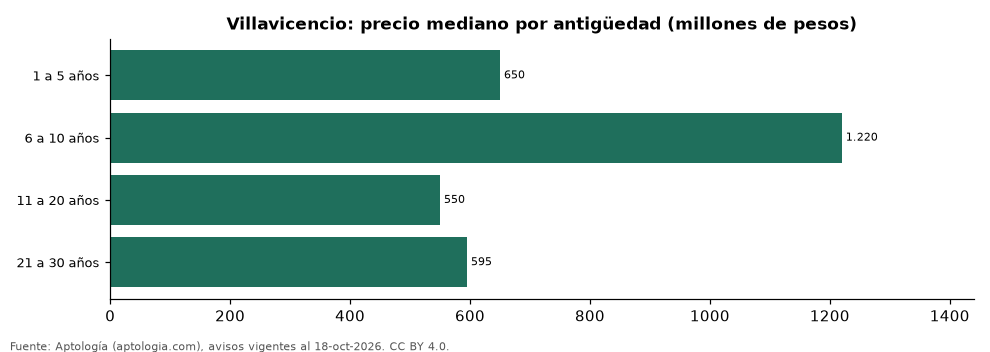

# Casas en venta en Villavicencio según antigüedad: precio y m² de cada grupo (octubre 2026)

**En Villavicencio, una casa en venta del grupo «1 a 5 años» se pide en 650 millones de pesos en la mediana y una del grupo «21 a 30 años» en 595 millones de pesos (-8,5 %).** Por metro cuadrado, el más barato es «21 a 30 años» (2,90 millones de pesos/m²) y el más caro «11 a 20 años» (3,29 millones de pesos/m²).

*Resumen: analizamos 586 casas en venta en Villavicencio con antigüedad declarado.*

**Actualizado:** 18 de octubre de 2026 (datos del 18 de octubre de 2026) · **Próxima actualización:** mensual.

## Resumen

| Indicador | Valor |
|---|---|
| 1 a 5 años | 650 millones de pesos |
| 6 a 10 años | 1.220 millones de pesos |
| 11 a 20 años | 550 millones de pesos |
| 21 a 30 años | 595 millones de pesos |
| Avisos | 586 |

## Precio y m² por antigüedad

| Antigüedad | Precio (mediana) | Rango típico (P25–P75) | Por m² (mediana) | Área mediana (m²) | Avisos |
|---|---|---|---|---|---|
| 1 a 5 años | 650 millones de pesos | 420 millones de pesos – 1.350 millones de pesos | 3,00 millones de pesos | 224 | 292 |
| 6 a 10 años | 1.220 millones de pesos | 480 millones de pesos – 1.690 millones de pesos | 2,94 millones de pesos | 300 | 65 |
| 11 a 20 años | 550 millones de pesos | 335 millones de pesos – 1.035 millones de pesos | 3,29 millones de pesos | 142 | 127 |
| 21 a 30 años | 595 millones de pesos | 369 millones de pesos – 848 millones de pesos | 2,90 millones de pesos | 177 | 102 |

Medianas del precio pedido; grupos con menos de 30 avisos se omiten.

## Preguntas frecuentes

**¿Cuánto cuesta comprar una casa de qué antigüedad en Villavicencio?**
1 a 5 años: 650 millones de pesos; 6 a 10 años: 1.220 millones de pesos; 11 a 20 años: 550 millones de pesos; 21 a 30 años: 595 millones de pesos (medianas de octubre de 2026).

**¿Qué grupo sale más barato por m²?**
Por metro cuadrado, el más barato es «21 a 30 años» (2,90 millones de pesos/m²) y el más caro «11 a 20 años» (3,29 millones de pesos/m²).

## Metodología

- **Fuente:** exportes nocturnos de la base de datos de Aptología (aptologia.com) del 18 de octubre de 2026: avisos vigentes de vivienda en portales inmobiliarios de 13 países, recogidos por Aptología y vistos en línea entre el 11 y el 18 de octubre de 2026. Corte: 18 de octubre de 2026.
- **Depuración:** se eliminan duplicados exactos (misma ciudad, zona, tipo, precio, moneda, área, habitaciones y baños) y los precios fuera del percentil 1–99 de cada país, operación, moneda y tipo; el precio por m² usa solo avisos con área declarada entre 12 y 2.000 m² y también se recorta al P1–P99.
- **Qué se mide:** precios pedidos (publicados), no precios de cierre. En arriendo, el canon mensual sin administración, gastos comunes ni condominio.
- **Muestra mínima:** cada cifra publicada se apoya en al menos 30 avisos; las celdas con menos se omiten.
- **Colombia:** Precios en pesos colombianos, sin conversión de moneda.
- **Limitaciones:** la cobertura depende de los portales que recorre Aptología en cada país y es mayor en las ciudades grandes y en los segmentos medio-alto y alto; el área es la que declara el aviso, sin verificar; los nombres de zona vienen de los portales.
- **Privacidad:** solo se publican agregados; no se publica ningún dato personal, enlace a avisos ni nombre de anunciante.
- **Datos abiertos:** [datos.csv](datos.csv), licencia CC BY 4.0.

## Cómo citar

Pinzón Pineda, D. M. (2026). *Casas en venta en Villavicencio según antigüedad: precio y m² de cada grupo (octubre 2026)*. Aptología (aptologia.com). https://github.com/elbroker/aptologia-datos/tree/main/estudios/casas-en-venta-por-antiguedad-villavicencio-2026. Datos: datos.csv, licencia CC BY 4.0.
