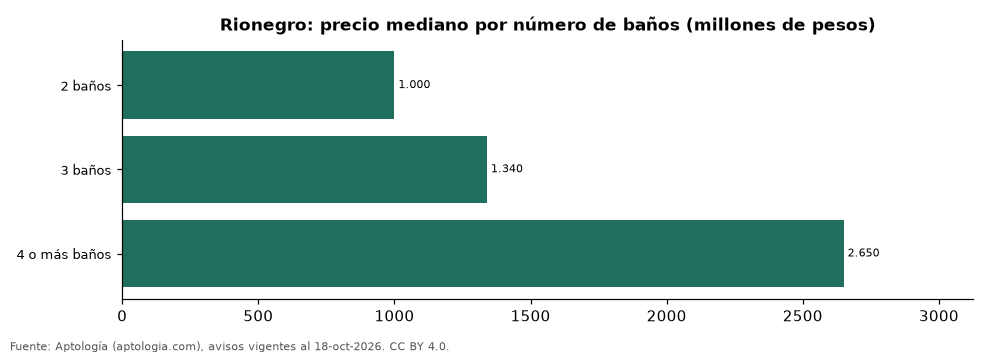

# Casas en venta en Rionegro según número de baños: precio y m² de cada grupo (octubre 2026)

**En Rionegro, una casa en venta del grupo «2 baños» se pide en 1.000 millones de pesos en la mediana y una del grupo «4 o más baños» en 2.650 millones de pesos (+165,0 %).** Por metro cuadrado, el más barato es «2 baños» (5,80 millones de pesos/m²) y el más caro «4 o más baños» (6,98 millones de pesos/m²).

*Resumen: analizamos 2.537 casas en venta en Rionegro con número de baños declarado.*

**Actualizado:** 18 de octubre de 2026 (datos del 18 de octubre de 2026) · **Próxima actualización:** mensual.

## Resumen

| Indicador | Valor |
|---|---|
| 2 baños | 1.000 millones de pesos |
| 3 baños | 1.340 millones de pesos |
| 4 o más baños | 2.650 millones de pesos |
| Avisos | 2.537 |

## Precio y m² por número de baños

| Número de baños | Precio (mediana) | Rango típico (P25–P75) | Por m² (mediana) | Área mediana (m²) | Avisos |
|---|---|---|---|---|---|
| 2 baños | 1.000 millones de pesos | 599 millones de pesos – 1.500 millones de pesos | 5,80 millones de pesos | 154 | 184 |
| 3 baños | 1.340 millones de pesos | 900 millones de pesos – 2.258 millones de pesos | 6,25 millones de pesos | 200 | 552 |
| 4 o más baños | 2.650 millones de pesos | 1.450 millones de pesos – 3.950 millones de pesos | 6,98 millones de pesos | 350 | 1.801 |

Medianas del precio pedido; grupos con menos de 30 avisos se omiten.

## Preguntas frecuentes

**¿Cuánto cuesta comprar una casa con cuántos baños en Rionegro?**
2 baños: 1.000 millones de pesos; 3 baños: 1.340 millones de pesos; 4 o más baños: 2.650 millones de pesos (medianas de octubre de 2026).

**¿Qué grupo sale más barato por m²?**
Por metro cuadrado, el más barato es «2 baños» (5,80 millones de pesos/m²) y el más caro «4 o más baños» (6,98 millones de pesos/m²).

## Metodología

- **Fuente:** exportes nocturnos de la base de datos de Aptología (aptologia.com) del 18 de octubre de 2026: avisos vigentes de vivienda en portales inmobiliarios de 13 países, recogidos por Aptología y vistos en línea entre el 11 y el 18 de octubre de 2026. Corte: 18 de octubre de 2026.
- **Depuración:** se eliminan duplicados exactos (misma ciudad, zona, tipo, precio, moneda, área, habitaciones y baños) y los precios fuera del percentil 1–99 de cada país, operación, moneda y tipo; el precio por m² usa solo avisos con área declarada entre 12 y 2.000 m² y también se recorta al P1–P99.
- **Qué se mide:** precios pedidos (publicados), no precios de cierre. En arriendo, el canon mensual sin administración, gastos comunes ni condominio.
- **Muestra mínima:** cada cifra publicada se apoya en al menos 30 avisos; las celdas con menos se omiten.
- **Colombia:** Precios en pesos colombianos, sin conversión de moneda.
- **Cordura:** solo se publica si la mediana crece con número de baños.
- **Limitaciones:** la cobertura depende de los portales que recorre Aptología en cada país y es mayor en las ciudades grandes y en los segmentos medio-alto y alto; el área es la que declara el aviso, sin verificar; los nombres de zona vienen de los portales.
- **Privacidad:** solo se publican agregados; no se publica ningún dato personal, enlace a avisos ni nombre de anunciante.
- **Datos abiertos:** [datos.csv](datos.csv), licencia CC BY 4.0.

## Cómo citar

Pinzón Pineda, D. M. (2026). *Casas en venta en Rionegro según número de baños: precio y m² de cada grupo (octubre 2026)*. Aptología (aptologia.com). https://github.com/elbroker/aptologia-datos/tree/main/estudios/casas-en-venta-por-numero-de-banos-rionegro-2026. Datos: datos.csv, licencia CC BY 4.0.
