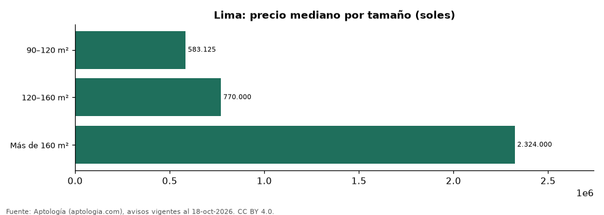

# Casas en venta en Lima según tamaño: precio y m² de cada grupo (octubre 2026)

**En Lima, una casa en venta del grupo «90–120 m²» se pide en 583.125 soles (USD 169.734) en la mediana y una del grupo «Más de 160 m²» en 2.324.000 soles (USD 676.461) (+298,5 %).** Por metro cuadrado, el más barato es «90–120 m²» (5.519 soles (USD 1.606)/m²) y el más caro «Más de 160 m²» (5.903 soles (USD 1.718)/m²).

*Resumen: analizamos 2.310 casas en venta en Lima con tamaño declarado.*

**Actualizado:** 18 de octubre de 2026 (datos del 18 de octubre de 2026) · **Próxima actualización:** mensual.

## Resumen

| Indicador | Valor |
|---|---|
| 90–120 m² | 583.125 soles (USD 169.734) |
| 120–160 m² | 770.000 soles (USD 224.129) |
| Más de 160 m² | 2.324.000 soles (USD 676.461) |
| Avisos | 2.310 |

## Precio y m² por tamaño

| Tamaño | Precio (mediana) | Rango típico (P25–P75) | Por m² (mediana) | Área mediana (m²) | Avisos |
|---|---|---|---|---|---|
| 90–120 m² | 583.125 soles (USD 169.734) | 359.900 soles (USD 104.758) – 878.312 soles (USD 255.656) | 5.519 soles (USD 1.606) | 100 | 74 |
| 120–160 m² | 770.000 soles (USD 224.129) | 532.920 soles (USD 155.120) – 1.105.250 soles (USD 321.712) | 5.688 soles (USD 1.655) | 139 | 126 |
| Más de 160 m² | 2.324.000 soles (USD 676.461) | 1.480.500 soles (USD 430.939) – 3.616.600 soles (USD 1.052.707) | 5.903 soles (USD 1.718) | 373 | 2.110 |

Medianas del precio pedido; grupos con menos de 30 avisos se omiten.

## Preguntas frecuentes

**¿Cuánto cuesta comprar una casa de qué tamaño en Lima?**
90–120 m²: 583.125 soles (USD 169.734); 120–160 m²: 770.000 soles (USD 224.129); Más de 160 m²: 2.324.000 soles (USD 676.461) (medianas de octubre de 2026).

**¿Qué grupo sale más barato por m²?**
Por metro cuadrado, el más barato es «90–120 m²» (5.519 soles (USD 1.606)/m²) y el más caro «Más de 160 m²» (5.903 soles (USD 1.718)/m²).

## Metodología

- **Fuente:** exportes nocturnos de la base de datos de Aptología (aptologia.com) del 18 de octubre de 2026: avisos vigentes de vivienda en portales inmobiliarios de 13 países, recogidos por Aptología y vistos en línea entre el 11 y el 18 de octubre de 2026. Corte: 18 de octubre de 2026.
- **Depuración:** se eliminan duplicados exactos (misma ciudad, zona, tipo, precio, moneda, área, habitaciones y baños) y los precios fuera del percentil 1–99 de cada país, operación, moneda y tipo; el precio por m² usa solo avisos con área declarada entre 12 y 2.000 m² y también se recorta al P1–P99.
- **Qué se mide:** precios pedidos (publicados), no precios de cierre. En arriendo, el canon mensual sin administración, gastos comunes ni condominio.
- **Muestra mínima:** cada cifra publicada se apoya en al menos 30 avisos; las celdas con menos se omiten.
- **Monedas:** nunca se mezclan avisos de monedas distintas sin convertirlos. Conversión a dólares con la tasa de mercado de ExchangeRate-API (open.er-api.com, actualización del 18 Oct 2026): 1 USD = 3.182,80 COP, 1 USD = 18,47 M.N, 1 USD = 5,09 BRL, 1 USD = 3,44 PEN, 1 USD = 982,44 CLP, 1 USD = 1.514,57 ARS, 1 USD = 40,20 UYU, 1 USD = 5.705,37 PYG, 1 USD = 61,27 DOP, 1 USD = 0,89 EUR, 1 USD = 11,72 BOB; la UF chilena a 41.178,64 CLP (mindicador,cl. 18-oct-2026). Los avisos publicados en dólares se usan tal cual.
- **Monedas:** en cada ciudad y operación se usa solo la moneda mayoritaria de los avisos (los avisos en otra moneda se excluyen) y la mediana se convierte a dólares con la tasa citada; nunca se promedian avisos de monedas distintas.
- **Cordura:** solo se publica si la mediana crece con tamaño.
- **Limitaciones:** la cobertura depende de los portales que recorre Aptología en cada país y es mayor en las ciudades grandes y en los segmentos medio-alto y alto; el área es la que declara el aviso, sin verificar; los nombres de zona vienen de los portales.
- **Privacidad:** solo se publican agregados; no se publica ningún dato personal, enlace a avisos ni nombre de anunciante.
- **Datos abiertos:** [datos.csv](datos.csv), licencia CC BY 4.0.

## Cómo citar

Pinzón Pineda, D. M. (2026). *Casas en venta en Lima según tamaño: precio y m² de cada grupo (octubre 2026)*. Aptología (aptologia.com). https://github.com/elbroker/aptologia-datos/tree/main/estudios/casas-en-venta-por-tamano-lima-2026. Datos: datos.csv, licencia CC BY 4.0.
