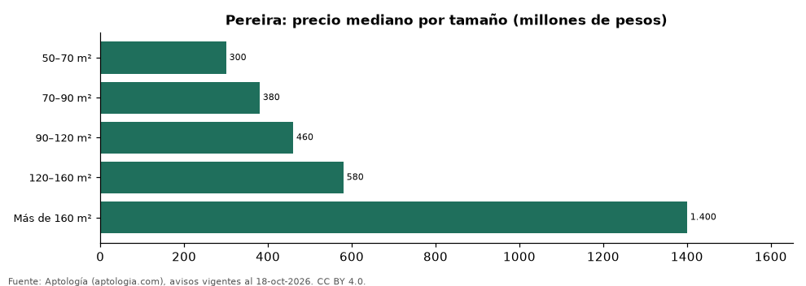

# Casas en venta en Pereira según tamaño: precio y m² de cada grupo (octubre 2026)

**En Pereira, una casa en venta del grupo «50–70 m²» se pide en 300 millones de pesos en la mediana y una del grupo «Más de 160 m²» en 1.400 millones de pesos (+366,7 %).** Por metro cuadrado, el más barato es «Más de 160 m²» (4,00 millones de pesos/m²) y el más caro «50–70 m²» (5,04 millones de pesos/m²).

*Resumen: analizamos 4.004 casas en venta en Pereira con tamaño declarado.*

**Actualizado:** 18 de octubre de 2026 (datos del 18 de octubre de 2026) · **Próxima actualización:** mensual.

## Resumen

| Indicador | Valor |
|---|---|
| 50–70 m² | 300 millones de pesos |
| 70–90 m² | 380 millones de pesos |
| 90–120 m² | 460 millones de pesos |
| 120–160 m² | 580 millones de pesos |
| Más de 160 m² | 1.400 millones de pesos |
| Avisos | 4.004 |

## Precio y m² por tamaño

| Tamaño | Precio (mediana) | Rango típico (P25–P75) | Por m² (mediana) | Área mediana (m²) | Avisos |
|---|---|---|---|---|---|
| 50–70 m² | 300 millones de pesos | 256 millones de pesos – 350 millones de pesos | 5,04 millones de pesos | 60 | 86 |
| 70–90 m² | 380 millones de pesos | 300 millones de pesos – 472 millones de pesos | 4,85 millones de pesos | 78 | 180 |
| 90–120 m² | 460 millones de pesos | 385 millones de pesos – 550 millones de pesos | 4,38 millones de pesos | 104 | 358 |
| 120–160 m² | 580 millones de pesos | 430 millones de pesos – 700 millones de pesos | 4,10 millones de pesos | 136 | 540 |
| Más de 160 m² | 1.400 millones de pesos | 850 millones de pesos – 1.972 millones de pesos | 4,00 millones de pesos | 350 | 2.840 |

Medianas del precio pedido; grupos con menos de 30 avisos se omiten.

## Preguntas frecuentes

**¿Cuánto cuesta comprar una casa de qué tamaño en Pereira?**
50–70 m²: 300 millones de pesos; 70–90 m²: 380 millones de pesos; 90–120 m²: 460 millones de pesos; 120–160 m²: 580 millones de pesos; Más de 160 m²: 1.400 millones de pesos (medianas de octubre de 2026).

**¿Qué grupo sale más barato por m²?**
Por metro cuadrado, el más barato es «Más de 160 m²» (4,00 millones de pesos/m²) y el más caro «50–70 m²» (5,04 millones de pesos/m²).

## Metodología

- **Fuente:** exportes nocturnos de la base de datos de Aptología (aptologia.com) del 18 de octubre de 2026: avisos vigentes de vivienda en portales inmobiliarios de 13 países, recogidos por Aptología y vistos en línea entre el 11 y el 18 de octubre de 2026. Corte: 18 de octubre de 2026.
- **Depuración:** se eliminan duplicados exactos (misma ciudad, zona, tipo, precio, moneda, área, habitaciones y baños) y los precios fuera del percentil 1–99 de cada país, operación, moneda y tipo; el precio por m² usa solo avisos con área declarada entre 12 y 2.000 m² y también se recorta al P1–P99.
- **Qué se mide:** precios pedidos (publicados), no precios de cierre. En arriendo, el canon mensual sin administración, gastos comunes ni condominio.
- **Muestra mínima:** cada cifra publicada se apoya en al menos 30 avisos; las celdas con menos se omiten.
- **Colombia:** Precios en pesos colombianos, sin conversión de moneda.
- **Cordura:** solo se publica si la mediana crece con tamaño.
- **Limitaciones:** la cobertura depende de los portales que recorre Aptología en cada país y es mayor en las ciudades grandes y en los segmentos medio-alto y alto; el área es la que declara el aviso, sin verificar; los nombres de zona vienen de los portales.
- **Privacidad:** solo se publican agregados; no se publica ningún dato personal, enlace a avisos ni nombre de anunciante.
- **Datos abiertos:** [datos.csv](datos.csv), licencia CC BY 4.0.

## Cómo citar

Pinzón Pineda, D. M. (2026). *Casas en venta en Pereira según tamaño: precio y m² de cada grupo (octubre 2026)*. Aptología (aptologia.com). https://github.com/elbroker/aptologia-datos/tree/main/estudios/casas-en-venta-por-tamano-pereira-2026. Datos: datos.csv, licencia CC BY 4.0.
