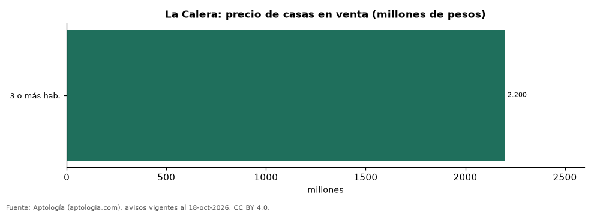

# Casas en venta y arriendo en La Calera (Cundinamarca): precio, m² y sectores (octubre 2026)

**En La Calera la oferta es sobre todo de casas: una casa en venta se pide en la mediana 2.200 millones de pesos, con 360 m² de área y 6,05 millones de pesos por m²; arrendar una casa cuesta 12.000.000 pesos al mes.** El sector más caro de la muestra es Conjunto Casa de Campo, con 2.900 millones de pesos por casa. De 1.834 avisos, el 88,7 % son casas.

*Resumen: analizamos 1.834 avisos de vivienda en La Calera (1.328 casas en venta y 298 en arriendo).*

**Actualizado:** 18 de octubre de 2026 (datos del 18 de octubre de 2026) · **Próxima actualización:** mensual.

## Resumen

| Indicador | Valor |
|---|---|
| Casa en venta (mediana) | 2.200 millones de pesos |
| Precio por m² (casas) | 6,05 millones de pesos |
| Área mediana | 360 m² |
| Casa en arriendo (mediana) | 12.000.000 pesos |

## Casas en venta por sector

| Sector | Precio casa (mediana) | Avisos |
|---|---|---|
| Conjunto Casa de Campo | 2.900 millones de pesos | 45 |
| Vereda el Hato | 2.600 millones de pesos | 43 |
| El Libano | 2.270 millones de pesos | 64 |
| Centro | 2.200 millones de pesos | 91 |
| Arboretto | 2.200 millones de pesos | 61 |
| San José de la Concepción | 2.200 millones de pesos | 68 |
| La Calera | 2.200 millones de pesos | 214 |
| Paso Real | 2.000 millones de pesos | 57 |
| El Salitre | 1.925 millones de pesos | 32 |
| Vereda el Salitre | 1.850 millones de pesos | 53 |
| El Hato | 1.730 millones de pesos | 48 |

Medianas del precio pedido; solo sectores con 30 avisos o más.

## Resumen por tipo

| Tipo | Precio (mediana) | Avisos |
|---|---|---|
| Casas en venta | 2.200 millones de pesos | 1.328 |
| Casas en arriendo | 12.000.000 pesos al mes | 298 |
| Apartamentos en venta | 420 millones de pesos | 141 |

## Casas en venta por habitaciones

| Habitaciones | Precio (mediana) | Avisos |
|---|---|---|
| 3 o más hab. | 2.200 millones de pesos | 1.297 |

## Preguntas frecuentes

**¿Cuánto cuesta una casa en La Calera?**
2.200 millones de pesos en la mediana de casas en venta (octubre de 2026), unos 6,05 millones de pesos por m².

**¿Cuánto cuesta arrendar una casa en La Calera?**
12.000.000 pesos al mes en la mediana.

## Metodología

- **Fuente:** exportes nocturnos de la base de datos de Aptología (aptologia.com) del 18 de octubre de 2026: avisos vigentes de vivienda en portales inmobiliarios de 13 países, recogidos por Aptología y vistos en línea entre el 11 y el 18 de octubre de 2026. Corte: 18 de octubre de 2026.
- **Depuración:** se eliminan duplicados exactos (misma ciudad, zona, tipo, precio, moneda, área, habitaciones y baños) y los precios fuera del percentil 1–99 de cada país, operación, moneda y tipo; el precio por m² usa solo avisos con área declarada entre 12 y 2.000 m² y también se recorta al P1–P99.
- **Qué se mide:** precios pedidos (publicados), no precios de cierre. En arriendo, el canon mensual sin administración, gastos comunes ni condominio.
- **Muestra mínima:** cada cifra publicada se apoya en al menos 30 avisos; las celdas con menos se omiten.
- **Colombia:** Precios en pesos colombianos, sin conversión de moneda.
- **Limitaciones:** la cobertura depende de los portales que recorre Aptología en cada país y es mayor en las ciudades grandes y en los segmentos medio-alto y alto; el área es la que declara el aviso, sin verificar; los nombres de zona vienen de los portales.
- **Privacidad:** solo se publican agregados; no se publica ningún dato personal, enlace a avisos ni nombre de anunciante.
- **Datos abiertos:** [datos.csv](datos.csv), licencia CC BY 4.0.

## Cómo citar

Pinzón Pineda, D. M. (2026). *Casas en venta y arriendo en La Calera (Cundinamarca): precio, m² y sectores (octubre 2026)*. Aptología (aptologia.com). https://github.com/elbroker/aptologia-datos/tree/main/estudios/casas-en-venta-y-arriendo-la-calera-2026. Datos: datos.csv, licencia CC BY 4.0.
