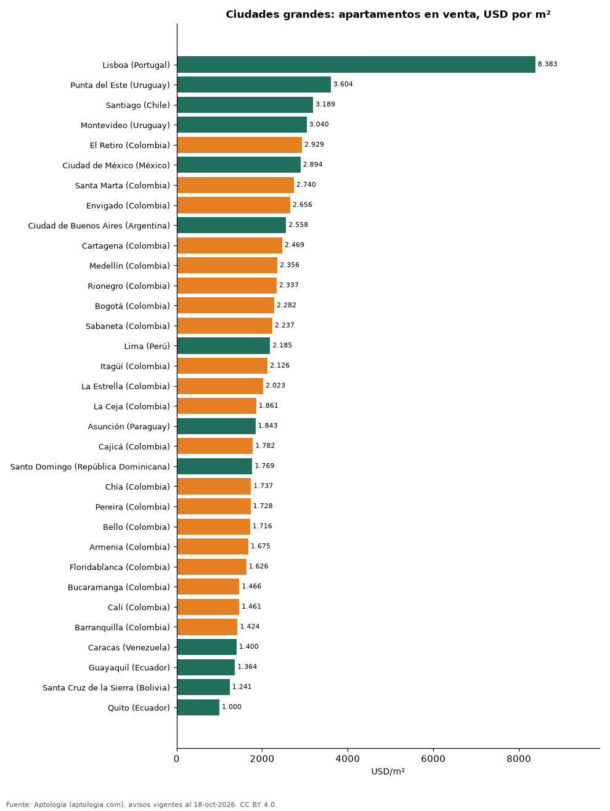

# Colombia frente al resto de Latinoamérica: cuánto cuesta la vivienda en Bogotá, Medellín, Cali y Barranquilla comparada con otras grandes ciudades (octubre 2026)

**Las grandes ciudades colombianas son más baratas por metro cuadrado que sus pares de la región: la mediana de las 20 ciudades colombianas con más oferta es USD 1.942/m² en venta, frente a USD 2.185/m² en las 13 ciudades grandes de otros países.** Medellín (USD 2.356/m²) y Bogotá (USD 2.282/m²) quedan por debajo de Ciudad de México, Santiago, Montevideo y Buenos Aires.

*Resumen: comparamos ciudades con 300 o más apartamentos con área en venta y en arriendo (33 ciudades).*

**Actualizado:** 18 de octubre de 2026 (datos del 18 de octubre de 2026) · **Próxima actualización:** mensual.

## Resumen

| Indicador | Valor |
|---|---|
| Mediana ciudades colombianas | USD 1.942/m² |
| Mediana otras ciudades grandes | USD 2.185/m² |
| Ciudades comparadas | 33 |

## Ciudades grandes (300 avisos o más en venta y en arriendo)

| Ciudad | Venta USD/m² | Arriendo USD/m²/mes | Rentabilidad bruta |
|---|---|---|---|
| Lisboa (Portugal) | 8.383 | 25,8 | 3,7 % |
| Punta del Este (Uruguay) | 3.604 | 40,6 | 13,5 % |
| Santiago (Chile) | 3.189 | 10,6 | 4,0 % |
| Montevideo (Uruguay) | 3.040 | 15,3 | 6,1 % |
| El Retiro (Colombia) | 2.929 | 15,5 | 6,3 % |
| Ciudad de México (México) | 2.894 | 18,1 | 7,5 % |
| Santa Marta (Colombia) | 2.740 | 14,1 | 6,2 % |
| Envigado (Colombia) | 2.656 | 15,4 | 6,9 % |
| Ciudad de Buenos Aires (Argentina) | 2.558 | 13,5 | 6,3 % |
| Cartagena (Colombia) | 2.469 | 13,9 | 6,7 % |
| Medellín (Colombia) | 2.356 | 15,5 | 7,9 % |
| Rionegro (Colombia) | 2.337 | 11,8 | 6,1 % |
| Bogotá (Colombia) | 2.282 | 15,2 | 8,0 % |
| Sabaneta (Colombia) | 2.237 | 12,9 | 6,9 % |
| Lima (Perú) | 2.185 | 10,0 | 5,5 % |
| Itagüí (Colombia) | 2.126 | 12,6 | 7,1 % |
| La Estrella (Colombia) | 2.023 | 12,0 | 7,1 % |
| La Ceja (Colombia) | 1.861 | 11,7 | 7,6 % |
| Asunción (Paraguay) | 1.843 | 12,9 | 8,4 % |
| Cajicá (Colombia) | 1.782 | 10,7 | 7,2 % |
| Santo Domingo (República Dominicana) | 1.769 | 11,7 | 7,9 % |
| Chía (Colombia) | 1.737 | 10,5 | 7,2 % |
| Pereira (Colombia) | 1.728 | 10,5 | 7,3 % |
| Bello (Colombia) | 1.716 | 10,5 | 7,3 % |
| Armenia (Colombia) | 1.675 | 10,1 | 7,3 % |
| Floridablanca (Colombia) | 1.626 | 9,2 | 6,8 % |
| Bucaramanga (Colombia) | 1.466 | 9,3 | 7,6 % |
| Cali (Colombia) | 1.461 | 9,4 | 7,7 % |
| Barranquilla (Colombia) | 1.424 | 10,6 | 8,9 % |
| Caracas (Venezuela) | 1.400 | 12,1 | 10,4 % |
| Guayaquil (Ecuador) | 1.364 | 8,5 | 7,5 % |
| Santa Cruz de la Sierra (Bolivia) | 1.241 | 7,3 | 7,0 % |
| Quito (Ecuador) | 1.000 | 7,2 | 8,7 % |

## Preguntas frecuentes

**¿La vivienda en Colombia es cara frente a Latinoamérica?**
Por metro cuadrado, no: las grandes ciudades colombianas tienen una mediana de USD 1.942/m², frente a USD 2.185/m² en otras grandes ciudades de la región.

**¿Medellín es más cara que Bogotá?**
Por m² en venta, Medellín marca USD 2.356 y Bogotá USD 2.282 (mediana de apartamentos).

## Metodología

- **Fuente:** exportes nocturnos de la base de datos de Aptología (aptologia.com) del 18 de octubre de 2026: avisos vigentes de vivienda en portales inmobiliarios de 13 países, recogidos por Aptología y vistos en línea entre el 11 y el 18 de octubre de 2026. Corte: 18 de octubre de 2026.
- **Depuración:** se eliminan duplicados exactos (misma ciudad, zona, tipo, precio, moneda, área, habitaciones y baños) y los precios fuera del percentil 1–99 de cada país, operación, moneda y tipo; el precio por m² usa solo avisos con área declarada entre 12 y 2.000 m² y también se recorta al P1–P99.
- **Qué se mide:** precios pedidos (publicados), no precios de cierre. En arriendo, el canon mensual sin administración, gastos comunes ni condominio.
- **Muestra mínima:** cada cifra publicada se apoya en al menos 30 avisos; las celdas con menos se omiten.
- **Monedas:** nunca se mezclan avisos de monedas distintas sin convertirlos. Conversión a dólares con la tasa de mercado de ExchangeRate-API (open.er-api.com, actualización del 18 Oct 2026): 1 USD = 3.182,80 COP, 1 USD = 18,47 M.N, 1 USD = 5,09 BRL, 1 USD = 3,44 PEN, 1 USD = 982,44 CLP, 1 USD = 1.514,57 ARS, 1 USD = 40,20 UYU, 1 USD = 5.705,37 PYG, 1 USD = 61,27 DOP, 1 USD = 0,89 EUR, 1 USD = 11,72 BOB; la UF chilena a 41.178,64 CLP (mindicador,cl. 18-oct-2026). Los avisos publicados en dólares se usan tal cual.
- **Limitaciones:** la cobertura depende de los portales que recorre Aptología en cada país y es mayor en las ciudades grandes y en los segmentos medio-alto y alto; el área es la que declara el aviso, sin verificar; los nombres de zona vienen de los portales.
- **Privacidad:** solo se publican agregados; no se publica ningún dato personal, enlace a avisos ni nombre de anunciante.
- **Datos abiertos:** [datos.csv](datos.csv), licencia CC BY 4.0.

## Cómo citar

Pinzón Pineda, D. M. (2026). *Colombia frente al resto de Latinoamérica: cuánto cuesta la vivienda en Bogotá, Medellín, Cali y Barranquilla comparada con otras grandes ciudades (octubre 2026)*. Aptología (aptologia.com). https://github.com/elbroker/aptologia-datos/tree/main/estudios/colombia-vs-latinoamerica-precio-vivienda-2026. Datos: datos.csv, licencia CC BY 4.0.
