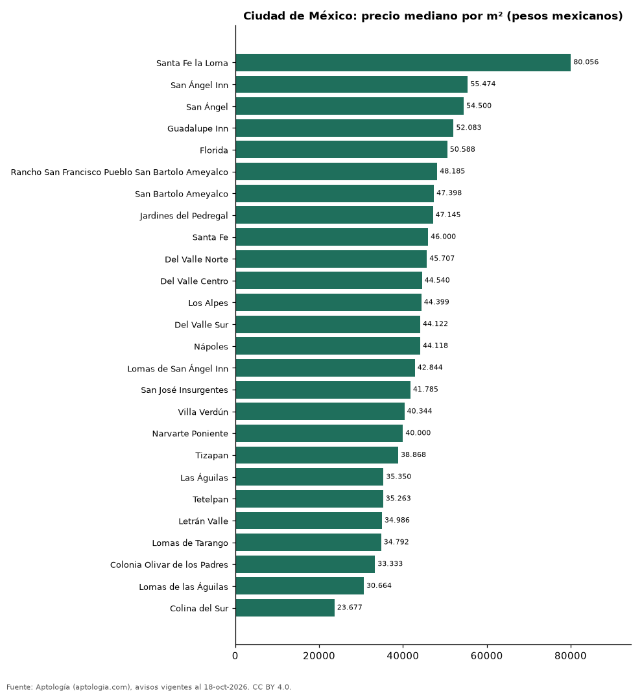

# Colonias más caras y más baratas de Ciudad de México para comprar casa: ranking por m² (octubre 2026)

**En Ciudad de México, la colonia con el m² más caro para comprar casa es Santa Fe la Loma (80.056 pesos mexicanos (USD 4.335)/m²) y la más barata Colina del Sur (23.677 pesos mexicanos (USD 1.282)/m²), 3,4 veces menos.** Comparamos 26 colonias con al menos 30 avisos con área.

*Resumen: analizamos 2.004 casas en venta con área declarada en 26 colonias de Ciudad de México.*

**Actualizado:** 18 de octubre de 2026 (datos del 18 de octubre de 2026) · **Próxima actualización:** mensual.

## Resumen

| Indicador | Valor |
|---|---|
| Más caro por m² | Santa Fe la Loma: 80.056 pesos mexicanos (USD 4.335) |
| Más barato por m² | Colina del Sur: 23.677 pesos mexicanos (USD 1.282) |
| Diferencia | 3,4 veces |
| Colonias | 26 |

## Ranking de colonias por precio del m²

| Colonia | Por m² (mediana) | Precio (mediana) | Área mediana (m²) | Avisos con área |
|---|---|---|---|---|
| Santa Fe la Loma | 80.056 pesos mexicanos (USD 4.335) | 50.000.000 pesos mexicanos (USD 2.707.759) | 720 | 39 |
| San Ángel Inn | 55.474 pesos mexicanos (USD 3.004) | 31.200.000 pesos mexicanos (USD 1.689.642) | 556 | 107 |
| San Ángel | 54.500 pesos mexicanos (USD 2.951) | 29.000.000 pesos mexicanos (USD 1.570.500) | 440 | 69 |
| Guadalupe Inn | 52.083 pesos mexicanos (USD 2.821) | 22.000.000 pesos mexicanos (USD 1.191.414) | 432 | 39 |
| Florida | 50.588 pesos mexicanos (USD 2.740) | 21.950.000 pesos mexicanos (USD 1.188.706) | 424 | 95 |
| Rancho San Francisco Pueblo San Bartolo Ameyalco | 48.185 pesos mexicanos (USD 2.609) | 32.000.000 pesos mexicanos (USD 1.732.966) | 668 | 31 |
| San Bartolo Ameyalco | 47.398 pesos mexicanos (USD 2.567) | 26.750.000 pesos mexicanos (USD 1.448.651) | 472 | 62 |
| Jardines del Pedregal | 47.145 pesos mexicanos (USD 2.553) | 32.500.000 pesos mexicanos (USD 1.760.044) | 774 | 469 |
| Santa Fe | 46.000 pesos mexicanos (USD 2.491) | 25.000.000 pesos mexicanos (USD 1.353.880) | 615 | 81 |
| Del Valle Norte | 45.707 pesos mexicanos (USD 2.475) | 14.134.021 pesos mexicanos (USD 765.431) | 298 | 30 |
| Del Valle Centro | 44.540 pesos mexicanos (USD 2.412) | 12.200.000 pesos mexicanos (USD 660.693) | 289 | 116 |
| Los Alpes | 44.399 pesos mexicanos (USD 2.404) | 13.650.000 pesos mexicanos (USD 739.218) | 283 | 38 |
| Del Valle Sur | 44.122 pesos mexicanos (USD 2.389) | 14.643.260 pesos mexicanos (USD 793.009) | 302 | 46 |
| Nápoles | 44.118 pesos mexicanos (USD 2.389) | 14.900.000 pesos mexicanos (USD 806.912) | 276 | 35 |
| Lomas de San Ángel Inn | 42.844 pesos mexicanos (USD 2.320) | 13.025.000 pesos mexicanos (USD 705.371) | 350 | 42 |
| San José Insurgentes | 41.785 pesos mexicanos (USD 2.263) | 13.500.000 pesos mexicanos (USD 731.095) | 300 | 35 |
| Villa Verdún | 40.344 pesos mexicanos (USD 2.185) | 13.650.000 pesos mexicanos (USD 739.218) | 342 | 80 |
| Narvarte Poniente | 40.000 pesos mexicanos (USD 2.166) | 10.470.000 pesos mexicanos (USD 567.005) | 270 | 70 |
| Tizapan | 38.868 pesos mexicanos (USD 2.105) | 12.600.000 pesos mexicanos (USD 682.355) | 306 | 30 |
| Las Águilas | 35.350 pesos mexicanos (USD 1.914) | 12.725.000 pesos mexicanos (USD 689.125) | 378 | 106 |
| Tetelpan | 35.263 pesos mexicanos (USD 1.910) | 12.450.000 pesos mexicanos (USD 674.232) | 350 | 104 |
| Letrán Valle | 34.986 pesos mexicanos (USD 1.895) | 10.149.500 pesos mexicanos (USD 549.648) | 285 | 42 |
| Lomas de Tarango | 34.792 pesos mexicanos (USD 1.884) | 11.399.500 pesos mexicanos (USD 617.342) | 384 | 50 |
| Colonia Olivar de los Padres | 33.333 pesos mexicanos (USD 1.805) | 11.190.000 pesos mexicanos (USD 605.997) | 320 | 103 |
| Lomas de las Águilas | 30.664 pesos mexicanos (USD 1.661) | 10.495.000 pesos mexicanos (USD 568.359) | 340 | 39 |
| Colina del Sur | 23.677 pesos mexicanos (USD 1.282) | 6.495.000 pesos mexicanos (USD 351.738) | 245 | 46 |

Medianas; solo colonias con 30 avisos o más con área declarada.

## Preguntas frecuentes

**¿Cuál es la colonia más cara de Ciudad de México para comprar?**
Santa Fe la Loma, con 80.056 pesos mexicanos (USD 4.335) por m² en la mediana (octubre de 2026).

**¿Y la más barata?**
Colina del Sur, con 23.677 pesos mexicanos (USD 1.282) por m².

## Metodología

- **Fuente:** exportes nocturnos de la base de datos de Aptología (aptologia.com) del 18 de octubre de 2026: avisos vigentes de vivienda en portales inmobiliarios de 13 países, recogidos por Aptología y vistos en línea entre el 11 y el 18 de octubre de 2026. Corte: 18 de octubre de 2026.
- **Depuración:** se eliminan duplicados exactos (misma ciudad, zona, tipo, precio, moneda, área, habitaciones y baños) y los precios fuera del percentil 1–99 de cada país, operación, moneda y tipo; el precio por m² usa solo avisos con área declarada entre 12 y 2.000 m² y también se recorta al P1–P99.
- **Qué se mide:** precios pedidos (publicados), no precios de cierre. En arriendo, el canon mensual sin administración, gastos comunes ni condominio.
- **Muestra mínima:** cada cifra publicada se apoya en al menos 30 avisos; las celdas con menos se omiten.
- **Monedas:** nunca se mezclan avisos de monedas distintas sin convertirlos. Conversión a dólares con la tasa de mercado de ExchangeRate-API (open.er-api.com, actualización del 18 Oct 2026): 1 USD = 3.182,80 COP, 1 USD = 18,47 M.N, 1 USD = 5,09 BRL, 1 USD = 3,44 PEN, 1 USD = 982,44 CLP, 1 USD = 1.514,57 ARS, 1 USD = 40,20 UYU, 1 USD = 5.705,37 PYG, 1 USD = 61,27 DOP, 1 USD = 0,89 EUR, 1 USD = 11,72 BOB; la UF chilena a 41.178,64 CLP (mindicador,cl. 18-oct-2026). Los avisos publicados en dólares se usan tal cual.
- **Monedas:** en cada ciudad y operación se usa solo la moneda mayoritaria de los avisos (los avisos en otra moneda se excluyen) y la mediana se convierte a dólares con la tasa citada; nunca se promedian avisos de monedas distintas.
- **Limitaciones:** la cobertura depende de los portales que recorre Aptología en cada país y es mayor en las ciudades grandes y en los segmentos medio-alto y alto; el área es la que declara el aviso, sin verificar; los nombres de zona vienen de los portales.
- **Privacidad:** solo se publican agregados; no se publica ningún dato personal, enlace a avisos ni nombre de anunciante.
- **Datos abiertos:** [datos.csv](datos.csv), licencia CC BY 4.0.

## Cómo citar

Pinzón Pineda, D. M. (2026). *Colonias más caras y más baratas de Ciudad de México para comprar casa: ranking por m² (octubre 2026)*. Aptología (aptologia.com). https://github.com/elbroker/aptologia-datos/tree/main/estudios/colonias-con-casas-mas-caras-y-baratas-ciudad-de-mexico-venta-m2-2026. Datos: datos.csv, licencia CC BY 4.0.
