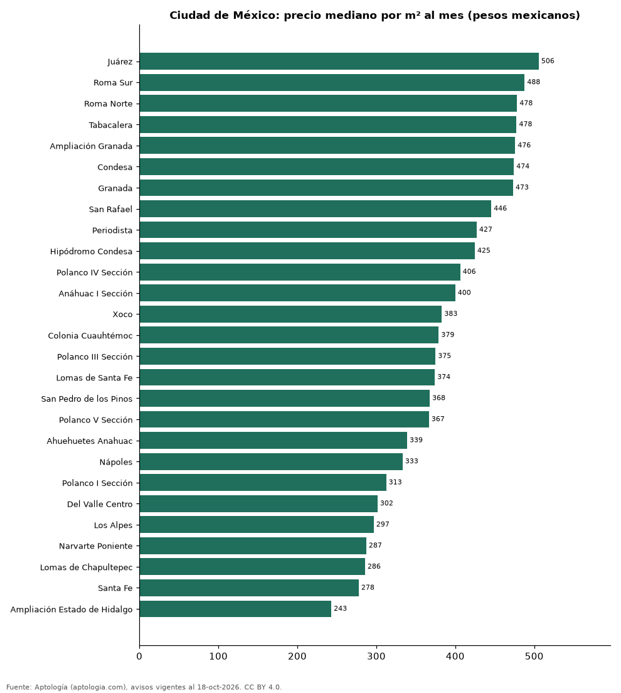

# Colonias más caras y más baratas de Ciudad de México para rentar departamento: ranking por m² (octubre 2026)

**En Ciudad de México, la colonia con el m² más caro para rentar departamento es Juárez (505,7 pesos mexicanos (USD 27,4)/m² al mes) y la más barata Ampliación Estado de Hidalgo (243,0 pesos mexicanos (USD 13,2)/m² al mes), 2,1 veces menos.** Comparamos 27 colonias con al menos 30 avisos con área.

*Resumen: analizamos 2.793 departamentos en renta con área declarada en 27 colonias de Ciudad de México.*

**Actualizado:** 18 de octubre de 2026 (datos del 18 de octubre de 2026) · **Próxima actualización:** mensual.

## Resumen

| Indicador | Valor |
|---|---|
| Más caro por m² | Juárez: 505,7 pesos mexicanos (USD 27,4) |
| Más barato por m² | Ampliación Estado de Hidalgo: 243,0 pesos mexicanos (USD 13,2) |
| Diferencia | 2,1 veces |
| Colonias | 27 |

## Ranking de colonias por precio del m²

| Colonia | Por m² (mediana) | Canon (mediana) | Área mediana (m²) | Avisos con área |
|---|---|---|---|---|
| Juárez | 505,7 pesos mexicanos (USD 27,4) | 32.000 pesos mexicanos (USD 1.733) | 67 | 177 |
| Roma Sur | 487,8 pesos mexicanos (USD 26,4) | 30.000 pesos mexicanos (USD 1.625) | 65 | 90 |
| Roma Norte | 478,3 pesos mexicanos (USD 25,9) | 35.602 pesos mexicanos (USD 1.928) | 78 | 185 |
| Tabacalera | 477,6 pesos mexicanos (USD 25,9) | 34.400 pesos mexicanos (USD 1.863) | 72 | 56 |
| Ampliación Granada | 475,9 pesos mexicanos (USD 25,8) | 45.000 pesos mexicanos (USD 2.437) | 100 | 165 |
| Condesa | 474,2 pesos mexicanos (USD 25,7) | 40.500 pesos mexicanos (USD 2.193) | 92 | 92 |
| Granada | 473,2 pesos mexicanos (USD 25,6) | 44.500 pesos mexicanos (USD 2.410) | 116 | 119 |
| San Rafael | 445,6 pesos mexicanos (USD 24,1) | 24.900 pesos mexicanos (USD 1.348) | 62 | 48 |
| Periodista | 427,2 pesos mexicanos (USD 23,1) | 22.017 pesos mexicanos (USD 1.192) | 58 | 36 |
| Hipódromo Condesa | 424,7 pesos mexicanos (USD 23,0) | 41.500 pesos mexicanos (USD 2.247) | 95 | 76 |
| Polanco IV Sección | 406,2 pesos mexicanos (USD 22,0) | 79.450 pesos mexicanos (USD 4.303) | 192 | 296 |
| Anáhuac I Sección | 400,0 pesos mexicanos (USD 21,7) | 33.000 pesos mexicanos (USD 1.787) | 80 | 47 |
| Xoco | 383,0 pesos mexicanos (USD 20,7) | 35.500 pesos mexicanos (USD 1.923) | 84 | 42 |
| Colonia Cuauhtémoc | 379,0 pesos mexicanos (USD 20,5) | 27.350 pesos mexicanos (USD 1.481) | 70 | 187 |
| Polanco III Sección | 375,0 pesos mexicanos (USD 20,3) | 85.000 pesos mexicanos (USD 4.603) | 222 | 92 |
| Lomas de Santa Fe | 374,1 pesos mexicanos (USD 20,3) | 32.000 pesos mexicanos (USD 1.733) | 80 | 32 |
| San Pedro de los Pinos | 367,6 pesos mexicanos (USD 19,9) | 20.500 pesos mexicanos (USD 1.110) | 65 | 61 |
| Polanco V Sección | 366,7 pesos mexicanos (USD 19,9) | 75.000 pesos mexicanos (USD 4.062) | 198 | 114 |
| Ahuehuetes Anahuac | 339,0 pesos mexicanos (USD 18,4) | 29.999 pesos mexicanos (USD 1.625) | 85 | 35 |
| Nápoles | 333,3 pesos mexicanos (USD 18,1) | 28.000 pesos mexicanos (USD 1.516) | 86 | 114 |
| Polanco I Sección | 312,6 pesos mexicanos (USD 16,9) | 40.438 pesos mexicanos (USD 2.190) | 128 | 300 |
| Del Valle Centro | 301,6 pesos mexicanos (USD 16,3) | 30.000 pesos mexicanos (USD 1.625) | 96 | 89 |
| Los Alpes | 296,8 pesos mexicanos (USD 16,1) | 28.000 pesos mexicanos (USD 1.516) | 90 | 46 |
| Narvarte Poniente | 287,3 pesos mexicanos (USD 15,6) | 29.000 pesos mexicanos (USD 1.571) | 96 | 42 |
| Lomas de Chapultepec | 285,7 pesos mexicanos (USD 15,5) | 60.000 pesos mexicanos (USD 3.249) | 230 | 75 |
| Santa Fe | 277,8 pesos mexicanos (USD 15,0) | 33.000 pesos mexicanos (USD 1.787) | 120 | 89 |
| Ampliación Estado de Hidalgo | 243,0 pesos mexicanos (USD 13,2) | 26.004 pesos mexicanos (USD 1.408) | 117 | 88 |

Medianas; solo colonias con 30 avisos o más con área declarada.

## Preguntas frecuentes

**¿Cuál es la colonia más cara de Ciudad de México para rentar?**
Juárez, con 505,7 pesos mexicanos (USD 27,4) por m² al mes en la mediana (octubre de 2026).

**¿Y la más barata?**
Ampliación Estado de Hidalgo, con 243,0 pesos mexicanos (USD 13,2) por m² al mes.

## Metodología

- **Fuente:** exportes nocturnos de la base de datos de Aptología (aptologia.com) del 18 de octubre de 2026: avisos vigentes de vivienda en portales inmobiliarios de 13 países, recogidos por Aptología y vistos en línea entre el 11 y el 18 de octubre de 2026. Corte: 18 de octubre de 2026.
- **Depuración:** se eliminan duplicados exactos (misma ciudad, zona, tipo, precio, moneda, área, habitaciones y baños) y los precios fuera del percentil 1–99 de cada país, operación, moneda y tipo; el precio por m² usa solo avisos con área declarada entre 12 y 2.000 m² y también se recorta al P1–P99.
- **Qué se mide:** precios pedidos (publicados), no precios de cierre. En arriendo, el canon mensual sin administración, gastos comunes ni condominio.
- **Muestra mínima:** cada cifra publicada se apoya en al menos 30 avisos; las celdas con menos se omiten.
- **Monedas:** nunca se mezclan avisos de monedas distintas sin convertirlos. Conversión a dólares con la tasa de mercado de ExchangeRate-API (open.er-api.com, actualización del 18 Oct 2026): 1 USD = 3.182,80 COP, 1 USD = 18,47 M.N, 1 USD = 5,09 BRL, 1 USD = 3,44 PEN, 1 USD = 982,44 CLP, 1 USD = 1.514,57 ARS, 1 USD = 40,20 UYU, 1 USD = 5.705,37 PYG, 1 USD = 61,27 DOP, 1 USD = 0,89 EUR, 1 USD = 11,72 BOB; la UF chilena a 41.178,64 CLP (mindicador,cl. 18-oct-2026). Los avisos publicados en dólares se usan tal cual.
- **Monedas:** en cada ciudad y operación se usa solo la moneda mayoritaria de los avisos (los avisos en otra moneda se excluyen) y la mediana se convierte a dólares con la tasa citada; nunca se promedian avisos de monedas distintas.
- **Limitaciones:** la cobertura depende de los portales que recorre Aptología en cada país y es mayor en las ciudades grandes y en los segmentos medio-alto y alto; el área es la que declara el aviso, sin verificar; los nombres de zona vienen de los portales.
- **Privacidad:** solo se publican agregados; no se publica ningún dato personal, enlace a avisos ni nombre de anunciante.
- **Datos abiertos:** [datos.csv](datos.csv), licencia CC BY 4.0.

## Cómo citar

Pinzón Pineda, D. M. (2026). *Colonias más caras y más baratas de Ciudad de México para rentar departamento: ranking por m² (octubre 2026)*. Aptología (aptologia.com). https://github.com/elbroker/aptologia-datos/tree/main/estudios/colonias-mas-caras-y-baratas-ciudad-de-mexico-renta-m2-2026. Datos: datos.csv, licencia CC BY 4.0.
