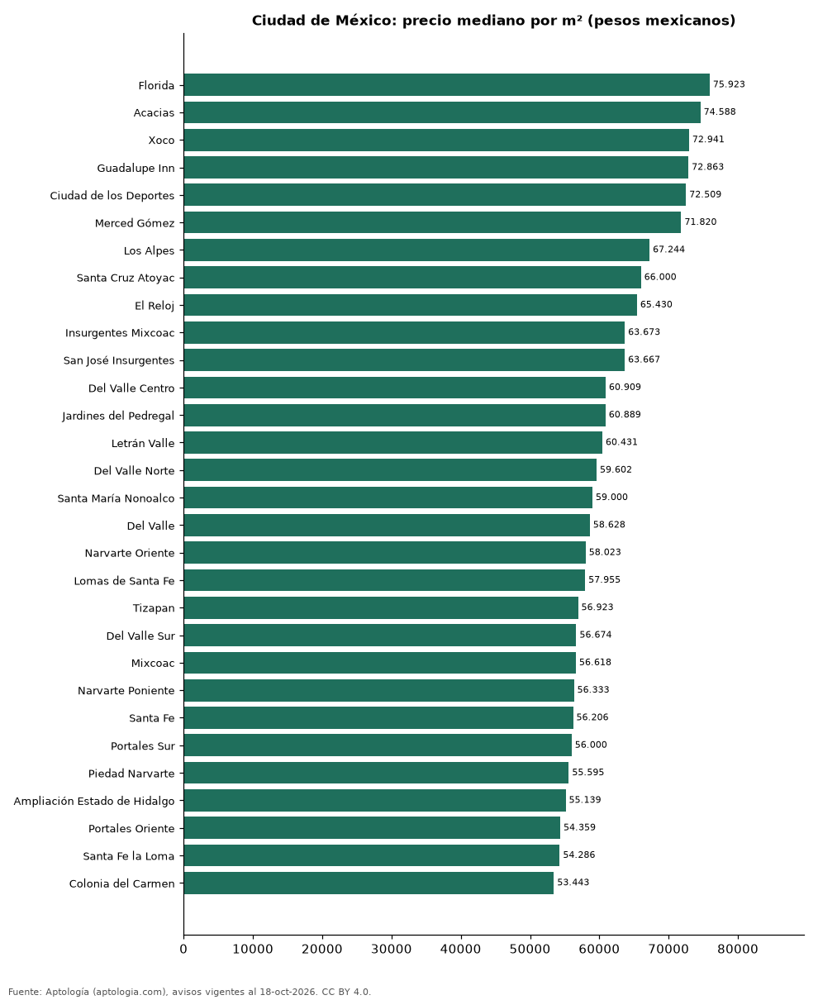

# Colonias más caras y más baratas de Ciudad de México para comprar departamento: ranking por m² (octubre 2026)

**En Ciudad de México, la colonia con el m² más caro para comprar departamento es Florida (75.923 pesos mexicanos (USD 4.112)/m²) y la más barata Villa Coyoacán (43.000 pesos mexicanos (USD 2.329)/m²), 1,8 veces menos.** Comparamos 50 colonias con al menos 30 avisos con área.

*Resumen: analizamos 6.012 departamentos en venta con área declarada en 50 colonias de Ciudad de México.*

**Actualizado:** 18 de octubre de 2026 (datos del 18 de octubre de 2026) · **Próxima actualización:** mensual.

## Resumen

| Indicador | Valor |
|---|---|
| Más caro por m² | Florida: 75.923 pesos mexicanos (USD 4.112) |
| Más barato por m² | Villa Coyoacán: 43.000 pesos mexicanos (USD 2.329) |
| Diferencia | 1,8 veces |
| Colonias | 50 |

## Ranking de colonias por precio del m²

| Colonia | Por m² (mediana) | Precio (mediana) | Área mediana (m²) | Avisos con área |
|---|---|---|---|---|
| Florida | 75.923 pesos mexicanos (USD 4.112) | 7.749.263 pesos mexicanos (USD 419.663) | 97 | 36 |
| Acacias | 74.588 pesos mexicanos (USD 4.039) | 6.360.000 pesos mexicanos (USD 344.427) | 80 | 85 |
| Xoco | 72.941 pesos mexicanos (USD 3.950) | 7.639.088 pesos mexicanos (USD 413.696) | 101 | 111 |
| Guadalupe Inn | 72.863 pesos mexicanos (USD 3.946) | 5.100.000 pesos mexicanos (USD 276.191) | 77 | 88 |
| Ciudad de los Deportes | 72.509 pesos mexicanos (USD 3.927) | 6.008.748 pesos mexicanos (USD 325.405) | 81 | 50 |
| Merced Gómez | 71.820 pesos mexicanos (USD 3.889) | 3.835.833 pesos mexicanos (USD 207.730) | 59 | 91 |
| Los Alpes | 67.244 pesos mexicanos (USD 3.642) | 6.944.249 pesos mexicanos (USD 376.067) | 106 | 361 |
| Santa Cruz Atoyac | 66.000 pesos mexicanos (USD 3.574) | 5.450.000 pesos mexicanos (USD 295.146) | 84 | 113 |
| El Reloj | 65.430 pesos mexicanos (USD 3.543) | 4.468.125 pesos mexicanos (USD 241.972) | 70 | 58 |
| Insurgentes Mixcoac | 63.673 pesos mexicanos (USD 3.448) | 6.600.000 pesos mexicanos (USD 357.424) | 110 | 53 |
| San José Insurgentes | 63.667 pesos mexicanos (USD 3.448) | 10.350.000 pesos mexicanos (USD 560.506) | 201 | 56 |
| Del Valle Centro | 60.909 pesos mexicanos (USD 3.299) | 6.759.158 pesos mexicanos (USD 366.043) | 116 | 457 |
| Jardines del Pedregal | 60.889 pesos mexicanos (USD 3.297) | 7.750.000 pesos mexicanos (USD 419.703) | 150 | 112 |
| Letrán Valle | 60.431 pesos mexicanos (USD 3.273) | 4.975.000 pesos mexicanos (USD 269.422) | 98 | 52 |
| Del Valle Norte | 59.602 pesos mexicanos (USD 3.228) | 6.938.850 pesos mexicanos (USD 375.775) | 129 | 85 |
| Santa María Nonoalco | 59.000 pesos mexicanos (USD 3.195) | 4.900.000 pesos mexicanos (USD 265.360) | 81 | 37 |
| Del Valle | 58.628 pesos mexicanos (USD 3.175) | 6.976.530 pesos mexicanos (USD 377.815) | 123 | 49 |
| Narvarte Oriente | 58.023 pesos mexicanos (USD 3.142) | 5.240.000 pesos mexicanos (USD 283.773) | 87 | 81 |
| Lomas de Santa Fe | 57.955 pesos mexicanos (USD 3.139) | 5.876.670 pesos mexicanos (USD 318.252) | 105 | 116 |
| Tizapan | 56.923 pesos mexicanos (USD 3.083) | 7.500.000 pesos mexicanos (USD 406.164) | 130 | 103 |
| Del Valle Sur | 56.674 pesos mexicanos (USD 3.069) | 6.280.000 pesos mexicanos (USD 340.095) | 107 | 111 |
| Mixcoac | 56.618 pesos mexicanos (USD 3.066) | 4.602.750 pesos mexicanos (USD 249.263) | 81 | 43 |
| Narvarte Poniente | 56.333 pesos mexicanos (USD 3.051) | 5.749.245 pesos mexicanos (USD 311.351) | 100 | 261 |
| Santa Fe | 56.206 pesos mexicanos (USD 3.044) | 7.500.000 pesos mexicanos (USD 406.164) | 140 | 382 |
| Portales Sur | 56.000 pesos mexicanos (USD 3.033) | 4.401.000 pesos mexicanos (USD 238.337) | 75 | 113 |
| Piedad Narvarte | 55.595 pesos mexicanos (USD 3.011) | 4.611.110 pesos mexicanos (USD 249.716) | 80 | 35 |
| Ampliación Estado de Hidalgo | 55.139 pesos mexicanos (USD 2.986) | 4.609.403 pesos mexicanos (USD 249.623) | 88 | 268 |
| Portales Oriente | 54.359 pesos mexicanos (USD 2.944) | 4.096.870 pesos mexicanos (USD 221.867) | 71 | 70 |
| Santa Fe la Loma | 54.286 pesos mexicanos (USD 2.940) | 13.750.000 pesos mexicanos (USD 744.634) | 265 | 57 |
| Colonia del Carmen | 53.443 pesos mexicanos (USD 2.894) | 4.409.000 pesos mexicanos (USD 238.770) | 78 | 57 |
| Portales Norte | 53.180 pesos mexicanos (USD 2.880) | 3.980.000 pesos mexicanos (USD 215.538) | 73 | 129 |
| Nápoles | 52.850 pesos mexicanos (USD 2.862) | 5.008.928 pesos mexicanos (USD 271.259) | 88 | 854 |
| Progreso Tizapan | 52.627 pesos mexicanos (USD 2.850) | 7.900.000 pesos mexicanos (USD 427.826) | 110 | 34 |
| Alamos | 52.625 pesos mexicanos (USD 2.850) | 3.600.000 pesos mexicanos (USD 194.959) | 75 | 79 |
| Carola | 52.500 pesos mexicanos (USD 2.843) | 3.350.000 pesos mexicanos (USD 181.420) | 65 | 47 |
| San Pedro de los Pinos | 52.164 pesos mexicanos (USD 2.825) | 4.184.550 pesos mexicanos (USD 226.615) | 78 | 188 |
| Lomas de Tarango | 52.053 pesos mexicanos (USD 2.819) | 4.025.914 pesos mexicanos (USD 218.024) | 86 | 66 |
| Las Águilas | 51.709 pesos mexicanos (USD 2.800) | 5.757.861 pesos mexicanos (USD 311.818) | 90 | 76 |
| Alcantarilla | 51.580 pesos mexicanos (USD 2.793) | 7.075.000 pesos mexicanos (USD 383.148) | 200 | 30 |
| Tetelpan | 50.050 pesos mexicanos (USD 2.710) | 5.467.150 pesos mexicanos (USD 296.075) | 112 | 200 |
| Colonia Olivar de los Padres | 49.426 pesos mexicanos (USD 2.677) | 5.400.000 pesos mexicanos (USD 292.438) | 112 | 205 |
| Lomas de los Angeles del Pueblo Tetelpan | 47.606 pesos mexicanos (USD 2.578) | 5.455.400 pesos mexicanos (USD 295.438) | 112 | 40 |
| Pedregal de Carrasco | 46.709 pesos mexicanos (USD 2.530) | 3.341.230 pesos mexicanos (USD 180.945) | 79 | 49 |
| Ex-Ejido de Santa Úrsula Coapa | 46.702 pesos mexicanos (USD 2.529) | 4.479.625 pesos mexicanos (USD 242.595) | 82 | 49 |
| Insurgentes Cuicuilco | 46.465 pesos mexicanos (USD 2.516) | 5.500.000 pesos mexicanos (USD 297.854) | 120 | 33 |
| Los Reyes | 45.870 pesos mexicanos (USD 2.484) | 3.586.000 pesos mexicanos (USD 194.201) | 78 | 56 |
| Ajusco | 45.833 pesos mexicanos (USD 2.482) | 2.999.999 pesos mexicanos (USD 162.466) | 64 | 47 |
| Pedregal de Santa Ursula | 44.118 pesos mexicanos (USD 2.389) | 2.800.000 pesos mexicanos (USD 151.635) | 61 | 55 |
| Alfonso XIII | 44.074 pesos mexicanos (USD 2.387) | 4.741.425 pesos mexicanos (USD 256.773) | 86 | 31 |
| Villa Coyoacán | 43.000 pesos mexicanos (USD 2.329) | 3.210.345 pesos mexicanos (USD 173.857) | 78 | 153 |

Medianas; solo colonias con 30 avisos o más con área declarada.

## Preguntas frecuentes

**¿Cuál es la colonia más cara de Ciudad de México para comprar?**
Florida, con 75.923 pesos mexicanos (USD 4.112) por m² en la mediana (octubre de 2026).

**¿Y la más barata?**
Villa Coyoacán, con 43.000 pesos mexicanos (USD 2.329) por m².

## Metodología

- **Fuente:** exportes nocturnos de la base de datos de Aptología (aptologia.com) del 18 de octubre de 2026: avisos vigentes de vivienda en portales inmobiliarios de 13 países, recogidos por Aptología y vistos en línea entre el 11 y el 18 de octubre de 2026. Corte: 18 de octubre de 2026.
- **Depuración:** se eliminan duplicados exactos (misma ciudad, zona, tipo, precio, moneda, área, habitaciones y baños) y los precios fuera del percentil 1–99 de cada país, operación, moneda y tipo; el precio por m² usa solo avisos con área declarada entre 12 y 2.000 m² y también se recorta al P1–P99.
- **Qué se mide:** precios pedidos (publicados), no precios de cierre. En arriendo, el canon mensual sin administración, gastos comunes ni condominio.
- **Muestra mínima:** cada cifra publicada se apoya en al menos 30 avisos; las celdas con menos se omiten.
- **Monedas:** nunca se mezclan avisos de monedas distintas sin convertirlos. Conversión a dólares con la tasa de mercado de ExchangeRate-API (open.er-api.com, actualización del 18 Oct 2026): 1 USD = 3.182,80 COP, 1 USD = 18,47 M.N, 1 USD = 5,09 BRL, 1 USD = 3,44 PEN, 1 USD = 982,44 CLP, 1 USD = 1.514,57 ARS, 1 USD = 40,20 UYU, 1 USD = 5.705,37 PYG, 1 USD = 61,27 DOP, 1 USD = 0,89 EUR, 1 USD = 11,72 BOB; la UF chilena a 41.178,64 CLP (mindicador,cl. 18-oct-2026). Los avisos publicados en dólares se usan tal cual.
- **Monedas:** en cada ciudad y operación se usa solo la moneda mayoritaria de los avisos (los avisos en otra moneda se excluyen) y la mediana se convierte a dólares con la tasa citada; nunca se promedian avisos de monedas distintas.
- **Limitaciones:** la cobertura depende de los portales que recorre Aptología en cada país y es mayor en las ciudades grandes y en los segmentos medio-alto y alto; el área es la que declara el aviso, sin verificar; los nombres de zona vienen de los portales.
- **Privacidad:** solo se publican agregados; no se publica ningún dato personal, enlace a avisos ni nombre de anunciante.
- **Datos abiertos:** [datos.csv](datos.csv), licencia CC BY 4.0.

## Cómo citar

Pinzón Pineda, D. M. (2026). *Colonias más caras y más baratas de Ciudad de México para comprar departamento: ranking por m² (octubre 2026)*. Aptología (aptologia.com). https://github.com/elbroker/aptologia-datos/tree/main/estudios/colonias-mas-caras-y-baratas-ciudad-de-mexico-venta-m2-2026. Datos: datos.csv, licencia CC BY 4.0.
