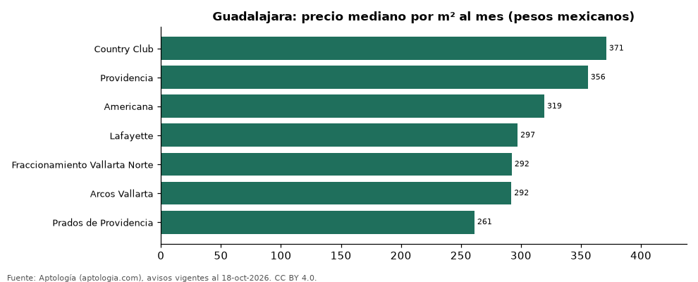

# Colonias más caras y más baratas de Guadalajara para rentar departamento: ranking por m² (octubre 2026)

**En Guadalajara, la colonia con el m² más caro para rentar departamento es Country Club (371,1 pesos mexicanos (USD 20,1)/m² al mes) y la más barata Prados de Providencia (261,2 pesos mexicanos (USD 14,1)/m² al mes), 1,4 veces menos.** Comparamos 7 colonias con al menos 30 avisos con área.

*Resumen: analizamos 478 departamentos en renta con área declarada en 7 colonias de Guadalajara.*

**Actualizado:** 18 de octubre de 2026 (datos del 18 de octubre de 2026) · **Próxima actualización:** mensual.

## Resumen

| Indicador | Valor |
|---|---|
| Más caro por m² | Country Club: 371,1 pesos mexicanos (USD 20,1) |
| Más barato por m² | Prados de Providencia: 261,2 pesos mexicanos (USD 14,1) |
| Diferencia | 1,4 veces |
| Colonias | 7 |

## Ranking de colonias por precio del m²

| Colonia | Por m² (mediana) | Canon (mediana) | Área mediana (m²) | Avisos con área |
|---|---|---|---|---|
| Country Club | 371,1 pesos mexicanos (USD 20,1) | 28.000 pesos mexicanos (USD 1.516) | 79 | 108 |
| Providencia | 355,8 pesos mexicanos (USD 19,3) | 27.500 pesos mexicanos (USD 1.489) | 83 | 94 |
| Americana | 319,4 pesos mexicanos (USD 17,3) | 21.000 pesos mexicanos (USD 1.137) | 65 | 93 |
| Lafayette | 297,2 pesos mexicanos (USD 16,1) | 23.000 pesos mexicanos (USD 1.246) | 88 | 32 |
| Fraccionamiento Vallarta Norte | 292,3 pesos mexicanos (USD 15,8) | 32.500 pesos mexicanos (USD 1.760) | 125 | 36 |
| Arcos Vallarta | 292,0 pesos mexicanos (USD 15,8) | 21.000 pesos mexicanos (USD 1.137) | 74 | 73 |
| Prados de Providencia | 261,2 pesos mexicanos (USD 14,1) | 26.900 pesos mexicanos (USD 1.457) | 100 | 42 |

Medianas; solo colonias con 30 avisos o más con área declarada.

## Preguntas frecuentes

**¿Cuál es la colonia más cara de Guadalajara para rentar?**
Country Club, con 371,1 pesos mexicanos (USD 20,1) por m² al mes en la mediana (octubre de 2026).

**¿Y la más barata?**
Prados de Providencia, con 261,2 pesos mexicanos (USD 14,1) por m² al mes.

## Metodología

- **Fuente:** exportes nocturnos de la base de datos de Aptología (aptologia.com) del 18 de octubre de 2026: avisos vigentes de vivienda en portales inmobiliarios de 13 países, recogidos por Aptología y vistos en línea entre el 11 y el 18 de octubre de 2026. Corte: 18 de octubre de 2026.
- **Depuración:** se eliminan duplicados exactos (misma ciudad, zona, tipo, precio, moneda, área, habitaciones y baños) y los precios fuera del percentil 1–99 de cada país, operación, moneda y tipo; el precio por m² usa solo avisos con área declarada entre 12 y 2.000 m² y también se recorta al P1–P99.
- **Qué se mide:** precios pedidos (publicados), no precios de cierre. En arriendo, el canon mensual sin administración, gastos comunes ni condominio.
- **Muestra mínima:** cada cifra publicada se apoya en al menos 30 avisos; las celdas con menos se omiten.
- **Monedas:** nunca se mezclan avisos de monedas distintas sin convertirlos. Conversión a dólares con la tasa de mercado de ExchangeRate-API (open.er-api.com, actualización del 18 Oct 2026): 1 USD = 3.182,80 COP, 1 USD = 18,47 M.N, 1 USD = 5,09 BRL, 1 USD = 3,44 PEN, 1 USD = 982,44 CLP, 1 USD = 1.514,57 ARS, 1 USD = 40,20 UYU, 1 USD = 5.705,37 PYG, 1 USD = 61,27 DOP, 1 USD = 0,89 EUR, 1 USD = 11,72 BOB; la UF chilena a 41.178,64 CLP (mindicador,cl. 18-oct-2026). Los avisos publicados en dólares se usan tal cual.
- **Monedas:** en cada ciudad y operación se usa solo la moneda mayoritaria de los avisos (los avisos en otra moneda se excluyen) y la mediana se convierte a dólares con la tasa citada; nunca se promedian avisos de monedas distintas.
- **Limitaciones:** la cobertura depende de los portales que recorre Aptología en cada país y es mayor en las ciudades grandes y en los segmentos medio-alto y alto; el área es la que declara el aviso, sin verificar; los nombres de zona vienen de los portales.
- **Privacidad:** solo se publican agregados; no se publica ningún dato personal, enlace a avisos ni nombre de anunciante.
- **Datos abiertos:** [datos.csv](datos.csv), licencia CC BY 4.0.

## Cómo citar

Pinzón Pineda, D. M. (2026). *Colonias más caras y más baratas de Guadalajara para rentar departamento: ranking por m² (octubre 2026)*. Aptología (aptologia.com). https://github.com/elbroker/aptologia-datos/tree/main/estudios/colonias-mas-caras-y-baratas-guadalajara-renta-m2-2026. Datos: datos.csv, licencia CC BY 4.0.
