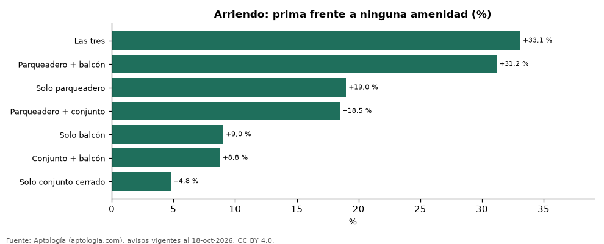

# Parqueadero, conjunto cerrado y balcón: cuánto suben el arriendo cuando vienen juntos en Colombia (octubre 2026)

**En Colombia, un apartamento en arriendo con las tres se pide +33,1 % frente a uno sin ninguna de las tres amenidades (parqueadero, conjunto cerrado y balcón) de la misma ciudad, estrato, habitaciones y rango de área; con solo conjunto cerrado, +4,8 %.** La combinación más común en la oferta es las tres (45,7 % de los avisos).

*Resumen: comparamos 58.435 apartamentos en arriendo según tengan parqueadero, conjunto cerrado y balcón, dentro de cada ciudad, estrato y número de habitaciones.*

**Actualizado:** 18 de octubre de 2026 (datos del 18 de octubre de 2026) · **Próxima actualización:** mensual.

## Resumen

| Indicador | Valor |
|---|---|
| Mayor prima | Las tres: +33,1 % |
| Menor prima | Solo conjunto cerrado: +4,8 % |
| Combinación más común | Las tres (45,7 %) |

## Prima de cada combinación frente a ninguna amenidad

| Combinación | Prima frente a ninguna | Avisos con la combinación | Celdas |
|---|---|---|---|
| Las tres | +33,1 % | 899 | 8 |
| Parqueadero + balcón | +31,2 % | 408 | 5 |
| Solo parqueadero | +19,0 % | 405 | 7 |
| Parqueadero + conjunto | +18,5 % | 323 | 6 |
| Solo balcón | +9,0 % | 254 | 5 |
| Conjunto + balcón | +8,8 % | 227 | 4 |
| Solo conjunto cerrado | +4,8 % | 326 | 5 |

Promedio ponderado de celdas ciudad × estrato × habitaciones × rango de área con 30 avisos o más con la combinación y 30 o más sin ninguna.

## Qué tan común es cada combinación

| Combinación | Parte de la oferta |
|---|---|
| Las tres | 45,7 % |
| Parqueadero + balcón | 21,8 % |
| Solo parqueadero | 10,5 % |
| Parqueadero + conjunto | 9,8 % |
| Ninguna | 4,6 % |
| Conjunto + balcón | 3,1 % |
| Solo balcón | 2,8 % |
| Solo conjunto cerrado | 1,8 % |

## Preguntas frecuentes

**¿Cuánto sube el arriendo un apartamento con parqueadero y conjunto cerrado?**
+18,5 % frente a uno comparable sin parqueadero, conjunto ni balcón.

**¿Qué combinación de amenidades encarece más el arriendo?**
Las tres: +33,1 %.

## Metodología

- **Fuente:** exportes nocturnos de la base de datos de Aptología (aptologia.com) del 18 de octubre de 2026: avisos vigentes de vivienda en portales inmobiliarios de 13 países, recogidos por Aptología y vistos en línea entre el 11 y el 18 de octubre de 2026. Corte: 18 de octubre de 2026.
- **Depuración:** se eliminan duplicados exactos (misma ciudad, zona, tipo, precio, moneda, área, habitaciones y baños) y los precios fuera del percentil 1–99 de cada país, operación, moneda y tipo; el precio por m² usa solo avisos con área declarada entre 12 y 2.000 m² y también se recorta al P1–P99.
- **Qué se mide:** precios pedidos (publicados), no precios de cierre. En arriendo, el canon mensual sin administración, gastos comunes ni condominio.
- **Muestra mínima:** cada cifra publicada se apoya en al menos 30 avisos; las celdas con menos se omiten.
- **Colombia:** Precios en pesos colombianos, sin conversión de moneda.
- **Amenidades:** parqueadero (1 o más declarados), conjunto cerrado y balcón, según los campos del aviso. Piscina, gimnasio y ascensor no vienen en los datos.
- **Comparación emparejada:** cada combinación se compara con los avisos sin ninguna de las tres amenidades en la misma celda ciudad × estrato × habitaciones × rango de área. Para no confundir el efecto con el tamaño, las celdas también se separan por rango de área declarada (<50, 50–70, 70–90, 90–120, 120–160 y más de 160 m²); solo entran avisos con área.
- **Limitaciones:** la cobertura depende de los portales que recorre Aptología en cada país y es mayor en las ciudades grandes y en los segmentos medio-alto y alto; el área es la que declara el aviso, sin verificar; los nombres de zona vienen de los portales.
- **Privacidad:** solo se publican agregados; no se publica ningún dato personal, enlace a avisos ni nombre de anunciante.
- **Datos abiertos:** [datos.csv](datos.csv), licencia CC BY 4.0.

## Cómo citar

Pinzón Pineda, D. M. (2026). *Parqueadero, conjunto cerrado y balcón: cuánto suben el arriendo cuando vienen juntos en Colombia (octubre 2026)*. Aptología (aptologia.com). https://github.com/elbroker/aptologia-datos/tree/main/estudios/combinaciones-de-amenidades-arriendo-colombia-2026. Datos: datos.csv, licencia CC BY 4.0.
