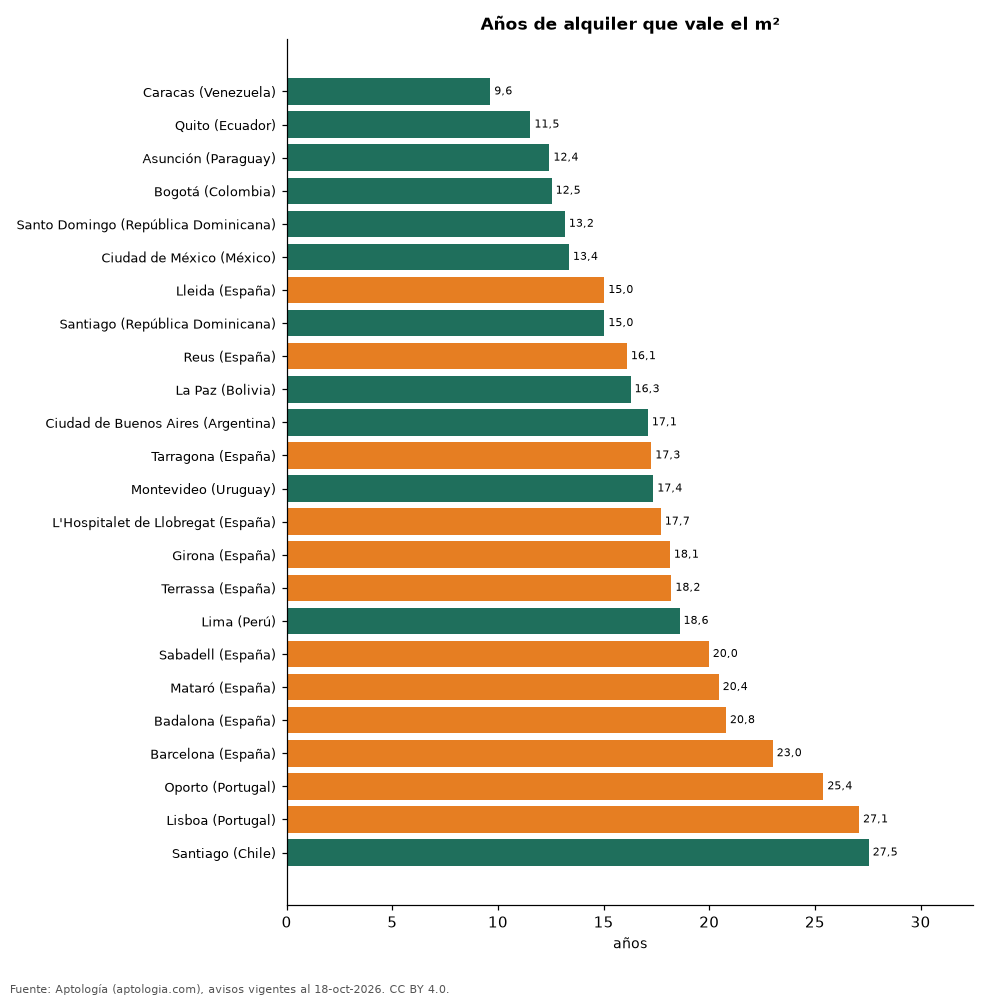

# ¿Comprar o alquilar? Años de alquiler que vale la vivienda en Barcelona, Lisboa, Oporto y las capitales de Latinoamérica (octubre 2026)

**En Lisboa el metro cuadrado de un apartamento equivale a 27,1 años de su alquiler y en Barcelona a 23,0 años, frente a 12,5 años en Bogotá.** En la comparación, la relación más baja está en Caracas (Venezuela) (9,6 años) y la más alta en Santiago (Chile) (27,5).

*Resumen: comparamos la relación precio/alquiler del metro cuadrado en 10 municipios catalanes con datos oficiales y en 14 capitales y Oporto con avisos.*

**Actualizado:** 18 de octubre de 2026 (datos del 18 de octubre de 2026) · **Próxima actualización:** mensual.

## Resumen

| Indicador | Valor |
|---|---|
| Lisboa | 27,1 años |
| Barcelona | 23,0 años |
| Bogotá | 12,5 años |
| Más baja | Caracas (Venezuela): 9,6 |

## Años de alquiler que vale el metro cuadrado

| Ciudad | Años de alquiler que vale el m² | Rentabilidad bruta | Fuente |
|---|---|---|---|
| Caracas (Venezuela) | 9,6 | 10,4 % | Avisos (Aptología) |
| Quito (Ecuador) | 11,5 | 8,7 % | Avisos (Aptología) |
| Asunción (Paraguay) | 12,4 | 8,0 % | Avisos (Aptología) |
| Bogotá (Colombia) | 12,5 | 8,0 % | Avisos (Aptología) |
| Santo Domingo (República Dominicana) | 13,2 | 7,6 % | Avisos (Aptología) |
| Ciudad de México (México) | 13,4 | 7,5 % | Avisos (Aptología) |
| Lleida (España) | 15,0 | 6,7 % | Oficial (Incasòl + MIVAU) |
| Santiago (República Dominicana) | 15,0 | 6,6 % | Avisos (Aptología) |
| Reus (España) | 16,1 | 6,2 % | Oficial (Incasòl + MIVAU) |
| La Paz (Bolivia) | 16,3 | 6,1 % | Avisos (Aptología) |
| Ciudad de Buenos Aires (Argentina) | 17,1 | 5,8 % | Avisos (Aptología) |
| Tarragona (España) | 17,3 | 5,8 % | Oficial (Incasòl + MIVAU) |
| Montevideo (Uruguay) | 17,4 | 5,8 % | Avisos (Aptología) |
| L'Hospitalet de Llobregat (España) | 17,7 | 5,6 % | Oficial (Incasòl + MIVAU) |
| Girona (España) | 18,1 | 5,5 % | Oficial (Incasòl + MIVAU) |
| Terrassa (España) | 18,2 | 5,5 % | Oficial (Incasòl + MIVAU) |
| Lima (Perú) | 18,6 | 5,4 % | Avisos (Aptología) |
| Sabadell (España) | 20,0 | 5,0 % | Oficial (Incasòl + MIVAU) |
| Mataró (España) | 20,4 | 4,9 % | Oficial (Incasòl + MIVAU) |
| Badalona (España) | 20,8 | 4,8 % | Oficial (Incasòl + MIVAU) |
| Barcelona (España) | 23,0 | 4,3 % | Oficial (Incasòl + MIVAU) |
| Oporto (Portugal) | 25,4 | 3,9 % | Avisos (Aptología) |
| Lisboa (Portugal) | 27,1 | 3,7 % | Avisos (Aptología) |
| Santiago (Chile) | 27,5 | 3,6 % | Avisos (Aptología) |

España: alquiler por m² de contratos (Incasòl) y valor tasado por m² (MIVAU). Resto: medianas de avisos de apartamentos en venta y en arriendo por m². Las fuentes no son idénticas.

## Preguntas frecuentes

**¿Rinde más alquilar un piso en Barcelona o en Bogotá?**
Por relación precio/alquiler, Bogotá: 12,5 años frente a 23,0.

**¿Cuántos años de alquiler vale un piso en Lisboa?**
27,1 años por metro cuadrado (avisos de octubre de 2026).

## Metodología

- **Fuente:** exportes nocturnos de la base de datos de Aptología (aptologia.com) del 18 de octubre de 2026: avisos vigentes de vivienda en portales inmobiliarios de 13 países, recogidos por Aptología y vistos en línea entre el 11 y el 18 de octubre de 2026. Corte: 18 de octubre de 2026.
- **Depuración:** se eliminan duplicados exactos (misma ciudad, zona, tipo, precio, moneda, área, habitaciones y baños) y los precios fuera del percentil 1–99 de cada país, operación, moneda y tipo; el precio por m² usa solo avisos con área declarada entre 12 y 2.000 m² y también se recorta al P1–P99.
- **Qué se mide:** precios pedidos (publicados), no precios de cierre. En arriendo, el canon mensual sin administración, gastos comunes ni condominio.
- **Muestra mínima:** cada cifra publicada se apoya en al menos 30 avisos; las celdas con menos se omiten.
- **Monedas:** nunca se mezclan avisos de monedas distintas sin convertirlos. Conversión a dólares con la tasa de mercado de ExchangeRate-API (open.er-api.com, actualización del 18 Oct 2026): 1 USD = 3.182,80 COP, 1 USD = 18,47 M.N, 1 USD = 5,09 BRL, 1 USD = 3,44 PEN, 1 USD = 982,44 CLP, 1 USD = 1.514,57 ARS, 1 USD = 40,20 UYU, 1 USD = 5.705,37 PYG, 1 USD = 61,27 DOP, 1 USD = 0,89 EUR, 1 USD = 11,72 BOB; la UF chilena a 41.178,64 CLP (mindicador,cl. 18-oct-2026). Los avisos publicados en dólares se usan tal cual.
- **Monedas:** en cada ciudad y operación se usa solo la moneda mayoritaria de los avisos (los avisos en otra moneda se excluyen) y la mediana se convierte a dólares con la tasa citada; nunca se promedian avisos de monedas distintas.
- **Años de arriendo para pagar la vivienda:** precio de venta mediano ÷ (canon mensual mediano × 12), entre avisos del mismo tipo y celda; es la relación precio/arriendo (price-to-rent ratio) y equivale a 100 ÷ rentabilidad bruta. No incluye administración, impuestos, vacancia, financiación ni valorización: es una referencia para comparar comprar con arrendar, no una recomendación de inversión.
- **España:** datos oficiales (Incasòl, alquiler de contratos 2024–2025; MIVAU, valor tasado 2026); los años no coinciden y no son precios pedidos.
- **Limitaciones:** la cobertura depende de los portales que recorre Aptología en cada país y es mayor en las ciudades grandes y en los segmentos medio-alto y alto; el área es la que declara el aviso, sin verificar; los nombres de zona vienen de los portales.
- **Privacidad:** solo se publican agregados; no se publica ningún dato personal, enlace a avisos ni nombre de anunciante.
- **Datos abiertos:** [datos.csv](datos.csv), licencia CC BY 4.0.

## Cómo citar

Pinzón Pineda, D. M. (2026). *¿Comprar o alquilar? Años de alquiler que vale la vivienda en Barcelona, Lisboa, Oporto y las capitales de Latinoamérica (octubre 2026)*. Aptología (aptologia.com). https://github.com/elbroker/aptologia-datos/tree/main/estudios/comprar-o-alquilar-espana-portugal-vs-latinoamerica-2026. Datos: datos.csv, licencia CC BY 4.0.
