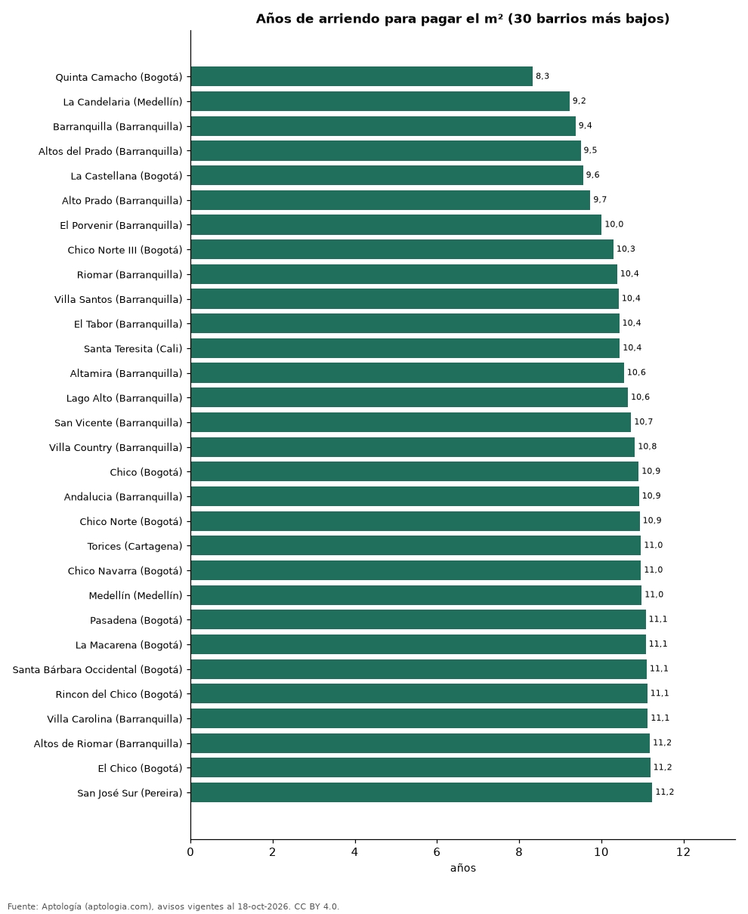

# ¿Comprar o arrendar? Años de arriendo que vale el metro cuadrado en 324 barrios de Colombia (octubre 2026)

**El barrio de Colombia donde el metro cuadrado se paga con menos años de arriendo es Quinta Camacho (Bogotá): 8,3 años; en Manzanillo (Cartagena) hacen falta 22,7 años.** En Bogotá, de 8,3 años (Quinta Camacho) a 16,4 (Santa Bárbara Alta). En Medellín, de 9,2 años (La Candelaria) a 16,7 (La Castellana). En Barranquilla, de 9,4 años (Barranquilla) a 14,2 (Alameda del Río). En Cali, de 10,4 años (Santa Teresita) a 14,3 (Bochalema). En Cartagena, de 11,0 años (Torices) a 22,7 (Manzanillo).

*Resumen: cruzamos el precio por m² en venta y en arriendo de apartamentos en 324 barrios con 30 avisos o más en cada operación.*

**Actualizado:** 18 de octubre de 2026 (datos del 18 de octubre de 2026) · **Próxima actualización:** mensual.

## Resumen

| Indicador | Valor |
|---|---|
| Barrios comparados | 324 |
| Menos años | Quinta Camacho (Bogotá): 8,3 |
| Más años | Manzanillo (Cartagena): 22,7 |
| Mediana de los barrios | 14,0 años |

## Los 30 barrios con menos años y los 20 con más

| Barrio | Ciudad | Venta por m² (millones) | Arriendo por m² al mes | Años de arriendo | Avisos (venta / arriendo) |
|---|---|---|---|---|---|
| Quinta Camacho | Bogotá | 6,71 | 67.105 | 8,3 | 46 / 31 |
| La Candelaria | Medellín | 4,62 | 41.742 | 9,2 | 180 / 90 |
| Barranquilla | Barranquilla | 4,66 | 41.458 | 9,4 | 83 / 48 |
| Altos del Prado | Barranquilla | 3,85 | 33.750 | 9,5 | 461 / 195 |
| La Castellana | Bogotá | 8,03 | 70.000 | 9,6 | 98 / 37 |
| Alto Prado | Barranquilla | 3,82 | 32.697 | 9,7 | 421 / 160 |
| El Porvenir | Barranquilla | 3,70 | 30.769 | 10,0 | 75 / 65 |
| Chico Norte III | Bogotá | 8,45 | 68.367 | 10,3 | 107 / 37 |
| Riomar | Barranquilla | 5,10 | 40.952 | 10,4 | 340 / 198 |
| Villa Santos | Barranquilla | 4,75 | 37.975 | 10,4 | 379 / 195 |
| El Tabor | Barranquilla | 3,68 | 29.377 | 10,4 | 83 / 56 |
| Santa Teresita | Cali | 5,47 | 43.614 | 10,4 | 364 / 62 |
| Altamira | Barranquilla | 5,35 | 42.242 | 10,6 | 39 / 32 |
| Lago Alto | Barranquilla | 5,43 | 42.464 | 10,6 | 81 / 38 |
| San Vicente | Barranquilla | 4,23 | 32.899 | 10,7 | 112 / 84 |
| Villa Country | Barranquilla | 4,14 | 31.875 | 10,8 | 165 / 77 |
| Chico | Bogotá | 8,87 | 67.765 | 10,9 | 613 / 296 |
| Andalucia | Barranquilla | 4,27 | 32.585 | 10,9 | 110 / 50 |
| Chico Norte | Bogotá | 8,99 | 68.500 | 10,9 | 820 / 504 |
| Torices | Cartagena | 6,20 | 47.128 | 11,0 | 110 / 52 |
| Chico Navarra | Bogotá | 7,85 | 59.630 | 11,0 | 425 / 108 |
| Medellín | Medellín | 6,59 | 50.000 | 11,0 | 75 / 71 |
| Pasadena | Bogotá | 7,77 | 58.462 | 11,1 | 204 / 59 |
| La Macarena | Bogotá | 7,88 | 59.217 | 11,1 | 35 / 48 |
| Santa Bárbara Occidental | Bogotá | 7,35 | 55.180 | 11,1 | 350 / 112 |
| Rincon del Chico | Bogotá | 6,86 | 51.429 | 11,1 | 141 / 39 |
| Villa Carolina | Barranquilla | 4,65 | 34.808 | 11,1 | 134 / 74 |
| Altos de Riomar | Barranquilla | 4,36 | 32.520 | 11,2 | 513 / 201 |
| El Chico | Bogotá | 8,86 | 65.980 | 11,2 | 184 / 98 |
| San José Sur | Pereira | 4,86 | 36.000 | 11,2 | 49 / 35 |
| Santa Bárbara Alta | Bogotá | 10,47 | 53.250 | 16,4 | 144 / 63 |
| Playa Salguero | Santa Marta | 9,84 | 50.000 | 16,4 | 293 / 39 |
| Las Vegas | Envigado | 10,22 | 51.765 | 16,5 | 126 / 167 |
| Galicia | Pereira | 5,81 | 29.375 | 16,5 | 166 / 89 |
| Pozos Colorados | Santa Marta | 10,50 | 52.273 | 16,7 | 498 / 89 |
| La Castellana | Medellín | 7,31 | 36.364 | 16,7 | 193 / 171 |
| Pantanillo | El Retiro | 8,73 | 43.333 | 16,8 | 66 / 61 |
| Fontibon | Rionegro | 6,01 | 29.630 | 16,9 | 260 / 125 |
| Barro Blanco | Rionegro | 8,16 | 40.230 | 16,9 | 223 / 203 |
| San Antonio de Pereira | Rionegro | 7,93 | 38.889 | 17,0 | 201 / 147 |
| Santa Ana | Rionegro | 7,56 | 36.986 | 17,0 | 92 / 141 |
| La Boquilla | Cartagena | 10,00 | 48.816 | 17,1 | 384 / 152 |
| San Nicolas | Rionegro | 8,37 | 40.000 | 17,4 | 31 / 54 |
| San Antonio | Rionegro | 7,97 | 37.879 | 17,5 | 78 / 129 |
| Zona Norte | Cartagena | 8,98 | 42.370 | 17,7 | 122 / 36 |
| Los Colegios | Rionegro | 7,68 | 35.566 | 18,0 | 100 / 208 |
| Ojo de Agua | Rionegro | 7,87 | 36.184 | 18,1 | 62 / 67 |
| Zona Centro | Envigado | 8,55 | 36.735 | 19,4 | 92 / 31 |
| Manzanillo del Mar | Cartagena | 11,22 | 44.017 | 21,2 | 69 / 56 |
| Manzanillo | Cartagena | 11,98 | 43.923 | 22,7 | 124 / 64 |

Precio de venta por m² ÷ (arriendo mensual por m² × 12). Ver datos.csv para todos los barrios.

## Preguntas frecuentes

**¿En qué barrio de Colombia conviene más comprar para arrendar?**
Por relación precio/arriendo, en Quinta Camacho (Bogotá): 8,3 años, una rentabilidad bruta de 12,0 %.

**¿Cuántos años de arriendo vale un metro cuadrado en Colombia?**
La mediana de 324 barrios es 14,0 años.

## Metodología

- **Fuente:** exportes nocturnos de la base de datos de Aptología (aptologia.com) del 18 de octubre de 2026: avisos vigentes de vivienda en portales inmobiliarios de 13 países, recogidos por Aptología y vistos en línea entre el 11 y el 18 de octubre de 2026. Corte: 18 de octubre de 2026.
- **Depuración:** se eliminan duplicados exactos (misma ciudad, zona, tipo, precio, moneda, área, habitaciones y baños) y los precios fuera del percentil 1–99 de cada país, operación, moneda y tipo; el precio por m² usa solo avisos con área declarada entre 12 y 2.000 m² y también se recorta al P1–P99.
- **Qué se mide:** precios pedidos (publicados), no precios de cierre. En arriendo, el canon mensual sin administración, gastos comunes ni condominio.
- **Muestra mínima:** cada cifra publicada se apoya en al menos 30 avisos; las celdas con menos se omiten.
- **Colombia:** Precios en pesos colombianos, sin conversión de moneda.
- **Años de arriendo para pagar la vivienda:** precio de venta mediano ÷ (canon mensual mediano × 12), entre avisos del mismo tipo y celda; es la relación precio/arriendo (price-to-rent ratio) y equivale a 100 ÷ rentabilidad bruta. No incluye administración, impuestos, vacancia, financiación ni valorización: es una referencia para comparar comprar con arrendar, no una recomendación de inversión.
- **Limitaciones:** la cobertura depende de los portales que recorre Aptología en cada país y es mayor en las ciudades grandes y en los segmentos medio-alto y alto; el área es la que declara el aviso, sin verificar; los nombres de zona vienen de los portales.
- **Privacidad:** solo se publican agregados; no se publica ningún dato personal, enlace a avisos ni nombre de anunciante.
- **Datos abiertos:** [datos.csv](datos.csv), licencia CC BY 4.0.

## Cómo citar

Pinzón Pineda, D. M. (2026). *¿Comprar o arrendar? Años de arriendo que vale el metro cuadrado en 324 barrios de Colombia (octubre 2026)*. Aptología (aptologia.com). https://github.com/elbroker/aptologia-datos/tree/main/estudios/comprar-o-arrendar-por-barrio-colombia-2026. Datos: datos.csv, licencia CC BY 4.0.
