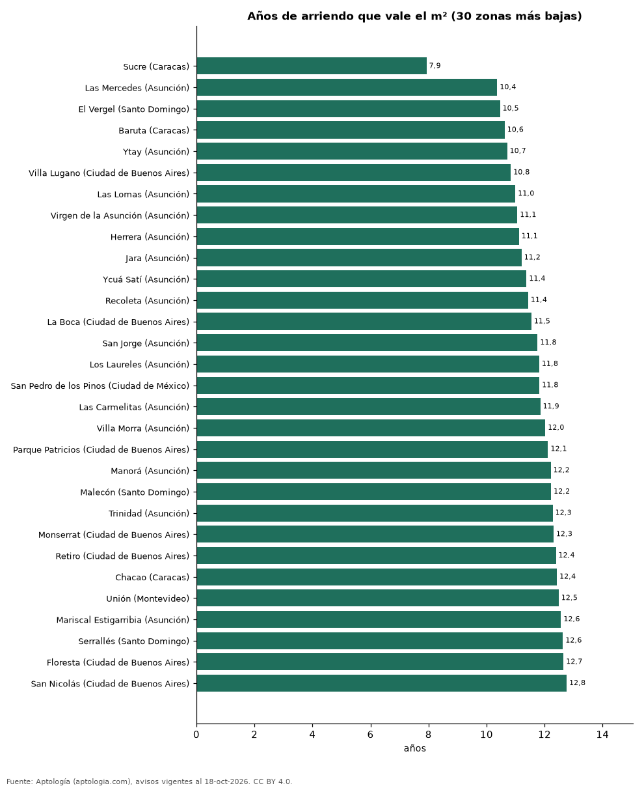

# ¿Comprar o arrendar? Años de arriendo que vale el metro cuadrado en 138 barrios, distritos y comunas de Latinoamérica y Portugal (octubre 2026)

**La zona de Latinoamérica (fuera de Colombia) donde el metro cuadrado se paga con menos años de arriendo es Sucre (Caracas, Venezuela): 7,9 años; en Lumiar (Lisboa, Portugal) hacen falta 31,5.** La ciudad con la mediana de zonas más baja es Caracas (Venezuela) (10,6 años) y la más alta Lisboa (Portugal) (30,0).

*Resumen: cruzamos el precio por m² en venta y en arriendo de apartamentos en 138 zonas de 14 ciudades con 30 avisos o más en cada operación.*

**Actualizado:** 18 de octubre de 2026 (datos del 18 de octubre de 2026) · **Próxima actualización:** mensual.

## Resumen

| Indicador | Valor |
|---|---|
| Zonas comparadas | 138 |
| Menos años | Sucre (Caracas): 7,9 |
| Más años | Lumiar (Lisboa): 31,5 |

## Las 30 zonas con menos años y las 15 con más

| Zona | Ciudad | Venta USD/m² | Arriendo USD/m² al mes | Años de arriendo |
|---|---|---|---|---|
| Sucre | Caracas (Venezuela) | USD 1.000 | 10,5 | 7,9 |
| Las Mercedes | Asunción (Paraguay) | USD 1.575 | 12,7 | 10,4 |
| El Vergel | Santo Domingo (República Dominicana) | USD 1.766 | 14,1 | 10,5 |
| Baruta | Caracas (Venezuela) | USD 1.500 | 11,8 | 10,6 |
| Ytay | Asunción (Paraguay) | USD 1.630 | 12,7 | 10,7 |
| Villa Lugano | Ciudad de Buenos Aires (Argentina) | USD 1.213 | 9,3 | 10,8 |
| Las Lomas | Asunción (Paraguay) | USD 2.143 | 16,2 | 11,0 |
| Virgen de la Asunción | Asunción (Paraguay) | USD 2.059 | 15,5 | 11,1 |
| Herrera | Asunción (Paraguay) | USD 1.628 | 12,2 | 11,1 |
| Jara | Asunción (Paraguay) | USD 1.607 | 12,0 | 11,2 |
| Ycuá Satí | Asunción (Paraguay) | USD 2.018 | 14,8 | 11,4 |
| Recoleta | Asunción (Paraguay) | USD 1.930 | 14,1 | 11,4 |
| La Boca | Ciudad de Buenos Aires (Argentina) | USD 1.472 | 10,6 | 11,5 |
| San Jorge | Asunción (Paraguay) | USD 1.988 | 14,1 | 11,8 |
| Los Laureles | Asunción (Paraguay) | USD 1.711 | 12,1 | 11,8 |
| San Pedro de los Pinos | Ciudad de México (México) | USD 2.825 | 19,9 | 11,8 |
| Las Carmelitas | Asunción (Paraguay) | USD 2.000 | 14,1 | 11,9 |
| Villa Morra | Asunción (Paraguay) | USD 1.941 | 13,5 | 12,0 |
| Parque Patricios | Ciudad de Buenos Aires (Argentina) | USD 1.783 | 12,3 | 12,1 |
| Manorá | Asunción (Paraguay) | USD 2.314 | 15,8 | 12,2 |
| Malecón | Santo Domingo (República Dominicana) | USD 1.519 | 10,4 | 12,2 |
| Trinidad | Asunción (Paraguay) | USD 1.895 | 12,9 | 12,3 |
| Monserrat | Ciudad de Buenos Aires (Argentina) | USD 1.625 | 11,0 | 12,3 |
| Retiro | Ciudad de Buenos Aires (Argentina) | USD 2.500 | 16,8 | 12,4 |
| Chacao | Caracas (Venezuela) | USD 2.472 | 16,6 | 12,4 |
| Unión | Montevideo (Uruguay) | USD 1.864 | 12,4 | 12,5 |
| Mariscal Estigarribia | Asunción (Paraguay) | USD 1.865 | 12,4 | 12,6 |
| Serrallés | Santo Domingo (República Dominicana) | USD 2.229 | 14,7 | 12,6 |
| Floresta | Ciudad de Buenos Aires (Argentina) | USD 1.705 | 11,2 | 12,7 |
| San Nicolás | Ciudad de Buenos Aires (Argentina) | USD 1.618 | 10,6 | 12,8 |
| Villa Devoto | Ciudad de Buenos Aires (Argentina) | USD 3.257 | 13,3 | 20,5 |
| Coghlan | Ciudad de Buenos Aires (Argentina) | USD 3.272 | 13,2 | 20,6 |
| Colegiales | Ciudad de Buenos Aires (Argentina) | USD 3.444 | 13,7 | 20,9 |
| Santiago de Surco | Lima (Perú) | USD 1.972 | 7,9 | 20,9 |
| Santiago Centro | Santiago (Chile) | USD 2.336 | 9,3 | 21,0 |
| San Borja | Lima (Perú) | USD 2.169 | 8,5 | 21,4 |
| Chorrillos | Lima (Perú) | USD 1.771 | 6,9 | 21,5 |
| Belgrano | Ciudad de Buenos Aires (Argentina) | USD 3.734 | 14,4 | 21,5 |
| Ñuñoa | Santiago (Chile) | USD 3.459 | 12,0 | 24,0 |
| Núñez | Ciudad de Buenos Aires (Argentina) | USD 4.444 | 15,2 | 24,4 |
| Arroios | Lisboa (Portugal) | USD 7.800 | 26,6 | 24,5 |
| Avenidas Novas | Lisboa (Portugal) | USD 10.061 | 29,8 | 28,1 |
| São Domingos de Benfica | Lisboa (Portugal) | USD 8.068 | 22,4 | 30,0 |
| Alvalade | Lisboa (Portugal) | USD 8.483 | 23,4 | 30,2 |
| Lumiar | Lisboa (Portugal) | USD 8.021 | 21,2 | 31,5 |

## Resumen por ciudad

| Ciudad | Zonas | Mínimo | Mediana | Máximo |
|---|---|---|---|---|
| Caracas (Venezuela) | 3 | 7,9 | 10,6 | 12,4 |
| Asunción (Paraguay) | 16 | 10,4 | 11,6 | 13,0 |
| Quito (Ecuador) | 2 | 12,8 | 13,2 | 13,7 |
| Guayaquil (Ecuador) | 2 | 13,2 | 13,4 | 13,5 |
| Santa Cruz de la Sierra (Bolivia) | 5 | 13,5 | 14,4 | 16,3 |
| Santo Domingo (República Dominicana) | 19 | 10,5 | 14,6 | 17,6 |
| Montevideo (Uruguay) | 19 | 12,5 | 15,8 | 18,5 |
| La Paz (Bolivia) | 3 | 15,9 | 16,2 | 18,1 |
| Ciudad de México (México) | 9 | 11,8 | 16,3 | 18,9 |
| Ciudad de Buenos Aires (Argentina) | 36 | 10,8 | 16,4 | 24,4 |
| Córdoba (Argentina) | 1 | 16,5 | 16,5 | 16,5 |
| Lima (Perú) | 14 | 16,7 | 19,1 | 21,5 |
| Santiago (Chile) | 4 | 18,0 | 20,5 | 24,0 |
| Lisboa (Portugal) | 5 | 24,5 | 30,0 | 31,5 |

## Preguntas frecuentes

**¿En qué barrio de Latinoamérica rinde más comprar para arrendar?**
Por relación precio/arriendo, en Sucre (Caracas, Venezuela): 7,9 años, rentabilidad bruta de 12,6 %.

**¿Cuántos años de arriendo vale el m² en Lima?**
La mediana de sus distritos es 19,1 años.

## Metodología

- **Fuente:** exportes nocturnos de la base de datos de Aptología (aptologia.com) del 18 de octubre de 2026: avisos vigentes de vivienda en portales inmobiliarios de 13 países, recogidos por Aptología y vistos en línea entre el 11 y el 18 de octubre de 2026. Corte: 18 de octubre de 2026.
- **Depuración:** se eliminan duplicados exactos (misma ciudad, zona, tipo, precio, moneda, área, habitaciones y baños) y los precios fuera del percentil 1–99 de cada país, operación, moneda y tipo; el precio por m² usa solo avisos con área declarada entre 12 y 2.000 m² y también se recorta al P1–P99.
- **Qué se mide:** precios pedidos (publicados), no precios de cierre. En arriendo, el canon mensual sin administración, gastos comunes ni condominio.
- **Muestra mínima:** cada cifra publicada se apoya en al menos 30 avisos; las celdas con menos se omiten.
- **Monedas:** nunca se mezclan avisos de monedas distintas sin convertirlos. Conversión a dólares con la tasa de mercado de ExchangeRate-API (open.er-api.com, actualización del 18 Oct 2026): 1 USD = 3.182,80 COP, 1 USD = 18,47 M.N, 1 USD = 5,09 BRL, 1 USD = 3,44 PEN, 1 USD = 982,44 CLP, 1 USD = 1.514,57 ARS, 1 USD = 40,20 UYU, 1 USD = 5.705,37 PYG, 1 USD = 61,27 DOP, 1 USD = 0,89 EUR, 1 USD = 11,72 BOB; la UF chilena a 41.178,64 CLP (mindicador,cl. 18-oct-2026). Los avisos publicados en dólares se usan tal cual.
- **Monedas:** en cada ciudad y operación se usa solo la moneda mayoritaria de los avisos (los avisos en otra moneda se excluyen) y la mediana se convierte a dólares con la tasa citada; nunca se promedian avisos de monedas distintas.
- **Años de arriendo para pagar la vivienda:** precio de venta mediano ÷ (canon mensual mediano × 12), entre avisos del mismo tipo y celda; es la relación precio/arriendo (price-to-rent ratio) y equivale a 100 ÷ rentabilidad bruta. No incluye administración, impuestos, vacancia, financiación ni valorización: es una referencia para comparar comprar con arrendar, no una recomendación de inversión.
- **Destinos de temporada:** Punta del Este, Maldonado y Punta Cana se excluyen de las comparaciones de años de arriendo porque muchos avisos de alquiler son de temporada (precio mensual de verano), lo que infla el canon y daría una relación artificialmente baja.
- **Limitaciones:** la cobertura depende de los portales que recorre Aptología en cada país y es mayor en las ciudades grandes y en los segmentos medio-alto y alto; el área es la que declara el aviso, sin verificar; los nombres de zona vienen de los portales.
- **Privacidad:** solo se publican agregados; no se publica ningún dato personal, enlace a avisos ni nombre de anunciante.
- **Datos abiertos:** [datos.csv](datos.csv), licencia CC BY 4.0.

## Cómo citar

Pinzón Pineda, D. M. (2026). *¿Comprar o arrendar? Años de arriendo que vale el metro cuadrado en 138 barrios, distritos y comunas de Latinoamérica y Portugal (octubre 2026)*. Aptología (aptologia.com). https://github.com/elbroker/aptologia-datos/tree/main/estudios/comprar-o-arrendar-por-zona-ciudades-latinoamerica-2026. Datos: datos.csv, licencia CC BY 4.0.
