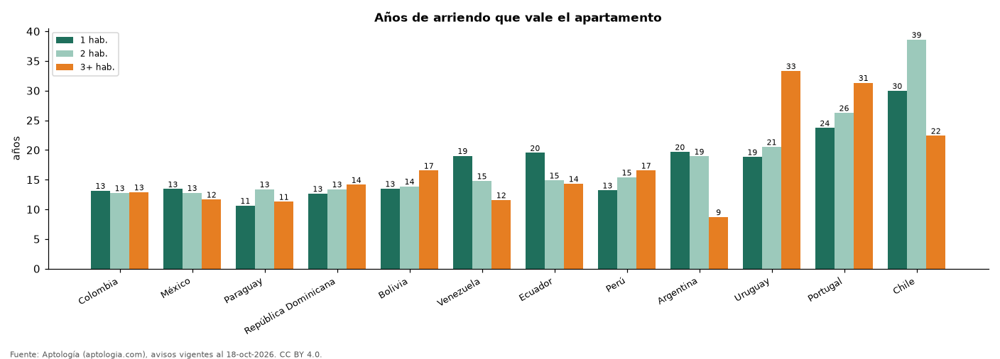

# ¿Rinde más un apartamento de 1, 2 o 3 habitaciones? Años de arriendo por tamaño en 12 países (octubre 2026)

**En 6 de 12 países un apartamento de 3 o más habitaciones necesita más años de arriendo para pagarse que uno de 1 habitación; Colombia tiene la relación más baja en 2 habitaciones (12,8 años) y Chile la más alta (38,6).** Cuantos menos años, más rinde el arriendo frente al precio de compra.

*Resumen: comparamos precio y canon de 281.088 apartamentos por número de habitaciones en cada país.*

**Actualizado:** 18 de octubre de 2026 (datos del 18 de octubre de 2026) · **Próxima actualización:** mensual.

## Resumen

| Indicador | Valor |
|---|---|
| Colombia | 13,2 / 12,8 / 12,9 años |
| México | 13,4 / 12,8 / 11,7 años |
| Paraguay | 10,6 / 13,4 / 11,3 años |
| República Dominicana | 12,7 / 13,4 / 14,1 años |
| Bolivia | 13,5 / 13,9 / 16,5 años |
| Venezuela | 19,0 / 14,8 / 11,6 años |
| Ecuador | 19,5 / 14,9 / 14,3 años |
| Perú | 13,2 / 15,4 / 16,6 años |
| Argentina | 19,7 / 18,9 / 8,7 años |
| Uruguay | 18,8 / 20,5 / 33,3 años |

## Años de arriendo por número de habitaciones y país

| País | 1 hab. (años) | 2 hab. (años) | 3 o más hab. (años) |
|---|---|---|---|
| Colombia | 13,2 | 12,8 | 12,9 |
| México | 13,4 | 12,8 | 11,7 |
| Paraguay | 10,6 | 13,4 | 11,3 |
| República Dominicana | 12,7 | 13,4 | 14,1 |
| Bolivia | 13,5 | 13,9 | 16,5 |
| Venezuela | 19,0 | 14,8 | 11,6 |
| Ecuador | 19,5 | 14,9 | 14,3 |
| Perú | 13,2 | 15,4 | 16,6 |
| Argentina | 19,7 | 18,9 | 8,7 |
| Uruguay | 18,8 | 20,5 | 33,3 |
| Portugal | 23,7 | 26,3 | 31,3 |
| Chile | 30,0 | 38,6 | 22,4 |

Medianas por país en la moneda mayoritaria de cada operación, convertidas a dólares.

## Preguntas frecuentes

**¿Es mejor invertir en un apartamento pequeño o grande para arrendar?**
En 6 de 12 países el de 1 habitación necesita menos años de arriendo que el de 3 o más.

**¿Cuántos años de arriendo vale un apartamento de 2 habitaciones en Colombia?**
12,8 años en la mediana nacional.

## Metodología

- **Fuente:** exportes nocturnos de la base de datos de Aptología (aptologia.com) del 18 de octubre de 2026: avisos vigentes de vivienda en portales inmobiliarios de 13 países, recogidos por Aptología y vistos en línea entre el 11 y el 18 de octubre de 2026. Corte: 18 de octubre de 2026.
- **Depuración:** se eliminan duplicados exactos (misma ciudad, zona, tipo, precio, moneda, área, habitaciones y baños) y los precios fuera del percentil 1–99 de cada país, operación, moneda y tipo; el precio por m² usa solo avisos con área declarada entre 12 y 2.000 m² y también se recorta al P1–P99.
- **Qué se mide:** precios pedidos (publicados), no precios de cierre. En arriendo, el canon mensual sin administración, gastos comunes ni condominio.
- **Muestra mínima:** cada cifra publicada se apoya en al menos 30 avisos; las celdas con menos se omiten.
- **Monedas:** nunca se mezclan avisos de monedas distintas sin convertirlos. Conversión a dólares con la tasa de mercado de ExchangeRate-API (open.er-api.com, actualización del 18 Oct 2026): 1 USD = 3.182,80 COP, 1 USD = 18,47 M.N, 1 USD = 5,09 BRL, 1 USD = 3,44 PEN, 1 USD = 982,44 CLP, 1 USD = 1.514,57 ARS, 1 USD = 40,20 UYU, 1 USD = 5.705,37 PYG, 1 USD = 61,27 DOP, 1 USD = 0,89 EUR, 1 USD = 11,72 BOB; la UF chilena a 41.178,64 CLP (mindicador,cl. 18-oct-2026). Los avisos publicados en dólares se usan tal cual.
- **Monedas:** en cada ciudad y operación se usa solo la moneda mayoritaria de los avisos (los avisos en otra moneda se excluyen) y la mediana se convierte a dólares con la tasa citada; nunca se promedian avisos de monedas distintas.
- **Años de arriendo para pagar la vivienda:** precio de venta mediano ÷ (canon mensual mediano × 12), entre avisos del mismo tipo y celda; es la relación precio/arriendo (price-to-rent ratio) y equivale a 100 ÷ rentabilidad bruta. No incluye administración, impuestos, vacancia, financiación ni valorización: es una referencia para comparar comprar con arrendar, no una recomendación de inversión.
- **Destinos de temporada:** Punta del Este, Maldonado y Punta Cana se excluyen de las comparaciones de años de arriendo porque muchos avisos de alquiler son de temporada (precio mensual de verano), lo que infla el canon y daría una relación artificialmente baja.
- **Limitaciones:** la cobertura depende de los portales que recorre Aptología en cada país y es mayor en las ciudades grandes y en los segmentos medio-alto y alto; el área es la que declara el aviso, sin verificar; los nombres de zona vienen de los portales.
- **Privacidad:** solo se publican agregados; no se publica ningún dato personal, enlace a avisos ni nombre de anunciante.
- **Datos abiertos:** [datos.csv](datos.csv), licencia CC BY 4.0.

## Cómo citar

Pinzón Pineda, D. M. (2026). *¿Rinde más un apartamento de 1, 2 o 3 habitaciones? Años de arriendo por tamaño en 12 países (octubre 2026)*. Aptología (aptologia.com). https://github.com/elbroker/aptologia-datos/tree/main/estudios/comprar-o-arrendar-segun-habitaciones-por-pais-latinoamerica-2026. Datos: datos.csv, licencia CC BY 4.0.
