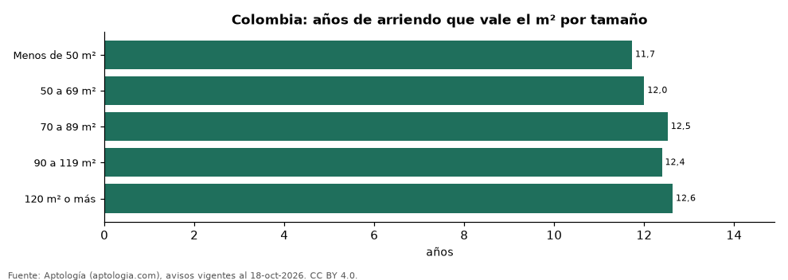

# ¿Rinde más un apartamento pequeño o uno grande? Años de arriendo y canon por m² según el tamaño en Colombia (octubre 2026)

**En Colombia el metro cuadrado de un apartamento de menos de 50 m² se paga con 11,7 años de arriendo, el tramo de tamaño con menos años; el de 120 m² o más necesita 12,6.** El arriendo por m² al mes baja de 45.678 pesos en los de menos de 50 m² a 45.143 pesos en los de 120 m² o más.

*Resumen: cruzamos precio y arriendo por m² de 180.268 apartamentos en cinco tramos de área.*

**Actualizado:** 18 de octubre de 2026 (datos del 18 de octubre de 2026) · **Próxima actualización:** mensual.

## Resumen

| Indicador | Valor |
|---|---|
| Menos de 50 m² | 11,7 años; arriendo 45.678 pesos/m² |
| 50 a 69 m² | 12,0 años; arriendo 39.062 pesos/m² |
| 70 a 89 m² | 12,5 años; arriendo 44.211 pesos/m² |
| 90 a 119 m² | 12,4 años; arriendo 45.263 pesos/m² |
| 120 m² o más | 12,6 años; arriendo 45.143 pesos/m² |

## Colombia por tramo de tamaño

| Tamaño | Venta por m² (millones) | Arriendo por m² al mes (pesos) | Años de arriendo | Rentabilidad bruta |
|---|---|---|---|---|
| Menos de 50 m² | 6,43 | 45.678 | 11,7 | 8,5 % |
| 50 a 69 m² | 5,62 | 39.062 | 12,0 | 8,3 % |
| 70 a 89 m² | 6,64 | 44.211 | 12,5 | 8,0 % |
| 90 a 119 m² | 6,73 | 45.263 | 12,4 | 8,1 % |
| 120 m² o más | 6,84 | 45.143 | 12,6 | 7,9 % |

## Años de arriendo por ciudad y tamaño

| Ciudad | Menos de 50 m² | 50 a 69 m² | 70 a 89 m² | 90 a 119 m² | 120 m² o más |
|---|---|---|---|---|---|
| Armenia | 12,4 | 13,1 | 14,5 | 16,5 | 13,6 |
| Barranquilla | 9,8 | 12,5 | 11,1 | 11,5 | 10,4 |
| Bello | 12,1 | 13,8 | 14,2 | 12,1 | — |
| Bogotá | 12,0 | 12,4 | 13,1 | 12,7 | 12,2 |
| Bucaramanga | — | 15,7 | 12,9 | 12,7 | 11,8 |
| Cajicá | 14,6 | 14,8 | 13,0 | 14,7 | — |
| Cali | 11,7 | 13,4 | 13,4 | 10,8 | 12,2 |
| Cartagena | 15,1 | 13,7 | 15,4 | 14,6 | 15,4 |
| Chía | 12,5 | 14,7 | 13,9 | 13,8 | 12,0 |
| Cúcuta | 13,5 | 13,7 | 14,5 | 12,3 | 14,6 |
| El Retiro | — | 15,8 | 16,2 | 15,3 | 17,2 |
| Envigado | — | 13,2 | 14,3 | 15,2 | 15,1 |
| Floridablanca | — | 15,3 | 14,3 | 14,6 | 14,0 |
| Itagüí | 10,7 | 14,4 | 13,8 | 14,3 | 13,1 |
| Manizales | 15,7 | 15,4 | 15,5 | — | 11,9 |
| Medellín | 10,6 | 12,0 | 13,3 | 13,0 | 12,9 |
| Pereira | 10,0 | 13,5 | 14,5 | 13,8 | 14,4 |
| Rionegro | 14,9 | 15,5 | 17,6 | 15,7 | 14,3 |
| Sabaneta | 12,8 | 14,0 | 15,0 | 14,5 | 14,5 |
| Santa Marta | 15,9 | 18,2 | 16,3 | 14,4 | 14,6 |

— indica menos de 30 avisos en venta o en arriendo.

## Preguntas frecuentes

**¿Rinde más comprar un apartamento pequeño para arrendar?**
En Colombia el tramo con menos años de arriendo por m² es menos de 50 m² (11,7 años).

**¿Cuánto vale el arriendo por m² de un apartamento pequeño?**
45.678 pesos al mes por m² en los de menos de 50 m².

## Metodología

- **Fuente:** exportes nocturnos de la base de datos de Aptología (aptologia.com) del 18 de octubre de 2026: avisos vigentes de vivienda en portales inmobiliarios de 13 países, recogidos por Aptología y vistos en línea entre el 11 y el 18 de octubre de 2026. Corte: 18 de octubre de 2026.
- **Depuración:** se eliminan duplicados exactos (misma ciudad, zona, tipo, precio, moneda, área, habitaciones y baños) y los precios fuera del percentil 1–99 de cada país, operación, moneda y tipo; el precio por m² usa solo avisos con área declarada entre 12 y 2.000 m² y también se recorta al P1–P99.
- **Qué se mide:** precios pedidos (publicados), no precios de cierre. En arriendo, el canon mensual sin administración, gastos comunes ni condominio.
- **Muestra mínima:** cada cifra publicada se apoya en al menos 30 avisos; las celdas con menos se omiten.
- **Colombia:** Precios en pesos colombianos, sin conversión de moneda.
- **Años de arriendo para pagar la vivienda:** precio de venta mediano ÷ (canon mensual mediano × 12), entre avisos del mismo tipo y celda; es la relación precio/arriendo (price-to-rent ratio) y equivale a 100 ÷ rentabilidad bruta. No incluye administración, impuestos, vacancia, financiación ni valorización: es una referencia para comparar comprar con arrendar, no una recomendación de inversión.
- **Limitaciones:** la cobertura depende de los portales que recorre Aptología en cada país y es mayor en las ciudades grandes y en los segmentos medio-alto y alto; el área es la que declara el aviso, sin verificar; los nombres de zona vienen de los portales.
- **Privacidad:** solo se publican agregados; no se publica ningún dato personal, enlace a avisos ni nombre de anunciante.
- **Datos abiertos:** [datos.csv](datos.csv), licencia CC BY 4.0.

## Cómo citar

Pinzón Pineda, D. M. (2026). *¿Rinde más un apartamento pequeño o uno grande? Años de arriendo y canon por m² según el tamaño en Colombia (octubre 2026)*. Aptología (aptologia.com). https://github.com/elbroker/aptologia-datos/tree/main/estudios/comprar-o-arrendar-segun-tamano-del-apartamento-colombia-2026. Datos: datos.csv, licencia CC BY 4.0.
