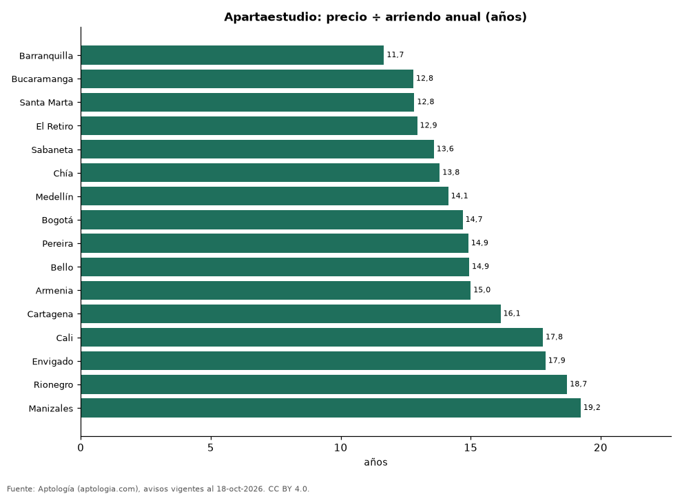

# ¿Comprar un apartaestudio para arrendar? Años de arriendo que vale un apartaestudio en 16 ciudades de Colombia (octubre 2026)

**Un apartaestudio en Barranquilla cuesta lo mismo que 11,7 años de su arriendo (8,6 % de rentabilidad bruta), la relación más baja de 16 ciudades colombianas; en Manizales son 19,2 años.** En Bogotá, 14,7 años: 335 millones de pesos de precio frente a 1,90 millones de pesos al mes.

*Resumen: comparamos el precio y el canon medianos de 12.706 apartaestudios en venta y en arriendo en 16 ciudades.*

**Actualizado:** 18 de octubre de 2026 (datos del 18 de octubre de 2026) · **Próxima actualización:** mensual.

## Resumen

| Indicador | Valor |
|---|---|
| Menos años | Barranquilla: 11,7 |
| Más años | Manizales: 19,2 |
| Bogotá | 14,7 años |

## Años de arriendo que vale un apartaestudio, por ciudad

| Ciudad | Precio apartaestudio (mediana) | Arriendo al mes | Años de arriendo | Rentabilidad bruta | Años (apto. 1 hab.) | Avisos (venta / arriendo) |
|---|---|---|---|---|---|---|
| Barranquilla | 280 millones de pesos | 2,00 millones de pesos | 11,7 | 8,6 % | 12,3 | 243 / 424 |
| Bucaramanga | 195 millones de pesos | 1,27 millones de pesos | 12,8 | 7,8 % | — | 100 / 77 |
| Santa Marta | 385 millones de pesos | 2,50 millones de pesos | 12,8 | 7,8 % | 14,4 | 345 / 47 |
| El Retiro | 497 millones de pesos | 3,20 millones de pesos | 12,9 | 7,7 % | 12,0 | 41 / 51 |
| Sabaneta | 350 millones de pesos | 2,15 millones de pesos | 13,6 | 7,4 % | 12,9 | 133 / 122 |
| Chía | 285 millones de pesos | 1,72 millones de pesos | 13,8 | 7,2 % | 14,7 | 118 / 88 |
| Medellín | 475 millones de pesos | 2,80 millones de pesos | 14,1 | 7,1 % | 13,6 | 900 / 2.055 |
| Bogotá | 335 millones de pesos | 1,90 millones de pesos | 14,7 | 6,8 % | 14,3 | 2.202 / 2.919 |
| Pereira | 340 millones de pesos | 1,90 millones de pesos | 14,9 | 6,7 % | 15,8 | 319 / 221 |
| Bello | 260 millones de pesos | 1,45 millones de pesos | 14,9 | 6,7 % | — | 33 / 58 |
| Armenia | 270 millones de pesos | 1,50 millones de pesos | 15,0 | 6,7 % | — | 291 / 115 |
| Cartagena | 484 millones de pesos | 2,50 millones de pesos | 16,1 | 6,2 % | 18,6 | 104 / 43 |
| Cali | 320 millones de pesos | 1,50 millones de pesos | 17,8 | 5,6 % | 13,3 | 327 / 479 |
| Envigado | 665 millones de pesos | 3,10 millones de pesos | 17,9 | 5,6 % | 15,5 | 86 / 176 |
| Rionegro | 494 millones de pesos | 2,20 millones de pesos | 18,7 | 5,3 % | 14,4 | 77 / 153 |
| Manizales | 300 millones de pesos | 1,30 millones de pesos | 19,2 | 5,2 % | — | 234 / 125 |

Precio de venta mediano ÷ (canon mensual mediano × 12) de apartaestudios; la última columna compara con apartamentos de 1 habitación.

## Preguntas frecuentes

**¿Es buen negocio comprar un apartaestudio para arrendar?**
Depende de la ciudad: en Barranquilla se paga con 11,7 años de arriendo y en Manizales con 19,2, antes de administración, impuestos y vacancia.

**¿Cuánto renta un apartaestudio en Bogotá?**
6,8 % bruto anual.

## Metodología

- **Fuente:** exportes nocturnos de la base de datos de Aptología (aptologia.com) del 18 de octubre de 2026: avisos vigentes de vivienda en portales inmobiliarios de 13 países, recogidos por Aptología y vistos en línea entre el 11 y el 18 de octubre de 2026. Corte: 18 de octubre de 2026.
- **Depuración:** se eliminan duplicados exactos (misma ciudad, zona, tipo, precio, moneda, área, habitaciones y baños) y los precios fuera del percentil 1–99 de cada país, operación, moneda y tipo; el precio por m² usa solo avisos con área declarada entre 12 y 2.000 m² y también se recorta al P1–P99.
- **Qué se mide:** precios pedidos (publicados), no precios de cierre. En arriendo, el canon mensual sin administración, gastos comunes ni condominio.
- **Muestra mínima:** cada cifra publicada se apoya en al menos 30 avisos; las celdas con menos se omiten.
- **Colombia:** Precios en pesos colombianos, sin conversión de moneda.
- **Años de arriendo para pagar la vivienda:** precio de venta mediano ÷ (canon mensual mediano × 12), entre avisos del mismo tipo y celda; es la relación precio/arriendo (price-to-rent ratio) y equivale a 100 ÷ rentabilidad bruta. No incluye administración, impuestos, vacancia, financiación ni valorización: es una referencia para comparar comprar con arrendar, no una recomendación de inversión.
- **Limitaciones:** la cobertura depende de los portales que recorre Aptología en cada país y es mayor en las ciudades grandes y en los segmentos medio-alto y alto; el área es la que declara el aviso, sin verificar; los nombres de zona vienen de los portales.
- **Privacidad:** solo se publican agregados; no se publica ningún dato personal, enlace a avisos ni nombre de anunciante.
- **Datos abiertos:** [datos.csv](datos.csv), licencia CC BY 4.0.

## Cómo citar

Pinzón Pineda, D. M. (2026). *¿Comprar un apartaestudio para arrendar? Años de arriendo que vale un apartaestudio en 16 ciudades de Colombia (octubre 2026)*. Aptología (aptologia.com). https://github.com/elbroker/aptologia-datos/tree/main/estudios/comprar-o-arrendar-un-apartaestudio-ciudades-colombia-2026. Datos: datos.csv, licencia CC BY 4.0.
