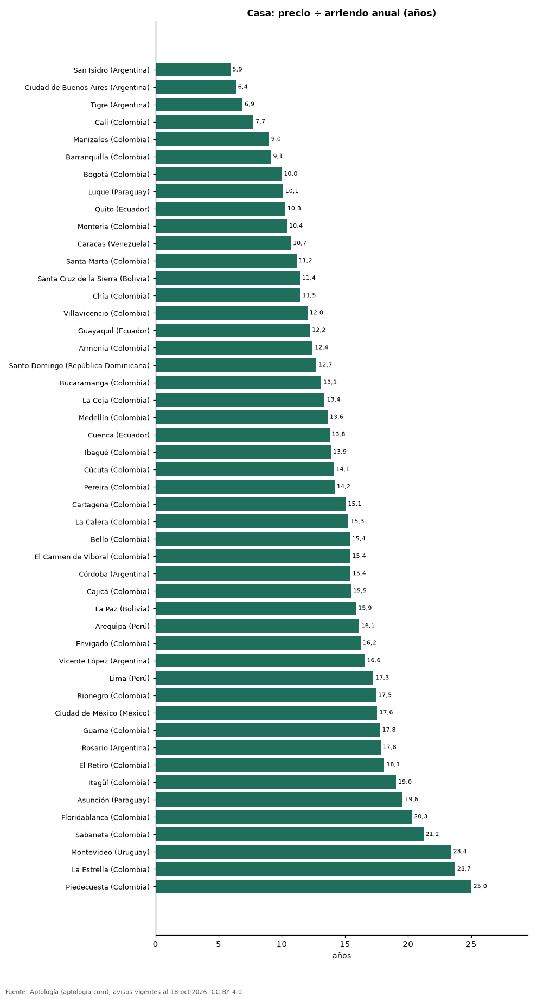

# ¿Comprar o arrendar una casa? Años de arriendo que vale una casa en 48 ciudades de Latinoamérica (octubre 2026)

**Una casa en San Isidro (Argentina) cuesta lo mismo que 5,9 años de su arriendo, la relación más baja de 48 ciudades; en Piedecuesta (Colombia) son 25,0 años.** En 18 de 47 ciudades la casa necesita más años de arriendo que el apartamento, es decir, rinde menos en arriendo.

*Resumen: comparamos precio y canon medianos de 119.483 casas en venta y en arriendo en 48 ciudades.*

**Actualizado:** 18 de octubre de 2026 (datos del 18 de octubre de 2026) · **Próxima actualización:** mensual.

## Resumen

| Indicador | Valor |
|---|---|
| Menos años | San Isidro (Argentina): 5,9 |
| Más años | Piedecuesta (Colombia): 25,0 |
| Casa rinde menos que apartamento | 18 de 47 ciudades |

## Años de arriendo que vale una casa, por ciudad

| Ciudad | Precio casa (mediana) | Arriendo casa al mes | Años (casa) | Años (apartamento) |
|---|---|---|---|---|
| San Isidro (Argentina) | USD 320.000 | USD 4.500 | 5,9 | 28,9 |
| Ciudad de Buenos Aires (Argentina) | USD 290.000 | USD 3.800 | 6,4 | 24,5 |
| Tigre (Argentina) | USD 310.000 | USD 3.750 | 6,9 | 19,9 |
| Cali (Colombia) | USD 292.195 | USD 3.142 | 7,7 | 18,9 |
| Manizales (Colombia) | USD 241.925 | USD 2.244 | 9,0 | 18,3 |
| Barranquilla (Colombia) | USD 282.770 | USD 2.576 | 9,1 | 13,4 |
| Bogotá (Colombia) | USD 377.026 | USD 3.142 | 10,0 | 18,9 |
| Luque (Paraguay) | USD 110.422 | USD 911 | 10,1 | 10,6 |
| Quito (Ecuador) | USD 185.000 | USD 1.500 | 10,3 | 15,1 |
| Montería (Colombia) | USD 176.731 | USD 1.414 | 10,4 | 16,2 |
| Caracas (Venezuela) | USD 450.000 | USD 3.500 | 10,7 | 15,4 |
| Santa Marta (Colombia) | USD 210.506 | USD 1.571 | 11,2 | 16,7 |
| Santa Cruz de la Sierra (Bolivia) | USD 160.000 | USD 1.166 | 11,4 | 14,6 |
| Chía (Colombia) | USD 345.607 | USD 2.514 | 11,5 | 15,8 |
| Villavicencio (Colombia) | USD 204.222 | USD 1.414 | 12,0 | 17,9 |
| Guayaquil (Ecuador) | USD 220.000 | USD 1.500 | 12,2 | 16,2 |
| Armenia (Colombia) | USD 314.188 | USD 2.105 | 12,4 | 12,7 |
| Santo Domingo (República Dominicana) | USD 650.000 | USD 4.250 | 12,7 | 14,8 |
| Bucaramanga (Colombia) | USD 296.908 | USD 1.885 | 13,1 | 15,2 |
| La Ceja (Colombia) | USD 282.770 | USD 1.759 | 13,4 | 13,0 |
| Medellín (Colombia) | USD 436.722 | USD 2.671 | 13,6 | 14,6 |
| Cuenca (Ecuador) | USD 215.000 | USD 1.300 | 13,8 | 19,1 |
| Ibagué (Colombia) | USD 235.641 | USD 1.414 | 13,9 | 19,6 |
| Cúcuta (Colombia) | USD 157.094 | USD 927 | 14,1 | 15,6 |
| Pereira (Colombia) | USD 345.607 | USD 2.030 | 14,2 | 12,9 |
| Cartagena (Colombia) | USD 408.445 | USD 2.259 | 15,1 | 18,0 |
| La Calera (Colombia) | USD 691.215 | USD 3.770 | 15,3 | 14,0 |
| Bello (Colombia) | USD 150.810 | USD 817 | 15,4 | 14,2 |
| El Carmen de Viboral (Colombia) | USD 581.249 | USD 3.142 | 15,4 | 18,1 |
| Córdoba (Argentina) | USD 165.000 | USD 891 | 15,4 | 20,6 |
| Cajicá (Colombia) | USD 408.445 | USD 2.199 | 15,5 | 15,5 |
| La Paz (Bolivia) | USD 343.000 | USD 1.800 | 15,9 | 18,1 |
| Arequipa (Perú) | USD 335.669 | USD 1.736 | 16,1 | 15,5 |
| Envigado (Colombia) | USD 722.633 | USD 3.707 | 16,2 | 15,5 |
| Vicente López (Argentina) | USD 249.500 | USD 1.254 | 16,6 | 10,7 |
| Lima (Perú) | USD 632.681 | USD 3.056 | 17,3 | 17,0 |
| Rionegro (Colombia) | USD 691.215 | USD 3.299 | 17,5 | 16,4 |
| Ciudad de México (México) | USD 798.789 | USD 3.791 | 17,6 | 13,0 |
| Guarne (Colombia) | USD 502.701 | USD 2.356 | 17,8 | — |
| Rosario (Argentina) | USD 169.500 | USD 792 | 17,8 | 60,6 |
| El Retiro (Colombia) | USD 785.471 | USD 3.613 | 18,1 | 14,5 |
| Itagüí (Colombia) | USD 201.081 | USD 880 | 19,0 | 14,4 |
| Asunción (Paraguay) | USD 350.000 | USD 1.490 | 19,6 | 12,8 |
| Floridablanca (Colombia) | USD 298.479 | USD 1.225 | 20,3 | 15,3 |
| Sabaneta (Colombia) | USD 527.837 | USD 2.074 | 21,2 | 14,8 |
| Montevideo (Uruguay) | USD 269.000 | USD 958 | 23,4 | 20,7 |
| La Estrella (Colombia) | USD 464.999 | USD 1.634 | 23,7 | 14,4 |
| Piedecuesta (Colombia) | USD 424.154 | USD 1.414 | 25,0 | 13,9 |

Medianas de todas las casas (sin emparejar por tamaño); el apartamento usa todas las habitaciones.

## Preguntas frecuentes

**¿Dónde conviene comprar una casa en vez de arrendarla?**
Por relación precio/arriendo, en San Isidro (Argentina): 5,9 años.

**¿Rinde más arrendar una casa o un apartamento?**
En 18 de 47 ciudades rinde más el apartamento.

## Metodología

- **Fuente:** exportes nocturnos de la base de datos de Aptología (aptologia.com) del 18 de octubre de 2026: avisos vigentes de vivienda en portales inmobiliarios de 13 países, recogidos por Aptología y vistos en línea entre el 11 y el 18 de octubre de 2026. Corte: 18 de octubre de 2026.
- **Depuración:** se eliminan duplicados exactos (misma ciudad, zona, tipo, precio, moneda, área, habitaciones y baños) y los precios fuera del percentil 1–99 de cada país, operación, moneda y tipo; el precio por m² usa solo avisos con área declarada entre 12 y 2.000 m² y también se recorta al P1–P99.
- **Qué se mide:** precios pedidos (publicados), no precios de cierre. En arriendo, el canon mensual sin administración, gastos comunes ni condominio.
- **Muestra mínima:** cada cifra publicada se apoya en al menos 30 avisos; las celdas con menos se omiten.
- **Monedas:** nunca se mezclan avisos de monedas distintas sin convertirlos. Conversión a dólares con la tasa de mercado de ExchangeRate-API (open.er-api.com, actualización del 18 Oct 2026): 1 USD = 3.182,80 COP, 1 USD = 18,47 M.N, 1 USD = 5,09 BRL, 1 USD = 3,44 PEN, 1 USD = 982,44 CLP, 1 USD = 1.514,57 ARS, 1 USD = 40,20 UYU, 1 USD = 5.705,37 PYG, 1 USD = 61,27 DOP, 1 USD = 0,89 EUR, 1 USD = 11,72 BOB; la UF chilena a 41.178,64 CLP (mindicador,cl. 18-oct-2026). Los avisos publicados en dólares se usan tal cual.
- **Monedas:** en cada ciudad y operación se usa solo la moneda mayoritaria de los avisos (los avisos en otra moneda se excluyen) y la mediana se convierte a dólares con la tasa citada; nunca se promedian avisos de monedas distintas.
- **Años de arriendo para pagar la vivienda:** precio de venta mediano ÷ (canon mensual mediano × 12), entre avisos del mismo tipo y celda; es la relación precio/arriendo (price-to-rent ratio) y equivale a 100 ÷ rentabilidad bruta. No incluye administración, impuestos, vacancia, financiación ni valorización: es una referencia para comparar comprar con arrendar, no una recomendación de inversión.
- **Destinos de temporada:** Punta del Este, Maldonado y Punta Cana se excluyen de las comparaciones de años de arriendo porque muchos avisos de alquiler son de temporada (precio mensual de verano), lo que infla el canon y daría una relación artificialmente baja.
- **Limitaciones:** la cobertura depende de los portales que recorre Aptología en cada país y es mayor en las ciudades grandes y en los segmentos medio-alto y alto; el área es la que declara el aviso, sin verificar; los nombres de zona vienen de los portales.
- **Privacidad:** solo se publican agregados; no se publica ningún dato personal, enlace a avisos ni nombre de anunciante.
- **Datos abiertos:** [datos.csv](datos.csv), licencia CC BY 4.0.

## Cómo citar

Pinzón Pineda, D. M. (2026). *¿Comprar o arrendar una casa? Años de arriendo que vale una casa en 48 ciudades de Latinoamérica (octubre 2026)*. Aptología (aptologia.com). https://github.com/elbroker/aptologia-datos/tree/main/estudios/comprar-o-arrendar-una-casa-ciudades-latinoamerica-2026. Datos: datos.csv, licencia CC BY 4.0.
