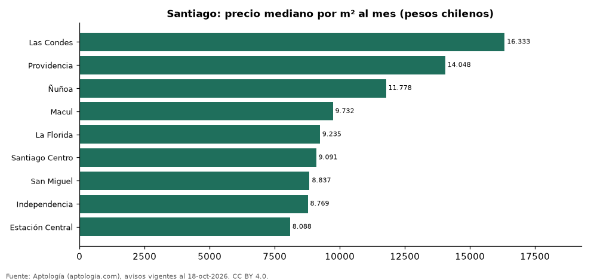

# Comunas más caras y más baratas de Santiago para arrendar departamento: ranking por m² (octubre 2026)

**En Santiago, la comuna con el m² más caro para arrendar departamento es Las Condes (16.333,3 pesos chilenos (USD 16,6)/m² al mes) y la más barata Estación Central (8.088,2 pesos chilenos (USD 8,2)/m² al mes), 2,0 veces menos.** Comparamos 9 comunas con al menos 30 avisos con área.

*Resumen: analizamos 3.817 departamentos en arriendo con área declarada en 9 comunas de Santiago.*

**Actualizado:** 18 de octubre de 2026 (datos del 18 de octubre de 2026) · **Próxima actualización:** mensual.

## Resumen

| Indicador | Valor |
|---|---|
| Más caro por m² | Las Condes: 16.333,3 pesos chilenos (USD 16,6) |
| Más barato por m² | Estación Central: 8.088,2 pesos chilenos (USD 8,2) |
| Diferencia | 2,0 veces |
| Comunas | 9 |

## Ranking de comunas por precio del m²

| Comuna | Por m² (mediana) | Canon (mediana) | Área mediana (m²) | Avisos con área |
|---|---|---|---|---|
| Las Condes | 16.333,3 pesos chilenos (USD 16,6) | 1.200.000 pesos chilenos (USD 1.221) | 72 | 247 |
| Providencia | 14.048,3 pesos chilenos (USD 14,3) | 850.000 pesos chilenos (USD 865) | 65 | 310 |
| Ñuñoa | 11.777,8 pesos chilenos (USD 12,0) | 580.000 pesos chilenos (USD 590) | 50 | 420 |
| Macul | 9.732,1 pesos chilenos (USD 9,9) | 477.500 pesos chilenos (USD 486) | 50 | 258 |
| La Florida | 9.234,9 pesos chilenos (USD 9,4) | 450.000 pesos chilenos (USD 458) | 50 | 388 |
| Santiago Centro | 9.090,9 pesos chilenos (USD 9,3) | 410.000 pesos chilenos (USD 417) | 45 | 1.280 |
| San Miguel | 8.837,2 pesos chilenos (USD 9,0) | 410.000 pesos chilenos (USD 417) | 49 | 363 |
| Independencia | 8.768,9 pesos chilenos (USD 8,9) | 341.000 pesos chilenos (USD 347) | 40 | 256 |
| Estación Central | 8.088,2 pesos chilenos (USD 8,2) | 320.000 pesos chilenos (USD 326) | 41 | 295 |

Medianas; solo comunas con 30 avisos o más con área declarada.

## Preguntas frecuentes

**¿Cuál es la comuna más cara de Santiago para arrendar?**
Las Condes, con 16.333,3 pesos chilenos (USD 16,6) por m² al mes en la mediana (octubre de 2026).

**¿Y la más barata?**
Estación Central, con 8.088,2 pesos chilenos (USD 8,2) por m² al mes.

## Metodología

- **Fuente:** exportes nocturnos de la base de datos de Aptología (aptologia.com) del 18 de octubre de 2026: avisos vigentes de vivienda en portales inmobiliarios de 13 países, recogidos por Aptología y vistos en línea entre el 11 y el 18 de octubre de 2026. Corte: 18 de octubre de 2026.
- **Depuración:** se eliminan duplicados exactos (misma ciudad, zona, tipo, precio, moneda, área, habitaciones y baños) y los precios fuera del percentil 1–99 de cada país, operación, moneda y tipo; el precio por m² usa solo avisos con área declarada entre 12 y 2.000 m² y también se recorta al P1–P99.
- **Qué se mide:** precios pedidos (publicados), no precios de cierre. En arriendo, el canon mensual sin administración, gastos comunes ni condominio.
- **Muestra mínima:** cada cifra publicada se apoya en al menos 30 avisos; las celdas con menos se omiten.
- **Monedas:** nunca se mezclan avisos de monedas distintas sin convertirlos. Conversión a dólares con la tasa de mercado de ExchangeRate-API (open.er-api.com, actualización del 18 Oct 2026): 1 USD = 3.182,80 COP, 1 USD = 18,47 M.N, 1 USD = 5,09 BRL, 1 USD = 3,44 PEN, 1 USD = 982,44 CLP, 1 USD = 1.514,57 ARS, 1 USD = 40,20 UYU, 1 USD = 5.705,37 PYG, 1 USD = 61,27 DOP, 1 USD = 0,89 EUR, 1 USD = 11,72 BOB; la UF chilena a 41.178,64 CLP (mindicador,cl. 18-oct-2026). Los avisos publicados en dólares se usan tal cual.
- **Monedas:** en cada ciudad y operación se usa solo la moneda mayoritaria de los avisos (los avisos en otra moneda se excluyen) y la mediana se convierte a dólares con la tasa citada; nunca se promedian avisos de monedas distintas.
- **Limitaciones:** la cobertura depende de los portales que recorre Aptología en cada país y es mayor en las ciudades grandes y en los segmentos medio-alto y alto; el área es la que declara el aviso, sin verificar; los nombres de zona vienen de los portales.
- **Privacidad:** solo se publican agregados; no se publica ningún dato personal, enlace a avisos ni nombre de anunciante.
- **Datos abiertos:** [datos.csv](datos.csv), licencia CC BY 4.0.

## Cómo citar

Pinzón Pineda, D. M. (2026). *Comunas más caras y más baratas de Santiago para arrendar departamento: ranking por m² (octubre 2026)*. Aptología (aptologia.com). https://github.com/elbroker/aptologia-datos/tree/main/estudios/comunas-mas-caras-y-baratas-santiago-chile-arriendo-m2-2026. Datos: datos.csv, licencia CC BY 4.0.
