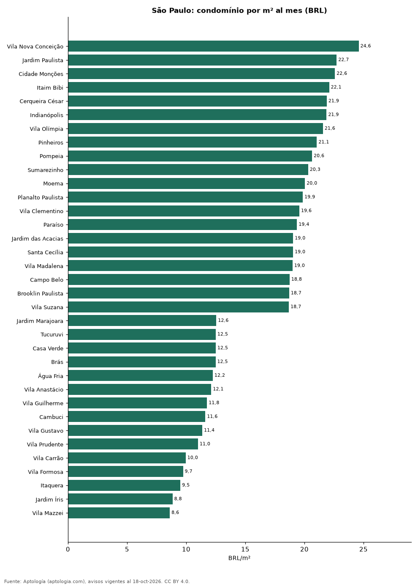

# Condomínio em São Paulo por bairro: quanto se paga por m² (octubre 2026)

**En São Paulo el condomínio más caro por metro cuadrado se paga en Vila Nova Conceição: 25 reales (USD 4,8) por m² al mes en la mediana; el más barato, en Vila Mazzei, con 9 reales (USD 1,7).** La mediana de la ciudad es 951 reales (USD 187) al mes (16 reales (USD 3,1) por m²).

*Resumen: analizamos el condomínio declarado en 10.546 anuncios de alquiler de apartamentos en 73 bairros.*

**Actualizado:** 18 de octubre de 2026 (datos del 18 de octubre de 2026) · **Próxima actualización:** mensual.

## Resumen

| Indicador | Valor |
|---|---|
| Más caro por m² | Vila Nova Conceição: 25 reales (USD 4,8) |
| Más barato por m² | Vila Mazzei: 9 reales (USD 1,7) |
| Mediana de la ciudad | 951 reales (USD 187) |

## Condomínio por bairro

| Bairro | Condomínio por m² | Condomínio mensal (mediana) | Anúncios |
|---|---|---|---|
| Vila Nova Conceição | 25 reales (USD 4,8) | 2.033 reales (USD 400) | 186 |
| Jardim Paulista | 23 reales (USD 4,5) | 2.278 reales (USD 448) | 283 |
| Cidade Monções | 23 reales (USD 4,4) | 1.909 reales (USD 375) | 65 |
| Itaim Bibi | 22 reales (USD 4,3) | 2.252 reales (USD 443) | 296 |
| Cerqueira César | 22 reales (USD 4,3) | 2.030 reales (USD 399) | 134 |
| Indianópolis | 22 reales (USD 4,3) | 1.687 reales (USD 332) | 131 |
| Vila Olímpia | 22 reales (USD 4,2) | 1.510 reales (USD 297) | 400 |
| Pinheiros | 21 reales (USD 4,1) | 1.450 reales (USD 285) | 503 |
| Pompeia | 21 reales (USD 4,1) | 1.377 reales (USD 271) | 35 |
| Sumarezinho | 20 reales (USD 4,0) | 1.210 reales (USD 238) | 52 |
| Moema | 20 reales (USD 3,9) | 1.600 reales (USD 314) | 299 |
| Planalto Paulista | 20 reales (USD 3,9) | 1.490 reales (USD 293) | 32 |
| Vila Clementino | 20 reales (USD 3,8) | 1.120 reales (USD 220) | 112 |
| Paraíso | 19 reales (USD 3,8) | 2.042 reales (USD 401) | 147 |
| Jardim das Acacias | 19 reales (USD 3,7) | 1.371 reales (USD 269) | 40 |
| Santa Cecília | 19 reales (USD 3,7) | 855 reales (USD 168) | 50 |
| Vila Madalena | 19 reales (USD 3,7) | 1.400 reales (USD 275) | 99 |
| Campo Belo | 19 reales (USD 3,7) | 1.500 reales (USD 295) | 171 |
| Brooklin Paulista | 19 reales (USD 3,7) | 1.584 reales (USD 311) | 39 |
| Vila Suzana | 19 reales (USD 3,7) | 2.538 reales (USD 499) | 57 |
| Consolação | 19 reales (USD 3,7) | 1.031 reales (USD 203) | 141 |
| Sumaré | 18 reales (USD 3,6) | 1.300 reales (USD 255) | 45 |
| Vila Mariana | 18 reales (USD 3,6) | 1.350 reales (USD 265) | 255 |
| Higienópolis | 18 reales (USD 3,6) | 1.929 reales (USD 379) | 60 |
| Brooklin | 18 reales (USD 3,6) | 1.400 reales (USD 275) | 313 |
| Vila da Saúde | 18 reales (USD 3,5) | 1.188 reales (USD 233) | 35 |
| Perdizes | 17 reales (USD 3,4) | 1.578 reales (USD 310) | 225 |
| Bela Vista | 17 reales (USD 3,4) | 932 reales (USD 183) | 188 |
| Vila Buarque | 17 reales (USD 3,4) | 700 reales (USD 138) | 35 |
| Aclimação | 16 reales (USD 3,2) | 936 reales (USD 184) | 51 |
| Butantã | 16 reales (USD 3,2) | 660 reales (USD 130) | 121 |
| Vila Romana | 16 reales (USD 3,1) | 1.375 reales (USD 270) | 52 |
| Vila Regente Feijó | 16 reales (USD 3,1) | 1.330 reales (USD 261) | 34 |
| Pompéia | 16 reales (USD 3,1) | 1.100 reales (USD 216) | 70 |
| Panamby | 16 reales (USD 3,1) | 1.600 reales (USD 314) | 95 |
| Santo Amaro | 16 reales (USD 3,1) | 910 reales (USD 179) | 138 |
| Vila Leopoldina | 16 reales (USD 3,0) | 1.264 reales (USD 248) | 70 |
| Chácara Santo Antônio | 15 reales (USD 3,0) | 990 reales (USD 195) | 69 |
| Água Branca | 15 reales (USD 2,9) | 574 reales (USD 113) | 97 |
| Barra Funda | 15 reales (USD 2,9) | 583 reales (USD 115) | 113 |
| Vila Gomes Cardim | 15 reales (USD 2,9) | 1.450 reales (USD 285) | 38 |
| Vila Andrade | 14 reales (USD 2,8) | 1.094 reales (USD 215) | 222 |
| Saúde | 14 reales (USD 2,8) | 925 reales (USD 182) | 42 |
| Morumbi | 14 reales (USD 2,8) | 1.152 reales (USD 226) | 83 |
| Vila Mascote | 14 reales (USD 2,8) | 1.050 reales (USD 206) | 39 |
| Jabaquara | 14 reales (USD 2,7) | 582 reales (USD 114) | 37 |
| Santana | 14 reales (USD 2,7) | 852 reales (USD 167) | 147 |
| Liberdade | 14 reales (USD 2,7) | 560 reales (USD 110) | 44 |
| Jardim Anália Franco | 13 reales (USD 2,6) | 930 reales (USD 183) | 51 |
| Tatuapé | 13 reales (USD 2,6) | 800 reales (USD 157) | 165 |
| Ipiranga | 13 reales (USD 2,6) | 726 reales (USD 143) | 97 |
| Vila Santa Clara | 13 reales (USD 2,5) | 460 reales (USD 90,4) | 33 |
| Vila Ema | 13 reales (USD 2,5) | 503 reales (USD 98,8) | 35 |
| Mooca | 13 reales (USD 2,5) | 600 reales (USD 118) | 183 |
| Freguesia do Ó | 13 reales (USD 2,5) | 600 reales (USD 118) | 52 |
| Belém | 13 reales (USD 2,5) | 614 reales (USD 121) | 39 |
| Belenzinho | 13 reales (USD 2,5) | 494 reales (USD 97,2) | 42 |
| Jaguaré | 13 reales (USD 2,5) | 600 reales (USD 118) | 42 |
| Jardim Marajoara | 13 reales (USD 2,5) | 850 reales (USD 167) | 53 |
| Tucuruvi | 12 reales (USD 2,5) | 700 reales (USD 138) | 49 |
| Casa Verde | 12 reales (USD 2,5) | 780 reales (USD 153) | 35 |
| Brás | 12 reales (USD 2,5) | 500 reales (USD 98,4) | 64 |
| Água Fria | 12 reales (USD 2,4) | 474 reales (USD 93,2) | 42 |
| Vila Anastácio | 12 reales (USD 2,4) | 786 reales (USD 154) | 33 |
| Vila Guilherme | 12 reales (USD 2,3) | 537 reales (USD 106) | 33 |
| Cambuci | 12 reales (USD 2,3) | 459 reales (USD 90,2) | 72 |
| Vila Gustavo | 11 reales (USD 2,2) | 429 reales (USD 84,3) | 33 |
| Vila Prudente | 11 reales (USD 2,2) | 500 reales (USD 98,3) | 55 |
| Vila Carrão | 10 reales (USD 2,0) | 394 reales (USD 77,4) | 45 |
| Vila Formosa | 10 reales (USD 1,9) | 500 reales (USD 98,3) | 64 |
| Itaquera | 10 reales (USD 1,9) | 400 reales (USD 78,6) | 61 |
| Jardim Íris | 9 reales (USD 1,7) | 412 reales (USD 81,1) | 34 |
| Vila Mazzei | 9 reales (USD 1,7) | 375 reales (USD 73,7) | 34 |

Medianas; solo bairros con 30 anuncios o más.

## Preguntas frecuentes

**Quanto custa o condomínio em São Paulo?**
951 reales (USD 187) al mes en la mediana, 16 reales (USD 3,1) por m² (octubre de 2026).

**Onde o condomínio é mais caro?**
En Vila Nova Conceição: 25 reales (USD 4,8) por m² al mes.

## Metodología

- **Fuente:** exportes nocturnos de la base de datos de Aptología (aptologia.com) del 18 de octubre de 2026: avisos vigentes de vivienda en portales inmobiliarios de 13 países, recogidos por Aptología y vistos en línea entre el 11 y el 18 de octubre de 2026. Corte: 18 de octubre de 2026.
- **Depuración:** se eliminan duplicados exactos (misma ciudad, zona, tipo, precio, moneda, área, habitaciones y baños) y los precios fuera del percentil 1–99 de cada país, operación, moneda y tipo; el precio por m² usa solo avisos con área declarada entre 12 y 2.000 m² y también se recorta al P1–P99.
- **Qué se mide:** precios pedidos (publicados), no precios de cierre. En arriendo, el canon mensual sin administración, gastos comunes ni condominio.
- **Muestra mínima:** cada cifra publicada se apoya en al menos 30 avisos; las celdas con menos se omiten.
- **Monedas:** nunca se mezclan avisos de monedas distintas sin convertirlos. Conversión a dólares con la tasa de mercado de ExchangeRate-API (open.er-api.com, actualización del 18 Oct 2026): 1 USD = 3.182,80 COP, 1 USD = 18,47 M.N, 1 USD = 5,09 BRL, 1 USD = 3,44 PEN, 1 USD = 982,44 CLP, 1 USD = 1.514,57 ARS, 1 USD = 40,20 UYU, 1 USD = 5.705,37 PYG, 1 USD = 61,27 DOP, 1 USD = 0,89 EUR, 1 USD = 11,72 BOB; la UF chilena a 41.178,64 CLP (mindicador,cl. 18-oct-2026). Los avisos publicados en dólares se usan tal cual.
- **Moneda:** reales brasileños (BRL); equivalencias en dólares con la tasa citada.
- **Aluguel:** valor mensual pedido, sin condomínio ni IPTU (salvo que se indique).
- **Condomínio:** valor mensual declarado ÷ área declarada; se descartan razones fuera de 1–80 reales por m².
- **Limitaciones:** la cobertura depende de los portales que recorre Aptología en cada país y es mayor en las ciudades grandes y en los segmentos medio-alto y alto; el área es la que declara el aviso, sin verificar; los nombres de zona vienen de los portales.
- **Privacidad:** solo se publican agregados; no se publica ningún dato personal, enlace a avisos ni nombre de anunciante.
- **Datos abiertos:** [datos.csv](datos.csv), licencia CC BY 4.0.

## Cómo citar

Pinzón Pineda, D. M. (2026). *Condomínio em São Paulo por bairro: quanto se paga por m² (octubre 2026)*. Aptología (aptologia.com). https://github.com/elbroker/aptologia-datos/tree/main/estudios/condominio-por-metro-quadrado-sao-paulo-por-bairro-2026. Datos: datos.csv, licencia CC BY 4.0.
