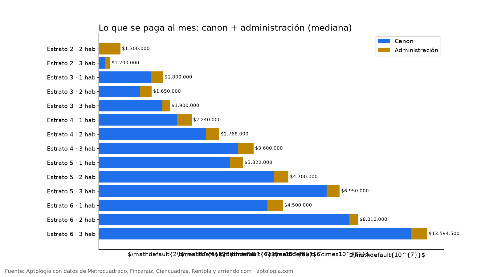

# Costo real de mudarse a un apartamento en Bogotá: arriendo + administración y pago de entrada (octubre 2026)

**El costo real de un apartamento en arriendo en Bogotá es el canon más la administración: en un 2 habitaciones de estrato 3 son $1.650.000 al mes (canon $1.508.100) y en estrato 4, $2.768.000 (canon $2.500.000).** Para entrar, el primer pago típico es un mes completo (canon + administración). Si arriendas con inmobiliaria, súmale el estudio de la póliza (cerca del 5 % + IVA del canon): unos $1.739.732 en estrato 3. En Colombia la Ley 820 de 2003 no permite exigir depósitos en dinero.

*Resumen: 11.051 apartamentos con administración publicada (aparte o incluida), sin duplicados, corte al 12 de octubre de 2026.*

**Actualizado:** 12 de octubre de 2026 · **Próxima actualización:** mensual.

## Lo que pagas al mes y para entrar, por estrato y habitaciones

| Estrato · habitaciones | Canon mediano | Canon + administración | Rango típico (p25–p75) | Entrada sin inmobiliaria | Entrada con estudio de póliza | Avisos |
|---|---|---|---|---|---|---|
| Estrato 2 · 2 hab | $1.100.000 | $1.300.000 | $1.028.000 – $1.500.000 | $1.300.000 | $1.365.450 | 151 |
| Estrato 2 · 3 hab | $1.155.000 | $1.200.000 | $995.000 – $1.425.000 | $1.200.000 | $1.268.722 | 51 |
| Estrato 3 · 1 hab | $1.640.500 | $1.800.000 | $1.500.000 – $2.222.912 | $1.800.000 | $1.897.610 | 592 |
| Estrato 3 · 2 hab | $1.508.100 | $1.650.000 | $1.450.000 – $1.920.000 | $1.650.000 | $1.739.732 | 857 |
| Estrato 3 · 3 hab | $1.790.000 | $1.900.000 | $1.539.500 – $2.500.000 | $1.900.000 | $2.006.505 | 336 |
| Estrato 4 · 1 hab | $2.000.000 | $2.240.000 | $1.859.500 – $2.800.000 | $2.240.000 | $2.359.000 | 968 |
| Estrato 4 · 2 hab | $2.500.000 | $2.768.000 | $2.000.000 – $3.600.000 | $2.768.000 | $2.916.750 | 783 |
| Estrato 4 · 3 hab | $3.200.000 | $3.600.000 | $2.900.000 – $4.500.000 | $3.600.000 | $3.790.400 | 675 |
| Estrato 5 · 1 hab | $3.000.000 | $3.322.000 | $2.700.000 – $4.179.500 | $3.322.000 | $3.500.500 | 491 |
| Estrato 5 · 2 hab | $4.200.000 | $4.700.000 | $3.796.250 – $6.243.750 | $4.700.000 | $4.949.900 | 448 |
| Estrato 5 · 3 hab | $6.300.000 | $6.950.000 | $4.990.000 – $10.000.000 | $6.950.000 | $7.324.850 | 509 |
| Estrato 6 · 1 hab | $4.000.000 | $4.500.000 | $3.500.000 – $5.800.000 | $4.500.000 | $4.738.000 | 906 |
| Estrato 6 · 2 hab | $7.500.000 | $8.010.000 | $5.800.000 – $11.000.000 | $8.010.000 | $8.456.250 | 1.173 |
| Estrato 6 · 3 hab | $12.000.000 | $13.594.500 | $9.503.750 – $18.600.000 | $13.594.500 | $14.308.500 | 2.192 |

## Por barrio (canon + administración, mediana)

| Barrio | Canon mediano | Canon + administración | Avisos |
|---|---|---|---|
| [El Redil](/arriendo/bogota/el-redil) | $1.150.000 | $1.400.000 | 131 |
| [Mirandela](/arriendo/bogota/mirandela) | $1.230.000 | $1.400.000 | 35 |
| [Lagos de Torca](/arriendo/bogota/lagos-de-torca) | $1.600.000 | $1.700.000 | 87 |
| [San jose de bavaria](/arriendo/bogota/san-jose-de-bavaria) | $2.000.000 | $2.066.500 | 46 |
| [Alameda](/arriendo/bogota/alameda) | $1.900.000 | $2.125.000 | 36 |
| [Las Nieves](/arriendo/bogota/las-nieves) | $1.950.000 | $2.245.000 | 47 |
| [Chapinero Central](/arriendo/bogota/chapinero-central) | $2.094.300 | $2.333.000 | 76 |
| [Colina Campestre](/arriendo/bogota/colina-campestre) | $2.300.000 | $2.511.500 | 124 |
| [Centro Internacional](/arriendo/bogota/centro-internacional) | $2.500.000 | $2.700.000 | 71 |
| [La Castellana](/arriendo/bogota/la-castellana) | $2.425.000 | $2.768.500 | 30 |
| [Cedritos](/arriendo/bogota/cedritos) | $2.600.000 | $3.000.000 | 288 |
| [Quinta Paredes](/arriendo/bogota/quinta-paredes) | $2.950.000 | $3.000.000 | 30 |
| [Mazuren](/arriendo/bogota/mazuren) | $2.800.000 | $3.168.400 | 32 |
| [La Macarena](/arriendo/bogota/la-macarena) | $3.000.000 | $3.385.000 | 34 |
| [La Felicidad](/arriendo/bogota/la-felicidad) | $3.100.000 | $3.500.000 | 33 |
| [Nicolas De Federman](/arriendo/bogota/nicolas-de-federman) | $3.375.000 | $3.578.500 | 40 |
| [Ciudad salitre](/arriendo/bogota/ciudad-salitre) | $3.500.000 | $3.700.000 | 75 |
| [Chapinero Alto](/arriendo/bogota/chapinero-alto) | $3.029.850 | $3.715.000 | 90 |
| [Chico Norte Iii](/arriendo/bogota/chico-norte-iii) | $4.500.000 | $4.700.000 | 43 |
| [Santa Barbara Oriental](/arriendo/bogota/santa-barbara-oriental) | $3.975.000 | $4.761.000 | 54 |
| [La Calleja](/arriendo/bogota/la-calleja) | $4.500.000 | $4.900.000 | 43 |
| [Santa Barbara Occidental](/arriendo/bogota/santa-barbara-occidental) | $4.456.500 | $5.041.325 | 102 |
| [Santa Barbara](/arriendo/bogota/santa-barbara) | $4.500.000 | $5.063.350 | 298 |
| [Santa Barbara Central](/arriendo/bogota/santa-barbara-central) | $5.031.000 | $5.800.000 | 127 |
| [Antiguo Country](/arriendo/bogota/antiguo-country) | $5.110.000 | $5.836.000 | 106 |
| [Bella Suiza](/arriendo/bogota/bella-suiza) | $5.700.000 | $5.950.000 | 94 |
| [Chico Norte Et. Iii](/arriendo/bogota/chico-norte-et-iii) | $5.221.800 | $6.143.600 | 49 |
| [Rincon Del Chico](/arriendo/bogota/rincon-del-chico) | $5.500.000 | $6.466.600 | 52 |
| [San Patricio](/arriendo/bogota/san-patricio) | $5.616.700 | $6.500.000 | 147 |
| [Santa Paula](/arriendo/bogota/santa-paula) | $5.650.000 | $6.650.000 | 117 |
| [Santa Bibiana](/arriendo/bogota/santa-bibiana) | $6.500.000 | $7.055.556 | 56 |
| [Chico norte](/arriendo/bogota/chico-norte) | $6.500.000 | $7.146.800 | 558 |
| [Chico Navarra](/arriendo/bogota/chico-navarra) | $6.500.000 | $7.200.000 | 143 |
| [Chico Norte Et. Ii](/arriendo/bogota/chico-norte-et-ii) | $6.750.000 | $7.450.000 | 32 |
| [Chico](/arriendo/bogota/chico) | $7.250.000 | $8.150.000 | 236 |
| [Virrey](/arriendo/bogota/virrey) | $8.000.000 | $8.500.000 | 39 |
| [El Virrey](/arriendo/bogota/el-virrey) | $8.300.000 | $8.500.000 | 107 |
| [Parque Del Virrey](/arriendo/bogota/parque-del-virrey) | $7.500.000 | $8.684.500 | 36 |
| [Chico Virrey](/arriendo/bogota/chico-virrey) | $8.590.918 | $9.340.918 | 38 |
| [El chico](/arriendo/bogota/el-chico) | $8.681.836 | $9.396.000 | 109 |
| [La Carolina](/arriendo/bogota/la-carolina) | $9.500.000 | $9.817.004 | 104 |
| [El Nogal](/arriendo/bogota/el-nogal) | $10.000.000 | $10.950.000 | 151 |
| [Nogal](/arriendo/bogota/nogal) | $9.500.000 | $11.500.000 | 38 |
| [Rosales](/arriendo/bogota/rosales) | $10.500.000 | $12.000.000 | 97 |
| [Los Rosales](/arriendo/bogota/los-rosales) | $10.997.000 | $12.600.000 | 370 |
| [Chico Reservado](/arriendo/bogota/chico-reservado) | $11.500.000 | $13.310.000 | 261 |
| [Santa Ana](/arriendo/bogota/santa-ana) | $12.275.000 | $13.440.000 | 44 |
| [El Refugio](/arriendo/bogota/el-refugio) | $12.000.000 | $13.741.000 | 99 |
| [Las Rosales](/arriendo/bogota/las-rosales) | $13.500.000 | $14.454.000 | 51 |
| [Bosque Medina](/arriendo/bogota/bosque-medina) | $13.500.000 | $14.500.000 | 39 |
| [Chico Alto](/arriendo/bogota/chico-alto) | $13.800.000 | $15.500.000 | 63 |
| [Chico   La Cabrera](/arriendo/bogota/chico-la-cabrera) | $14.000.000 | $15.620.000 | 49 |
| [La Cabrera](/arriendo/bogota/la-cabrera) | $14.650.000 | $16.000.000 | 354 |
| [Santa Ana Oriental](/arriendo/bogota/santa-ana-oriental) | $14.000.000 | $16.000.000 | 62 |
| [Cabrera](/arriendo/bogota/cabrera) | $15.000.000 | $16.875.000 | 94 |
| [Santa Barbara Alta](/arriendo/bogota/santa-barbara-alta) | $15.000.000 | $17.773.841 | 95 |

## Qué incluye la "entrada" (y qué no)

- **Sí:** primer mes de canon + administración (medido en los avisos) y, con inmobiliaria, el estudio de la póliza estimado en 5 % + IVA del canon, tomado del tarifario público usado en nuestro estudio [Póliza de arrendamiento y lo que se paga antes de las llaves](/estudios/costo-de-arrendar-antes-de-las-llaves).
- **No:** trasteo, servicios públicos ni comisión de corretaje (la paga normalmente el propietario). Depósito: el artículo 16 de la Ley 820 de 2003 prohíbe exigir depósitos en dinero en arriendos de vivienda urbana; si te lo piden, es irregular.
- La entrada es una **estimación**: el estudio de póliza varía por aseguradora e inmobiliaria.

## Preguntas frecuentes

**¿Cuánto cuesta mudarse a un apartamento en Bogotá?**
El primer pago típico es un mes de canon + administración: $1.650.000 en un 2 habitaciones de estrato 3 y $2.768.000 en estrato 4. Con inmobiliaria, súmale el estudio de póliza (unos $89.732 en estrato 3).

**¿Cuánto se paga en total al mes por un apartamento en Bogotá?**
La mediana de canon + administración es $4.500.000 en 11.051 avisos; depende mucho del estrato (ver tabla).

**¿Me pueden cobrar depósito para arrendar?**
No en dinero. El artículo 16 de la Ley 820 de 2003 prohíbe exigir depósitos en dinero en efectivo u otra clase de cauciones reales en arriendos de vivienda urbana. Lo usual es una póliza o un codeudor.

**¿Cuánto suma la administración al arriendo?**
En un 2 habitaciones de estrato 3 suma $141.900 al mes; en estrato 4, $268.000. Ver el estudio de [cuota de administración](/estudios/cuota-de-administracion-bogota).

**¿Cuánto cuesta el estudio de la póliza de arrendamiento?**
En los tarifarios públicos revisados está alrededor del 5 % + IVA del canon, cobrado una vez. Aquí lo usamos como estimación.

## Metodología

- **Fuente:** base de ingesta diaria de Aptología, con avisos públicos de Metrocuadrado, Fincaraíz, Ciencuadras, Rentola y arriendo.com. Corte al 12 de octubre de 2026.
- **Filtros:** avisos vivos que pasan el control de calidad, solo apartamentos en Bogotá, canon entre $400.000 y $30.000.000. Se excluyen TikTok y Facebook Marketplace.
- **Duplicados:** se deja un aviso por grupo de duplicados (el mismo inmueble en varios portales). Quedan 21.042 apartamentos únicos.
- **Canon + administración:** si el aviso dice administración incluida, el total es el canon; si la publica aparte, se suma (entre $30.000 y $5.000.000 y menor que el canon). Se excluyen avisos sin dato de administración.
- **Entrada con estudio de póliza:** total mensual + 5 % × 1,19 del canon mediano (estimación, no medida en los avisos).
- **Limitaciones:** son precios pedidos, no cerrados. Los barrios vienen tal como los escribe cada portal, así que un mismo sector puede aparecer con dos nombres. Solo se publican grupos con al menos 20 avisos.
- **Datos abiertos:** [datos.csv](datos.csv), licencia CC BY 4.0.

## Cómo citar

Pinzón Pineda, D. M. (2026). *Costo real de mudarse a un apartamento en Bogotá: arriendo + administración y pago de entrada (octubre 2026)*. Aptología. https://www.aptologia.com/estudios/costo-real-de-mudarse-bogota. Datos: datos.csv, licencia CC BY 4.0.
