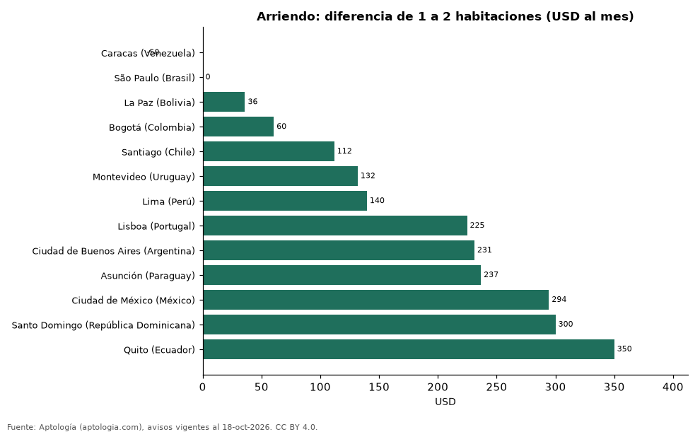

# Cuánto más se paga de arriendo por cada habitación extra en 13 capitales de Latinoamérica y Portugal (octubre 2026)

**Pasar de un apartamento de 1 a uno de 2 habitaciones sube el arriendo mediano en USD 36 al mes en La Paz (Bolivia) y en USD 350 en Quito (Ecuador), la mayor diferencia de 13 capitales.** La tercera habitación suma de USD 50 a USD 1.330 al mes según la capital. En Caracas (Venezuela), São Paulo (Brasil) el apartamento de 2 habitaciones mediano se arrienda incluso por menos que el de 1, porque los de 1 habitación se concentran en zonas más caras.

*Resumen: comparamos el canon mediano de 50.609 apartamentos de 1, 2 y 3 o más habitaciones en 13 capitales.*

**Actualizado:** 18 de octubre de 2026 (datos del 18 de octubre de 2026) · **Próxima actualización:** mensual.

## Resumen

| Indicador | Valor |
|---|---|
| Caracas (Venezuela) | USD -50 (1→2), +USD 925 (2→3+) |
| São Paulo (Brasil) | USD 0 (1→2), +USD 983 (2→3+) |
| La Paz (Bolivia) | +USD 36 (1→2), +USD 224 (2→3+) |
| Bogotá (Colombia) | +USD 60 (1→2), +USD 1.211 (2→3+) |
| Santiago (Chile) | +USD 112 (1→2), +USD 135 (2→3+) |
| Montevideo (Uruguay) | +USD 132 (1→2), +USD 169 (2→3+) |
| Lima (Perú) | +USD 140 (1→2), +USD 295 (2→3+) |
| Lisboa (Portugal) | +USD 225 (1→2), +USD 731 (2→3+) |
| Ciudad de Buenos Aires (Argentina) | +USD 231 (1→2), +USD 264 (2→3+) |
| Asunción (Paraguay) | +USD 237 (1→2), +USD 272 (2→3+) |
| Ciudad de México (México) | +USD 294 (1→2), +USD 1.330 (2→3+) |
| Santo Domingo (República Dominicana) | +USD 300 (1→2), +USD 400 (2→3+) |
| Quito (Ecuador) | +USD 350 (1→2), +USD 50 (2→3+) |

## Arriendo mediano por habitaciones y diferencia

| Capital | 1 hab. | 2 hab. | 3 o más hab. | De 1 a 2 | De 2 a 3+ | De 1 a 2 (%) |
|---|---|---|---|---|---|---|
| Caracas (Venezuela) | USD 1.000 | USD 950 | USD 1.875 | USD -50 | +USD 925 | -5,0 % |
| São Paulo (Brasil) | USD 590 | USD 590 | USD 1.572 | USD 0 | +USD 983 | 0,0 % |
| La Paz (Bolivia) | USD 470 | USD 506 | USD 730 | +USD 36 | +USD 224 | +7,7 % |
| Bogotá (Colombia) | USD 771 | USD 831 | USD 2.042 | +USD 60 | +USD 1.211 | +7,8 % |
| Santiago (Chile) | USD 377 | USD 489 | USD 623 | +USD 112 | +USD 135 | +29,7 % |
| Montevideo (Uruguay) | USD 694 | USD 826 | USD 995 | +USD 132 | +USD 169 | +19,0 % |
| Lima (Perú) | USD 699 | USD 838 | USD 1.133 | +USD 140 | +USD 295 | +20,0 % |
| Lisboa (Portugal) | USD 1.630 | USD 1.855 | USD 2.585 | +USD 225 | +USD 731 | +13,8 % |
| Ciudad de Buenos Aires (Argentina) | USD 495 | USD 726 | USD 990 | +USD 231 | +USD 264 | +46,7 % |
| Asunción (Paraguay) | USD 754 | USD 990 | USD 1.262 | +USD 237 | +USD 272 | +31,4 % |
| Ciudad de México (México) | USD 1.354 | USD 1.648 | USD 2.979 | +USD 294 | +USD 1.330 | +21,8 % |
| Santo Domingo (República Dominicana) | USD 1.100 | USD 1.400 | USD 1.800 | +USD 300 | +USD 400 | +27,3 % |
| Quito (Ecuador) | USD 550 | USD 900 | USD 950 | +USD 350 | +USD 50 | +63,6 % |

Canon mensual pedido en la moneda mayoritaria de cada capital, convertido a dólares; sin emparejar por barrio. Colombia: Bogotá; Brasil: São Paulo; Portugal: Lisboa.

## Preguntas frecuentes

**¿Cuánto más cuesta arrendar 2 habitaciones que 1?**
Entre USD 36 (La Paz (Bolivia)) y USD 350 (Quito (Ecuador)) al mes en las capitales donde sube.

**¿Cuánto cuesta la tercera habitación?**
De USD 50 a USD 1.330 más al mes.

## Metodología

- **Fuente:** exportes nocturnos de la base de datos de Aptología (aptologia.com) del 18 de octubre de 2026: avisos vigentes de vivienda en portales inmobiliarios de 13 países, recogidos por Aptología y vistos en línea entre el 11 y el 18 de octubre de 2026. Corte: 18 de octubre de 2026.
- **Depuración:** se eliminan duplicados exactos (misma ciudad, zona, tipo, precio, moneda, área, habitaciones y baños) y los precios fuera del percentil 1–99 de cada país, operación, moneda y tipo; el precio por m² usa solo avisos con área declarada entre 12 y 2.000 m² y también se recorta al P1–P99.
- **Qué se mide:** precios pedidos (publicados), no precios de cierre. En arriendo, el canon mensual sin administración, gastos comunes ni condominio.
- **Muestra mínima:** cada cifra publicada se apoya en al menos 30 avisos; las celdas con menos se omiten.
- **Monedas:** nunca se mezclan avisos de monedas distintas sin convertirlos. Conversión a dólares con la tasa de mercado de ExchangeRate-API (open.er-api.com, actualización del 18 Oct 2026): 1 USD = 3.182,80 COP, 1 USD = 18,47 M.N, 1 USD = 5,09 BRL, 1 USD = 3,44 PEN, 1 USD = 982,44 CLP, 1 USD = 1.514,57 ARS, 1 USD = 40,20 UYU, 1 USD = 5.705,37 PYG, 1 USD = 61,27 DOP, 1 USD = 0,89 EUR, 1 USD = 11,72 BOB; la UF chilena a 41.178,64 CLP (mindicador,cl. 18-oct-2026). Los avisos publicados en dólares se usan tal cual.
- **Monedas:** en cada ciudad y operación se usa solo la moneda mayoritaria de los avisos (los avisos en otra moneda se excluyen) y la mediana se convierte a dólares con la tasa citada; nunca se promedian avisos de monedas distintas.
- **Limitaciones:** la cobertura depende de los portales que recorre Aptología en cada país y es mayor en las ciudades grandes y en los segmentos medio-alto y alto; el área es la que declara el aviso, sin verificar; los nombres de zona vienen de los portales.
- **Privacidad:** solo se publican agregados; no se publica ningún dato personal, enlace a avisos ni nombre de anunciante.
- **Datos abiertos:** [datos.csv](datos.csv), licencia CC BY 4.0.

## Cómo citar

Pinzón Pineda, D. M. (2026). *Cuánto más se paga de arriendo por cada habitación extra en 13 capitales de Latinoamérica y Portugal (octubre 2026)*. Aptología (aptologia.com). https://github.com/elbroker/aptologia-datos/tree/main/estudios/cuanto-cuesta-una-habitacion-extra-arriendo-capitales-latinoamerica-2026. Datos: datos.csv, licencia CC BY 4.0.
