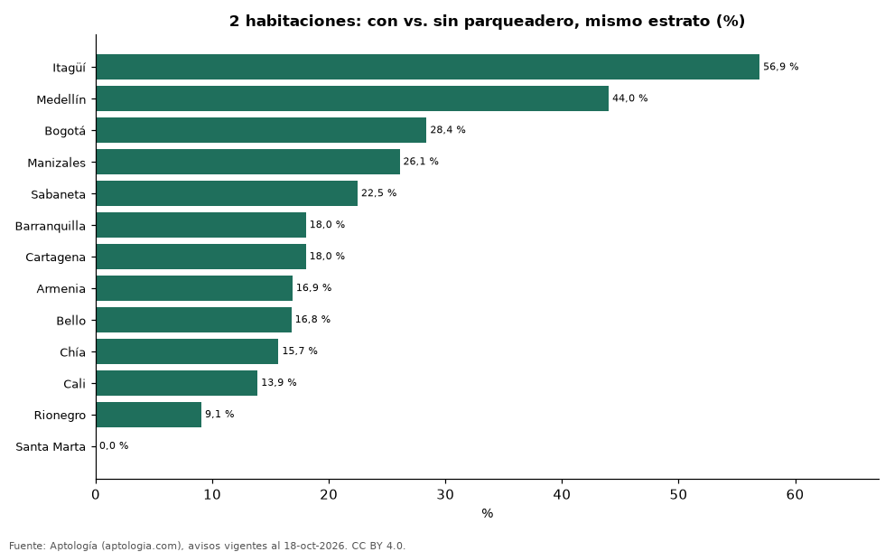

# Cuánto vale el parqueadero: apartamentos de 2 habitaciones con y sin parqueadero en las ciudades de Colombia (octubre 2026)

**Un apartamento de 2 habitaciones con parqueadero se pide en Colombia un 25,8 % más caro que uno sin él del mismo estrato y ciudad; la mayor diferencia está en Itagüí (56,9 %).** La menor está en Santa Marta (-3,5 %). Sin emparejar por estrato la diferencia sería 113,2 %.

*Resumen: comparamos 28.995 apartamentos de 2 habitaciones en venta en 13 ciudades.*

**Actualizado:** 18 de octubre de 2026 (datos del 18 de octubre de 2026) · **Próxima actualización:** mensual.

## Resumen

| Indicador | Valor |
|---|---|
| Colombia | +25,8 % |
| Mayor | Itagüí: +56,9 % |
| Ciudades | 13 |

## Ciudades

| Ciudad | Con vs. sin parqueadero (mismo estrato) | Combinaciones de estrato | Avisos (con / sin) |
|---|---|---|---|
| Itagüí | +56,9 % | 1 | 123 / 50 |
| Medellín | +44,0 % | 4 | 3.512 / 525 |
| Bogotá | +28,4 % | 4 | 3.248 / 1.330 |
| Manizales | +26,1 % | 2 | 182 / 77 |
| Sabaneta | +22,5 % | 2 | 971 / 151 |
| Barranquilla | +18,0 % | 2 | 572 / 151 |
| Cartagena | +18,0 % | 2 | 1.004 / 86 |
| Armenia | +16,9 % | 1 | 61 / 34 |
| Bello | +16,8 % | 1 | 128 / 120 |
| Chía | +15,7 % | 1 | 149 / 96 |
| Cali | +13,9 % | 2 | 750 / 341 |
| Rionegro | +9,1 % | 3 | 1.141 / 182 |
| Santa Marta | -3,5 % | 3 | 994 / 170 |

Diferencia del precio mediano dentro de cada combinación de ciudad y estrato (30 avisos o más en cada grupo), promediada con peso por avisos.

## Preguntas frecuentes

**¿Cuánto vale un parqueadero en un apartamento en Colombia?**
Un apartamento de 2 habitaciones con parqueadero se pide un 25,8 % más caro que uno sin él.

## Metodología

- **Fuente:** exportes nocturnos de la base de datos de Aptología (aptologia.com) del 18 de octubre de 2026: avisos vigentes de vivienda en portales inmobiliarios de 13 países, recogidos por Aptología y vistos en línea entre el 11 y el 18 de octubre de 2026. Corte: 18 de octubre de 2026.
- **Depuración:** se eliminan duplicados exactos (misma ciudad, zona, tipo, precio, moneda, área, habitaciones y baños) y los precios fuera del percentil 1–99 de cada país, operación, moneda y tipo; el precio por m² usa solo avisos con área declarada entre 12 y 2.000 m² y también se recorta al P1–P99.
- **Qué se mide:** precios pedidos (publicados), no precios de cierre. En arriendo, el canon mensual sin administración, gastos comunes ni condominio.
- **Muestra mínima:** cada cifra publicada se apoya en al menos 30 avisos; las celdas con menos se omiten.
- **Colombia:** Precios en pesos colombianos, sin conversión de moneda.
- **Limitaciones:** la cobertura depende de los portales que recorre Aptología en cada país y es mayor en las ciudades grandes y en los segmentos medio-alto y alto; el área es la que declara el aviso, sin verificar; los nombres de zona vienen de los portales.
- **Privacidad:** solo se publican agregados; no se publica ningún dato personal, enlace a avisos ni nombre de anunciante.
- **Datos abiertos:** [datos.csv](datos.csv), licencia CC BY 4.0.

## Cómo citar

Pinzón Pineda, D. M. (2026). *Cuánto vale el parqueadero: apartamentos de 2 habitaciones con y sin parqueadero en las ciudades de Colombia (octubre 2026)*. Aptología (aptologia.com). https://github.com/elbroker/aptologia-datos/tree/main/estudios/cuanto-vale-el-parqueadero-ciudades-colombia-2026. Datos: datos.csv, licencia CC BY 4.0.
