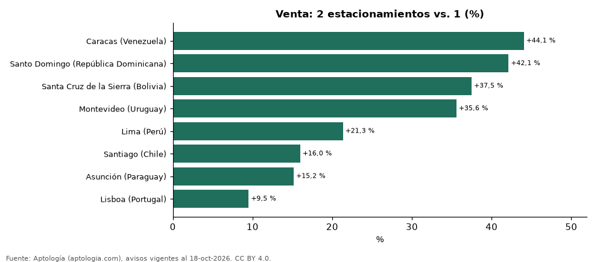

# ¿Cuánto vale el segundo estacionamiento o cochera? Prima en 8 ciudades de Latinoamérica y Portugal (octubre 2026)

**Un apartamento en venta con 2 estacionamientos se pide +44,1 % frente a uno con 1 del mismo número de habitaciones y rango de área en Caracas (Venezuela), la mayor prima de 8 ciudades; en Lisboa (Portugal) la diferencia es +9,5 %.** En alquiler, la prima va de +24,6 % a +52,3 %.

*Resumen: comparamos 4.638 apartamentos con 2 estacionamientos y 6.025 con 1 en 9 ciudades fuera de Colombia.*

**Actualizado:** 18 de octubre de 2026 (datos del 18 de octubre de 2026) · **Próxima actualización:** mensual.

## Resumen

| Indicador | Valor |
|---|---|
| Mayor prima (venta) | Caracas (Venezuela): +44,1 % |
| Menor prima (venta) | Lisboa (Portugal): +9,5 % |
| Ciudades en venta | 8 |
| Ciudades en alquiler | 4 |

## Venta

| Ciudad | Prima del 2.º estacionamiento (venta) | Avisos con 2 / con 1 |
|---|---|---|
| Caracas (Venezuela) | +44,1 % | 288 / 205 |
| Santo Domingo (República Dominicana) | +42,1 % | 151 / 92 |
| Santa Cruz de la Sierra (Bolivia) | +37,5 % | 68 / 75 |
| Montevideo (Uruguay) | +35,6 % | 121 / 154 |
| Lima (Perú) | +21,3 % | 880 / 1.160 |
| Santiago (Chile) | +16,0 % | 104 / 162 |
| Asunción (Paraguay) | +15,2 % | 188 / 505 |
| Lisboa (Portugal) | +9,5 % | 70 / 41 |

Promedio ponderado de celdas ciudad × habitaciones × rango de área con 30 avisos o más de cada lado, en la moneda mayoritaria de la ciudad.

## Alquiler

| Ciudad | Prima (alquiler) | Avisos con 2 / con 1 |
|---|---|---|
| Santa Cruz de la Sierra (Bolivia) | +52,3 % | 39 / 49 |
| Lima (Perú) | +28,3 % | 630 / 587 |
| São Paulo (Brasil) | +28,0 % | 1.986 / 2.781 |
| Asunción (Paraguay) | +24,6 % | 113 / 214 |

## Preguntas frecuentes

**¿Cuánto más vale un departamento con dos cocheras?**
Depende de la ciudad: de +9,5 % en Lisboa (Portugal) a +44,1 % en Caracas (Venezuela), frente a uno con una sola.

**¿Por qué no se compara con cero estacionamientos?**
Fuera de Colombia, Portugal y Venezuela muchos portales solo informan el dato cuando hay estacionamiento, así que no se puede distinguir 'sin estacionamiento' de 'sin dato'.

## Metodología

- **Fuente:** exportes nocturnos de la base de datos de Aptología (aptologia.com) del 18 de octubre de 2026: avisos vigentes de vivienda en portales inmobiliarios de 13 países, recogidos por Aptología y vistos en línea entre el 11 y el 18 de octubre de 2026. Corte: 18 de octubre de 2026.
- **Depuración:** se eliminan duplicados exactos (misma ciudad, zona, tipo, precio, moneda, área, habitaciones y baños) y los precios fuera del percentil 1–99 de cada país, operación, moneda y tipo; el precio por m² usa solo avisos con área declarada entre 12 y 2.000 m² y también se recorta al P1–P99.
- **Qué se mide:** precios pedidos (publicados), no precios de cierre. En arriendo, el canon mensual sin administración, gastos comunes ni condominio.
- **Muestra mínima:** cada cifra publicada se apoya en al menos 30 avisos; las celdas con menos se omiten.
- **Monedas:** nunca se mezclan avisos de monedas distintas sin convertirlos. Conversión a dólares con la tasa de mercado de ExchangeRate-API (open.er-api.com, actualización del 18 Oct 2026): 1 USD = 3.182,80 COP, 1 USD = 18,47 M.N, 1 USD = 5,09 BRL, 1 USD = 3,44 PEN, 1 USD = 982,44 CLP, 1 USD = 1.514,57 ARS, 1 USD = 40,20 UYU, 1 USD = 5.705,37 PYG, 1 USD = 61,27 DOP, 1 USD = 0,89 EUR, 1 USD = 11,72 BOB; la UF chilena a 41.178,64 CLP (mindicador,cl. 18-oct-2026). Los avisos publicados en dólares se usan tal cual.
- **Monedas:** en cada ciudad y operación se usa solo la moneda mayoritaria de los avisos (los avisos en otra moneda se excluyen) y la mediana se convierte a dólares con la tasa citada; nunca se promedian avisos de monedas distintas.
- **Comparación emparejada:** dentro de cada ciudad, número de habitaciones y rango de área se comparan las medianas con 2 y con 1 estacionamiento (30 avisos o más de cada lado). Para no confundir el efecto con el tamaño, las celdas también se separan por rango de área declarada (<50, 50–70, 70–90, 90–120, 120–160 y más de 160 m²); solo entran avisos con área. Solo entran avisos que declaran 1 o 2 estacionamientos.
- **Limitaciones:** la cobertura depende de los portales que recorre Aptología en cada país y es mayor en las ciudades grandes y en los segmentos medio-alto y alto; el área es la que declara el aviso, sin verificar; los nombres de zona vienen de los portales.
- **Privacidad:** solo se publican agregados; no se publica ningún dato personal, enlace a avisos ni nombre de anunciante.
- **Datos abiertos:** [datos.csv](datos.csv), licencia CC BY 4.0.

## Cómo citar

Pinzón Pineda, D. M. (2026). *¿Cuánto vale el segundo estacionamiento o cochera? Prima en 8 ciudades de Latinoamérica y Portugal (octubre 2026)*. Aptología (aptologia.com). https://github.com/elbroker/aptologia-datos/tree/main/estudios/cuanto-vale-el-segundo-estacionamiento-ciudades-latinoamerica-2026. Datos: datos.csv, licencia CC BY 4.0.
