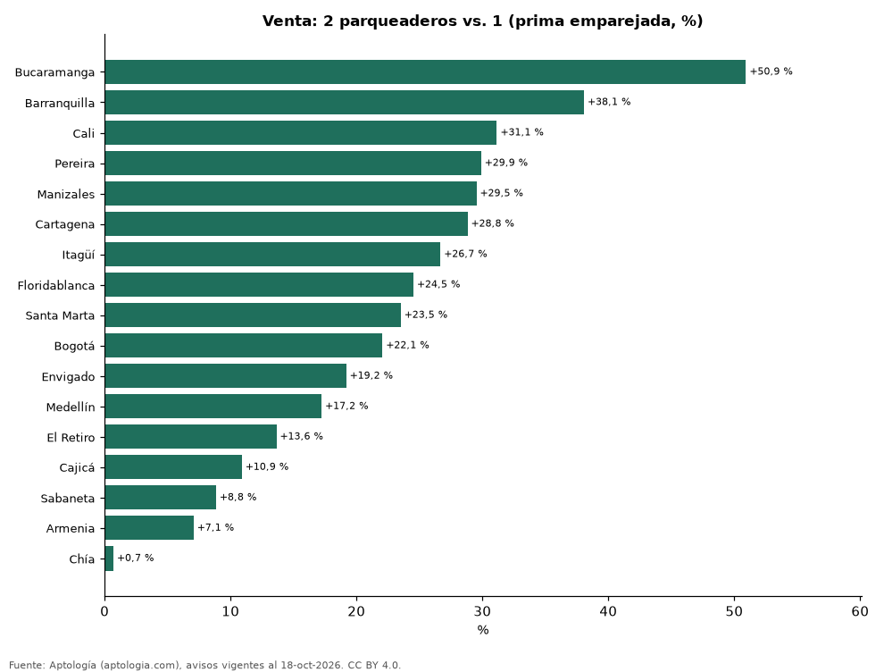

# ¿Cuánto vale el segundo parqueadero? Prima en venta y arriendo por ciudad y estrato en Colombia (octubre 2026)

**En Colombia un apartamento en venta con 2 parqueaderos se pide +23,1 % frente a uno comparable con 1 (misma ciudad, estrato, habitaciones y rango de área); en arriendo la diferencia es +15,6 %.** Por ciudad, la prima en venta va de +0,7 % en Chía a +50,9 % en Bucaramanga.

*Resumen: comparamos 25.385 apartamentos en venta con 2 parqueaderos y 20.520 con 1, en 110 celdas de ciudad, estrato y habitaciones.*

**Actualizado:** 18 de octubre de 2026 (datos del 18 de octubre de 2026) · **Próxima actualización:** mensual.

## Resumen

| Indicador | Valor |
|---|---|
| Prima en venta | +23,1 % |
| Prima en arriendo | +15,6 % |
| Mayor prima (venta) | Bucaramanga: +50,9 % |
| Menor prima (venta) | Chía: +0,7 % |

## Prima del segundo parqueadero por ciudad (venta)

| Ciudad | Prima del 2.º parqueadero (venta) | Avisos con 2 / con 1 |
|---|---|---|
| Bucaramanga | +50,9 % | 227 / 293 |
| Barranquilla | +38,1 % | 2.015 / 1.870 |
| Cali | +31,1 % | 2.497 / 1.391 |
| Pereira | +29,9 % | 594 / 755 |
| Manizales | +29,5 % | 212 / 356 |
| Cartagena | +28,8 % | 645 / 1.462 |
| Itagüí | +26,7 % | 70 / 74 |
| Floridablanca | +24,5 % | 54 / 86 |
| Santa Marta | +23,5 % | 262 / 164 |
| Bogotá | +22,1 % | 9.599 / 5.442 |
| Envigado | +19,2 % | 1.974 / 1.251 |
| Medellín | +17,2 % | 6.520 / 5.203 |
| El Retiro | +13,6 % | 30 / 46 |
| Cajicá | +10,9 % | 97 / 219 |
| Sabaneta | +8,8 % | 439 / 1.720 |
| Armenia | +7,1 % | 53 / 54 |
| Chía | +0,7 % | 97 / 134 |

Promedio ponderado de las celdas ciudad × estrato × habitaciones × rango de área con 30 avisos o más de cada lado.

## Por estrato (venta)

| Estrato | Prima (venta) | Avisos con 2 |
|---|---|---|
| 4 | +19,7 % | 3.223 |
| 5 | +21,3 % | 8.181 |
| 6 | +24,9 % | 13.981 |

## Preguntas frecuentes

**¿Cuánto más vale un apartamento con dos parqueaderos?**
En venta, +23,1 % frente a uno comparable con un solo parqueadero; en arriendo, +15,6 %.

**¿Dónde pesa más el segundo parqueadero?**
En Bucaramanga: +50,9 % en venta.

## Metodología

- **Fuente:** exportes nocturnos de la base de datos de Aptología (aptologia.com) del 18 de octubre de 2026: avisos vigentes de vivienda en portales inmobiliarios de 13 países, recogidos por Aptología y vistos en línea entre el 11 y el 18 de octubre de 2026. Corte: 18 de octubre de 2026.
- **Depuración:** se eliminan duplicados exactos (misma ciudad, zona, tipo, precio, moneda, área, habitaciones y baños) y los precios fuera del percentil 1–99 de cada país, operación, moneda y tipo; el precio por m² usa solo avisos con área declarada entre 12 y 2.000 m² y también se recorta al P1–P99.
- **Qué se mide:** precios pedidos (publicados), no precios de cierre. En arriendo, el canon mensual sin administración, gastos comunes ni condominio.
- **Muestra mínima:** cada cifra publicada se apoya en al menos 30 avisos; las celdas con menos se omiten.
- **Colombia:** Precios en pesos colombianos, sin conversión de moneda.
- **Comparación emparejada:** dentro de cada celda ciudad × estrato × habitaciones × rango de área se comparan las medianas con 2 y con 1 parqueadero (30 avisos o más de cada lado); la prima es el promedio ponderado por avisos con 2. Para no confundir el efecto con el tamaño, las celdas también se separan por rango de área declarada (<50, 50–70, 70–90, 90–120, 120–160 y más de 160 m²); solo entran avisos con área. Dentro de cada rango el apartamento con 2 parqueaderos puede seguir siendo algo más grande, y suele estar en edificios de gama más alta.
- **Limitaciones:** la cobertura depende de los portales que recorre Aptología en cada país y es mayor en las ciudades grandes y en los segmentos medio-alto y alto; el área es la que declara el aviso, sin verificar; los nombres de zona vienen de los portales.
- **Privacidad:** solo se publican agregados; no se publica ningún dato personal, enlace a avisos ni nombre de anunciante.
- **Datos abiertos:** [datos.csv](datos.csv), licencia CC BY 4.0.

## Cómo citar

Pinzón Pineda, D. M. (2026). *¿Cuánto vale el segundo parqueadero? Prima en venta y arriendo por ciudad y estrato en Colombia (octubre 2026)*. Aptología (aptologia.com). https://github.com/elbroker/aptologia-datos/tree/main/estudios/cuanto-vale-el-segundo-parqueadero-ciudades-colombia-2026. Datos: datos.csv, licencia CC BY 4.0.
